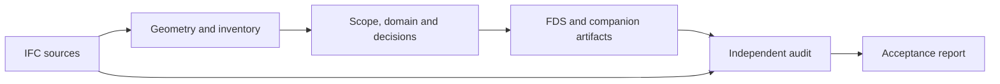

<a id="top"></a>

<div align="center">

# IFCtoFDS (English Documentation)

**From BIM geometry to traceable FDS mapping.**<br>
[Bản Tiếng Việt (Vietnamese README)](README.md)

[](https://github.com/fire-digital-twin-lab/IFCtoFDS/actions/workflows/verified.yml)
[](pyproject.toml)
[](LICENSE)

[**Watch the demo**](#demo) · [**Quick start**](#en-setup) · [Documentation](#en-development) · [Report an issue](https://github.com/fire-digital-twin-lab/IFCtoFDS/issues)


*The research workbench with a public IFC example.*

</div>

<a id="demo"></a>

## See it in action

<p align="center">
  <a href="demo/demo.gif"></a>
</p>

**Original browser workflow.** This legacy demonstration illustrates interactive conversion; it does not show the current Verified audit workflow. [Full-resolution animation](demo/demo.gif) · [Media sources](demo/readme/SOURCES.md).

<details>
<summary><strong>Contents</strong></summary>

[Overview](#en-overview) · [Quick start](#en-setup) · [Workflows](#en-modes) · [Usage](#en-cli) · [Results](#en-results) · [Limitations](#en-limits) · [Development](#en-development) · [Credits](#en-attribution)

</details>

<a id="workflow"></a>

## Mapping workflow



*The audit reopens source IFC and inspects exported artifacts.*

<a id="en-overview"></a>

### Overview

IFCtoFDS is a geometry preprocessing workbench for transferring IFC building models into geometry representations for Fire Dynamics Simulator (FDS). It supports visual inspection, source-element traceability and independent checks of the exported mapping.

This repository is the **Fire Digital Twin Lab research fork** of [ProfRino/IFCtoFDS](https://github.com/ProfRino/IFCtoFDS). It extends the browser workbench with a Python/IfcOpenShell pipeline, explicit scope and domain controls, multi-source processing, mapping manifests and acceptance reports. It is intended for engineers, researchers and developers building reproducible BIM-to-FDS workflows.

**A generated FDS file is not, by itself, an accepted mapping or a complete fire simulation.** Read it together with its manifest and acceptance report. Engineering use requires independent review by a qualified fire safety engineer.


| Inspect | Map | Trace | Review |
|---|---|---|---|
| Explore IFC and FDS geometry in one workbench | Choose Quick Preview or a policy-driven Verified workflow | Follow source identities through manifests and geometry packages | Examine independent gates, findings and downloadable evidence |

<a id="en-setup"></a>

### Installation and first run

The package declares **Python 3.10 or later**. The repository's CI configuration covers Python 3.11 and 3.12 on Windows and Linux. Dependencies, including IfcOpenShell, are declared in [pyproject.toml](pyproject.toml). The workbench requires a modern browser with WebGL support.

Clone this fork:

```sh
git clone https://github.com/fire-digital-twin-lab/IFCtoFDS.git
cd IFCtoFDS
```

**Windows PowerShell**

```powershell
python -m venv .venv
.\.venv\Scripts\Activate.ps1
python -m pip install -e .
python -m ifc_to_fds serve --port 8000
```

If activation is restricted, use `.\.venv\Scripts\python.exe` in place of `python` for the installation and service commands.

**Linux**

```sh
python3 -m venv .venv
. .venv/bin/activate
python -m pip install -e .
python -m ifc_to_fds serve --port 8000
```

Open [http://127.0.0.1:8000](http://127.0.0.1:8000) and keep the service running.

1. Load an IFC model; the [bundled examples](examples/SOURCES.md) provide a starting point.
2. Select **Verified Mapping**, review the scope and configure a simulation domain when exporting a selected region.
3. Supply reviewed entity decisions or reference-case settings when required by the model and profile.
4. Run the conversion, inspect the acceptance report and download the associated artifacts.

FDS is not required merely to start the workbench or perform basic mapping checks. Solver-dependent boundary validation requires additional setup; see the [artifact and boundary guide](docs/artifact-boundary-v05.md).

For browser-only exploration, open local `index.html` or use the [upstream demo](https://profrino.github.io/IFCtoFDS/). The demo and [upstream releases](https://github.com/ProfRino/IFCtoFDS/releases) are separate from this fork's local Verified workflow. Some browser assets load from CDNs, so opening the static page does not guarantee offline operation.

<a id="en-modes"></a>

### Conversion modes

| Aspect | Quick Conversion — UI: **Quick Preview** | Verified Conversion — UI: **Verified Mapping** |
|---|---|---|
| Purpose | Interactive inspection and preliminary export | Source-based mapping with independent audit |
| Runtime | Browser JavaScript | Local Python/IfcOpenShell service or CLI |
| Geometry | Supported IFC subset; heuristic OBST/GEOM, HOLE and voxel workflows | Source geometry, explicit mapping policies and audited representations |
| Controls | Preview settings, openings and optional solids | Scope, domain, reviewed entity decisions and audit profile |
| Output | Preview FDS file | FDS with geometry, provenance, MEP and acceptance artifacts |
| Acceptance | Does not establish mapping acceptance | Determined by the required audit gates |

**Verified Mapping** names the workflow, not a guaranteed outcome. Quick options, including furniture, MEP and proxy solids, do not constitute reviewed decisions for Verified.

<a id="en-cli"></a>

### Usage

The building screenshot shows Quick Preview of the public KIT model. The Verified screenshot is an existing QA capture of the small `box.ifc` test fixture, illustrating how audit gates are presented; it is not an acceptance result for the KIT building.


*Quick Preview · KIT AC20-FZK-Haus.*


*Verified Mapping · `box.ifc` QA fixture. Mapping acceptance is separate from solver evidence and simulation acceptance.*

<details>
<summary><strong>CLI examples and scoped conversion</strong></summary>

Run these commands from the repository root with the virtual environment active.

**Inspect the source inventory**

```sh
python -m ifc_to_fds inventory examples/AC20-FZK-Haus.ifc --json
```

**Convert a full model**

```sh
python -m ifc_to_fds convert examples/AC20-FZK-Haus.ifc -o out/fzk.fds --cell-size 0.2 --profile mapping
```

Acceptance depends on source data and evidence; a bundled example is not a promise of `MAPPING_VERIFIED`.

**Configure a scoped conversion**

Use `--config` for a project-specific JSON configuration containing `scope` and an independent `simulation_domain`. The domain fields are `xmin`, `xmax`, `ymin`, `ymax`, `zmin`, `zmax`, in common-world metres.

The CLI also accepts `--storey`, `--bbox` and `--domain`. Domain arguments follow `XMIN XMAX YMIN YMAX ZMIN ZMAX`. Resolve repeated storey names by source identity. Establish domain values for the actual model: viewer clipping and the scope bounding box do not automatically define the simulation domain.

See the [mapping guide](docs/golden-mapping-parity.md) for configuration, federation and reviewed decisions. Use `--decisions` for explicit entity decisions. The legacy `--include-review` flag remains exposed, but enabling it is rejected by the Verified configuration validator.

**Audit saved output independently**

```sh
python -m ifc_to_fds audit examples/AC20-FZK-Haus.ifc --fds out/fzk.fds --manifest out/fzk_manifest.json --geometry-package out/fzk_geometry.json -o out/fzk_reaudit.json
```

Keep the geometry index and its referenced payload directory together. Unless `--config` is supplied, audit uses the configuration recorded in the manifest.

Conversion and audit exit codes: `0` means the requested acceptance level was achieved; `1` means `REJECTED`; `2` means `INCONCLUSIVE`; `3` indicates an operational error. Use `python -m ifc_to_fds --help` or a subcommand's `--help` to inspect arguments.

</details>

<a id="en-results"></a>

### Artifacts and acceptance

Treat Verified output as a **mapping bundle**. CLI output `out/fzk.fds` produces companion files with the `fzk` stem. The service uses `model` internally and provides artifact download links.

| Artifact | Purpose |
|---|---|
| `fzk.fds` | FDS geometry and source provenance comments |
| `fzk_manifest.json`, `fzk_manifest.csv` | Source identities, mapping dispositions and primitive assignments |
| `fzk_acceptance_report.json`, `fzk_acceptance_report.md` | Audit gates, findings and acceptance results |
| `fzk_geometry.json` + `fzk_geometry.payloads/` | Geometry index and binary meshes, including retained reference geometry |
| `fzk_geometry.zip` | Portable geometry index and payload archive |
| `fzk_inventory.json`, `fzk_mep_graph.json` | Source inventory and extracted MEP systems/port relationships |
| `fzk_configuration.json`, `fzk_parity.json` | Run configuration and reference-comparison results |
| `fzk_timings.json`, `fzk_checksums.json` | Stage timings and artifact checksums |

An interrupted run may only have checkpoint or diagnostic files. Their presence does not establish acceptance.

Reports separate `mapping_status` and `simulation_status`; top-level `status` answers the requested profile.

| Mapping status | Meaning |
|---|---|
| `MAPPING_VERIFIED` | Required mapping gates passed or have justified `NOT_APPLICABLE` dispositions |
| `REJECTED` | A required check identified a confirmed failure |
| `INCONCLUSIVE` | Required evidence, decisions or supported validation are missing |

The `mapping` profile evaluates mapping requirements. The `research-basement` profile additionally requires an approved reference case and applicable research evidence. The `simulation` profile requires scenario, physics and effective-geometry evidence; the current implementation does **not** issue `SIMULATION_VERIFIED`.

Provenance and checksums support traceability and integrity. They do not independently prove geometric equivalence or simulation validity.

<a id="en-limits"></a>

### Capabilities and limitations

- **Geometry and openings.** Verified uses IfcOpenShell source geometry. Eligible closed, axis-aligned passive boxes without openings can use `OBST`; more complex supported solids use `GEOM`. The optional all-GEOM setting is diagnostic. Quick HOLE and voxel controls belong to the browser pipeline.
- **Scope and domain.** Scope selects source entities; the simulation domain defines FDS mesh bounds; viewer clipping changes the inspection view. Scoped exports without a domain remain incomplete. Unscoped full-model runs may use full source bounds.
- **Boundary treatment.** Opt-in `VALIDATED_BOUNDARY_OBST_SINGLE_MESH` applies to narrowly eligible structural boxes and requires independent checks plus solver/effective-geometry evidence. It is not general clipping for arbitrary GEOM or MEP.
- **MEP, HVAC and fire protection.** MEP defaults to reference geometry outside FDS, with available semantics and connectivity retained in companion artifacts. Missing source connections are not invented. Promotion to a passive obstacle requires explicit reviewed decisions and applicable checks.
- **Operational behaviour.** Duct airflow, fan curves, dampers and sprinkler activation are not automatically configured. Door/window filling geometry does not establish a reviewed open/closed scenario state.
- **Materials and scenarios.** The Verified serializer currently writes `T_END=0.0` and assigns geometry the `CONCRETE` surface identifier. This does not establish verified material properties. Fire sources, thermal properties, operating conditions and simulation mesh suitability require separate engineering work.
- **Incomplete evidence.** Assess unsupported geometry, unresolved decisions and missing boundary proof through the report. FDS generation, successful parsing or a solver smoke test alone does not establish full simulation acceptance.

<a id="en-development"></a>

### Documentation and development

The browser and Python pipelines serve different purposes. Python is organised around domain models, application use cases, ports and adapters, with compatibility modules retained during the architecture transition.

<details>
<summary>Repository structure</summary>

```text
index.html                 Browser workbench
js/                        IFC preview, FDS export, workers and viewer
ifc_to_fds/
  domain/                  Domain models and validation contracts
  application/             Use cases, configuration and ports
  adapters/                Geometry, storage and external integrations
  interfaces/              Service and worker interfaces
  core/, geometry/         Inventory, placement and mesh processing
  mapping/, mep/           Representation policies and MEP extraction
  validation/              Independent checks and acceptance
docs/                      Guides and architecture decisions
tests/                     Python regression tests
scripts/                   JavaScript, browser, solver and research tooling
examples/                  IFC models and source attribution
```

</details>

| Documentation | Focus |
|---|---|
| [Mapping profiles and golden parity](docs/golden-mapping-parity.md) | Acceptance, scope/domain, decisions and reference cases |
| [Artifact and boundary guide](docs/artifact-boundary-v05.md) | Compact API, binary geometry and solver-backed boundary policy |
| [Source fidelity and large IFC import](docs/adr/ADR-007-source-fidelity-and-backend-preview.md) | Passive MEP export, retained opening hosts, exact domain intersections and backend preview |
| [Architecture decision](docs/adr/ADR-002-hexagonal-architecture.md) | Ports, adapters and the architecture transition |
| [Correctness review](docs/post-refactor-correctness.md) | Documented correctness work and evidence |
| [Example sources](examples/SOURCES.md) | KIT and IfcOpenShell Duplex attribution |
| [CI workflow](.github/workflows/verified.yml) | Python, JavaScript, browser, solver and optional research checks |

Bundled models: [AC20-FZK-Haus.ifc](examples/AC20-FZK-Haus.ifc), [AC20-Institute-Var-2.ifc](examples/AC20-Institute-Var-2.ifc) and [IfcOpenShell-Duplex.ifc](examples/IfcOpenShell-Duplex.ifc).

Install test dependencies and run the non-solver suite:

```sh
python -m pip install -e ".[test]"
python -m pytest -q -m "not solver and not browser"
```

Representative JavaScript checks require Node.js:

```sh
node scripts/test-worker-bundle-parity.js
node scripts/test-golden-workflow.js
node scripts/test-verified-regressions.js
```

Consult CI for the complete check set and browser setup. Solver tests require a configured FDS executable; private research acceptance also requires external data and an approved reference bundle. Record unexecuted checks separately from passing checks.

#### Contributing

Use the [issue tracker](https://github.com/fire-digital-twin-lab/IFCtoFDS/issues) for reproducible bugs and feature proposals, or submit a pull request with a clear description and relevant checks. Include the revision, configuration and diagnostics; use a shareable IFC sample without confidential project data.

<a id="en-attribution"></a>

### Attribution, citation and license

Upstream IFCtoFDS was developed by **Prof Rino Lovreglio, Massey University**, with **resilienceengineer** credited as a project collaborator. This fork develops the research mapping and validation workflow under **Fire Digital Twin Lab**, retaining upstream attribution.

For the original software, use [CITATION.cff](CITATION.cff), which currently describes the upstream release:

> Lovreglio, R. *IFCtoFDS*. Massey University.
> [Original repository](https://github.com/ProfRino/IFCtoFDS)

For research using this fork, also identify the [fork repository](https://github.com/fire-digital-twin-lab/IFCtoFDS), commit, configuration and relevant acceptance artifacts.

The project is distributed under **GNU AGPL-3.0-or-later**, as declared in its package metadata. See [LICENSE](LICENSE). Third-party dependencies and example models retain their respective licenses and notices.
