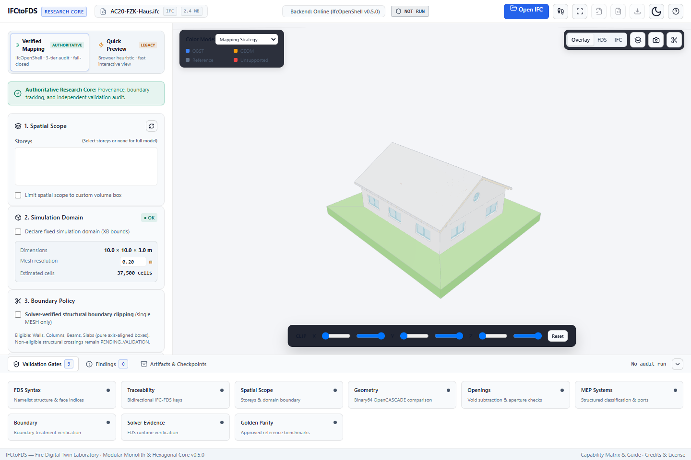
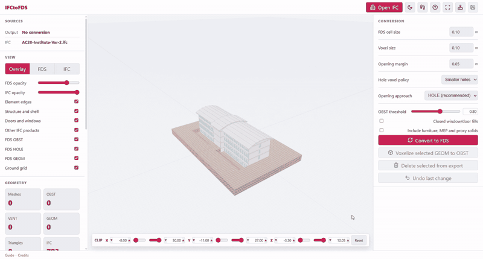
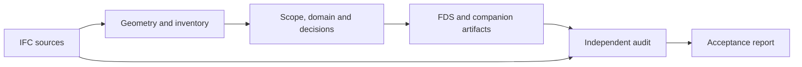
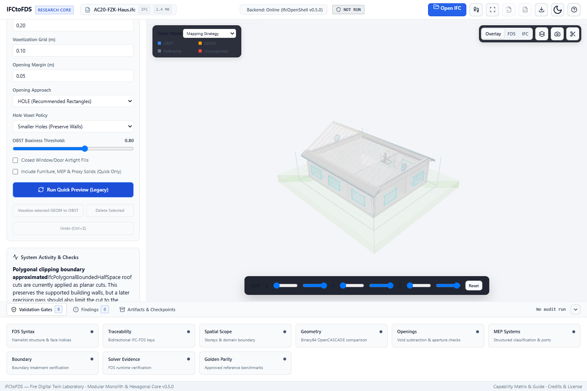
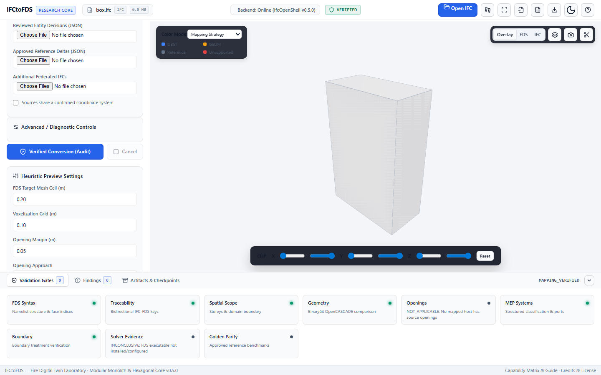

<a id="top"></a>

<div align="center">

# IFCtoFDS

**From BIM geometry to traceable FDS mapping.**<br>
Từ hình học BIM đến ánh xạ FDS có thể truy xuất và kiểm chứng.

[English](#english) · [Tiếng Việt](#tieng-viet)

[](https://github.com/fire-digital-twin-lab/IFCtoFDS/actions/workflows/verified.yml)
[](pyproject.toml)
[](LICENSE)

[**Watch the demo**](#demo) · [**Quick start**](#en-setup) · [Documentation](#en-development) · [Report an issue](https://github.com/fire-digital-twin-lab/IFCtoFDS/issues)



*The research workbench with a public IFC example. / Giao diện nghiên cứu với mô hình IFC mẫu công khai.*

</div>

<a id="demo"></a>

## See it in action · Xem minh họa

<p align="center">
  <a href="demo/demo.gif"></a>
</p>

**Original browser workflow / Quy trình trình duyệt gốc.** This legacy demonstration illustrates interactive conversion; it does not show the current Verified audit workflow. GIF này minh họa chuyển đổi tương tác ở phiên bản legacy, không phải quy trình audit Verified hiện tại. [Full-resolution animation / Xem bản gốc](demo/demo.gif) · [Media sources / Nguồn minh họa](demo/readme/SOURCES.md).

<details>
<summary><strong>Contents / Mục lục</strong></summary>

**English:** [Overview](#en-overview) · [Quick start](#en-setup) · [Workflows](#en-modes) · [Usage](#en-cli) · [Results](#en-results) · [Limitations](#en-limits) · [Development](#en-development) · [Credits](#en-attribution)

**Tiếng Việt:** [Giới thiệu](#vi-overview) · [Bắt đầu](#vi-setup) · [Chế độ](#vi-modes) · [Sử dụng](#vi-cli) · [Kết quả](#vi-results) · [Giới hạn](#vi-limits) · [Phát triển](#vi-development) · [Ghi công](#vi-attribution)

</details>

<a id="workflow"></a>

## Mapping workflow · Quy trình ánh xạ



*The audit reopens source IFC and inspects exported artifacts. / Audit đọc lại IFC nguồn và kiểm tra artifact đã xuất.*

<a id="english"></a>

## English

<a id="en-overview"></a>

### Overview

IFCtoFDS is a geometry preprocessing workbench for transferring IFC building models into geometry representations for Fire Dynamics Simulator (FDS). It supports visual inspection, source-element traceability and independent checks of the exported mapping.

This repository is the **Fire Digital Twin Lab research fork** of [ProfRino/IFCtoFDS](https://github.com/ProfRino/IFCtoFDS). It extends the browser workbench with a Python/IfcOpenShell pipeline, explicit scope and domain controls, multi-source processing, mapping manifests and acceptance reports. It is intended for engineers, researchers and developers building reproducible BIM-to-FDS workflows.

**A generated FDS file is not, by itself, an accepted mapping or a complete fire simulation.** Read it together with its manifest and acceptance report. Engineering use requires independent review by a qualified fire safety engineer.


| Inspect | Map | Trace | Review |
|---|---|---|---|
| Explore IFC and FDS geometry in one workbench | Choose Quick Preview or a policy-driven Verified workflow | Follow source identities through manifests and geometry packages | Examine independent gates, findings and downloadable evidence |

<a id="en-setup"></a>

### Installation and first run

The package declares **Python 3.10 or later**. The repository's CI configuration covers Python 3.11 and 3.12 on Windows and Linux. Dependencies, including IfcOpenShell, are declared in [pyproject.toml](pyproject.toml). The workbench requires a modern browser with WebGL support.

Clone this fork:

```sh
git clone https://github.com/fire-digital-twin-lab/IFCtoFDS.git
cd IFCtoFDS
```

**Windows PowerShell**

```powershell
python -m venv .venv
.\.venv\Scripts\Activate.ps1
python -m pip install -e .
python -m ifc_to_fds serve --port 8000
```

If activation is restricted, use `.\.venv\Scripts\python.exe` in place of `python` for the installation and service commands.

**Linux**

```sh
python3 -m venv .venv
. .venv/bin/activate
python -m pip install -e .
python -m ifc_to_fds serve --port 8000
```

Open [http://127.0.0.1:8000](http://127.0.0.1:8000) and keep the service running.

1. Load an IFC model; the [bundled examples](examples/SOURCES.md) provide a starting point.
2. Select **Verified Mapping**, review the scope and configure a simulation domain when exporting a selected region.
3. Supply reviewed entity decisions or reference-case settings when required by the model and profile.
4. Run the conversion, inspect the acceptance report and download the associated artifacts.

FDS is not required merely to start the workbench or perform basic mapping checks. Solver-dependent boundary validation requires additional setup; see the [artifact and boundary guide](docs/artifact-boundary-v05.md).

For browser-only exploration, open local `index.html` or use the [upstream demo](https://profrino.github.io/IFCtoFDS/). The demo and [upstream releases](https://github.com/ProfRino/IFCtoFDS/releases) are separate from this fork's local Verified workflow. Some browser assets load from CDNs, so opening the static page does not guarantee offline operation.

<a id="en-modes"></a>

### Conversion modes

| Aspect | Quick Conversion — UI: **Quick Preview** | Verified Conversion — UI: **Verified Mapping** |
|---|---|---|
| Purpose | Interactive inspection and preliminary export | Source-based mapping with independent audit |
| Runtime | Browser JavaScript | Local Python/IfcOpenShell service or CLI |
| Geometry | Supported IFC subset; heuristic OBST/GEOM, HOLE and voxel workflows | Source geometry, explicit mapping policies and audited representations |
| Controls | Preview settings, openings and optional solids | Scope, domain, reviewed entity decisions and audit profile |
| Output | Preview FDS file | FDS with geometry, provenance, MEP and acceptance artifacts |
| Acceptance | Does not establish mapping acceptance | Determined by the required audit gates |

**Verified Mapping** names the workflow, not a guaranteed outcome. Quick options, including furniture, MEP and proxy solids, do not constitute reviewed decisions for Verified.

<a id="en-cli"></a>

### Usage

The building screenshot shows Quick Preview of the public KIT model. The Verified screenshot is an existing QA capture of the small `box.ifc` test fixture, illustrating how audit gates are presented; it is not an acceptance result for the KIT building.



*Quick Preview · KIT AC20-FZK-Haus.*



*Verified Mapping · `box.ifc` QA fixture. Mapping acceptance is separate from solver evidence and simulation acceptance.*

<details>
<summary><strong>CLI examples and scoped conversion</strong></summary>

Run these commands from the repository root with the virtual environment active.

**Inspect the source inventory**

```sh
python -m ifc_to_fds inventory examples/AC20-FZK-Haus.ifc --json
```

**Convert a full model**

```sh
python -m ifc_to_fds convert examples/AC20-FZK-Haus.ifc -o out/fzk.fds --cell-size 0.2 --profile mapping
```

Acceptance depends on source data and evidence; a bundled example is not a promise of `MAPPING_VERIFIED`.

**Configure a scoped conversion**

Use `--config` for a project-specific JSON configuration containing `scope` and an independent `simulation_domain`. The domain fields are `xmin`, `xmax`, `ymin`, `ymax`, `zmin`, `zmax`, in common-world metres.

The CLI also accepts `--storey`, `--bbox` and `--domain`. Domain arguments follow `XMIN XMAX YMIN YMAX ZMIN ZMAX`. Resolve repeated storey names by source identity. Establish domain values for the actual model: viewer clipping and the scope bounding box do not automatically define the simulation domain.

See the [mapping guide](docs/golden-mapping-parity.md) for configuration, federation and reviewed decisions. Use `--decisions` for explicit entity decisions. The legacy `--include-review` flag remains exposed, but enabling it is rejected by the Verified configuration validator.

**Audit saved output independently**

```sh
python -m ifc_to_fds audit examples/AC20-FZK-Haus.ifc --fds out/fzk.fds --manifest out/fzk_manifest.json --geometry-package out/fzk_geometry.json -o out/fzk_reaudit.json
```

Keep the geometry index and its referenced payload directory together. Unless `--config` is supplied, audit uses the configuration recorded in the manifest.

Conversion and audit exit codes: `0` means the requested acceptance level was achieved; `1` means `REJECTED`; `2` means `INCONCLUSIVE`; `3` indicates an operational error. Use `python -m ifc_to_fds --help` or a subcommand's `--help` to inspect arguments.

</details>

<a id="en-results"></a>

### Artifacts and acceptance

Treat Verified output as a **mapping bundle**. CLI output `out/fzk.fds` produces companion files with the `fzk` stem. The service uses `model` internally and provides artifact download links.

| Artifact | Purpose |
|---|---|
| `fzk.fds` | FDS geometry and source provenance comments |
| `fzk_manifest.json`, `fzk_manifest.csv` | Source identities, mapping dispositions and primitive assignments |
| `fzk_acceptance_report.json`, `fzk_acceptance_report.md` | Audit gates, findings and acceptance results |
| `fzk_geometry.json` + `fzk_geometry.payloads/` | Geometry index and binary meshes, including retained reference geometry |
| `fzk_geometry.zip` | Portable geometry index and payload archive |
| `fzk_inventory.json`, `fzk_mep_graph.json` | Source inventory and extracted MEP systems/port relationships |
| `fzk_configuration.json`, `fzk_parity.json` | Run configuration and reference-comparison results |
| `fzk_timings.json`, `fzk_checksums.json` | Stage timings and artifact checksums |

An interrupted run may only have checkpoint or diagnostic files. Their presence does not establish acceptance.

Reports separate `mapping_status` and `simulation_status`; top-level `status` answers the requested profile.

| Mapping status | Meaning |
|---|---|
| `MAPPING_VERIFIED` | Required mapping gates passed or have justified `NOT_APPLICABLE` dispositions |
| `REJECTED` | A required check identified a confirmed failure |
| `INCONCLUSIVE` | Required evidence, decisions or supported validation are missing |

The `mapping` profile evaluates mapping requirements. The `research-basement` profile additionally requires an approved reference case and applicable research evidence. The `simulation` profile requires scenario, physics and effective-geometry evidence; the current implementation does **not** issue `SIMULATION_VERIFIED`.

Provenance and checksums support traceability and integrity. They do not independently prove geometric equivalence or simulation validity.

<a id="en-limits"></a>

### Capabilities and limitations

- **Geometry and openings.** Verified uses IfcOpenShell source geometry. Eligible closed, axis-aligned passive boxes without openings can use `OBST`; more complex supported solids use `GEOM`. The optional all-GEOM setting is diagnostic. Quick HOLE and voxel controls belong to the browser pipeline.
- **Scope and domain.** Scope selects source entities; the simulation domain defines FDS mesh bounds; viewer clipping changes the inspection view. Scoped exports without a domain remain incomplete. Unscoped full-model runs may use full source bounds.
- **Boundary treatment.** Opt-in `VALIDATED_BOUNDARY_OBST_SINGLE_MESH` applies to narrowly eligible structural boxes and requires independent checks plus solver/effective-geometry evidence. It is not general clipping for arbitrary GEOM or MEP.
- **MEP, HVAC and fire protection.** MEP defaults to reference geometry outside FDS, with available semantics and connectivity retained in companion artifacts. Missing source connections are not invented. Promotion to a passive obstacle requires explicit reviewed decisions and applicable checks.
- **Operational behaviour.** Duct airflow, fan curves, dampers and sprinkler activation are not automatically configured. Door/window filling geometry does not establish a reviewed open/closed scenario state.
- **Materials and scenarios.** The Verified serializer currently writes `T_END=0.0` and assigns geometry the `CONCRETE` surface identifier. This does not establish verified material properties. Fire sources, thermal properties, operating conditions and simulation mesh suitability require separate engineering work.
- **Incomplete evidence.** Assess unsupported geometry, unresolved decisions and missing boundary proof through the report. FDS generation, successful parsing or a solver smoke test alone does not establish full simulation acceptance.

<a id="en-development"></a>

### Documentation and development

The browser and Python pipelines serve different purposes. Python is organised around domain models, application use cases, ports and adapters, with compatibility modules retained during the architecture transition.

<details>
<summary>Repository structure</summary>

```text
index.html                 Compatibility browser launcher
frontend/                  App, features, API clients, viewer, workers and vendor
ifc_to_fds/
  domain/                  Domain models and validation contracts
  modules/                 BIM, Simulation, Geometry, FDS, Verification,
                           Reference, Artifacts and Jobs with public APIs
  application/             Cross-context workflows, DTOs and ports
  bootstrap/               Dependency composition
  interfaces/              HTTP routes, CLI and worker entry points
  runtime/                 Shared diagnostics, normalization and provenance
  adapters/, core/, ...    Compatible legacy imports
docs/                      Guides and architecture decisions
tests/                     Python regression tests
scripts/                   JavaScript, browser, solver and research tooling
examples/                  IFC models and source attribution
```

</details>

| Documentation | Focus |
|---|---|
| [Mapping profiles and golden parity](docs/golden-mapping-parity.md) | Acceptance, scope/domain, decisions and reference cases |
| [Artifact and boundary guide](docs/artifact-boundary-v05.md) | Compact API, binary geometry and solver-backed boundary policy |
| [Source fidelity and large IFC import](docs/adr/ADR-007-source-fidelity-and-backend-preview.md) | Passive MEP export, retained opening hosts, exact domain intersections and backend preview |
| [Architecture decision](docs/adr/ADR-002-hexagonal-architecture.md) | Ports, adapters and the architecture transition |
| [Correctness review](docs/post-refactor-correctness.md) | Documented correctness work and evidence |
| [Example sources](examples/SOURCES.md) | KIT and IfcOpenShell Duplex attribution |
| [CI workflow](.github/workflows/verified.yml) | Python, JavaScript, browser, solver and optional research checks |

Bundled models: [AC20-FZK-Haus.ifc](examples/AC20-FZK-Haus.ifc), [AC20-Institute-Var-2.ifc](examples/AC20-Institute-Var-2.ifc) and [IfcOpenShell-Duplex.ifc](examples/IfcOpenShell-Duplex.ifc).

Install test dependencies and run the non-solver suite:

```sh
python -m pip install -e ".[test]"
python -m pytest -q -m "not solver and not browser"
```

Representative JavaScript checks require Node.js:

```sh
node scripts/test-worker-bundle-parity.js
node scripts/test-golden-workflow.js
node scripts/test-verified-regressions.js
```

Consult CI for the complete check set and browser setup. Solver tests require a configured FDS executable; private research acceptance also requires external data and an approved reference bundle. Record unexecuted checks separately from passing checks.

#### Contributing

Use the [issue tracker](https://github.com/fire-digital-twin-lab/IFCtoFDS/issues) for reproducible bugs and feature proposals, or submit a pull request with a clear description and relevant checks. Include the revision, configuration and diagnostics; use a shareable IFC sample without confidential project data.

<a id="en-attribution"></a>

### Attribution, citation and license

Upstream IFCtoFDS was developed by **Prof Rino Lovreglio, Massey University**, with **resilienceengineer** credited as a project collaborator. This fork develops the research mapping and validation workflow under **Fire Digital Twin Lab**, retaining upstream attribution.

For the original software, use [CITATION.cff](CITATION.cff), which currently describes the upstream release:

> Lovreglio, R. *IFCtoFDS*. Massey University.
> [Original repository](https://github.com/ProfRino/IFCtoFDS)

For research using this fork, also identify the [fork repository](https://github.com/fire-digital-twin-lab/IFCtoFDS), commit, configuration and relevant acceptance artifacts.

The project is distributed under **GNU AGPL-3.0-or-later**, as declared in its package metadata. See [LICENSE](LICENSE). Third-party dependencies and example models retain their respective licenses and notices.

---

<a id="tieng-viet"></a>

## Tiếng Việt

<a id="vi-overview"></a>

### Giới thiệu

IFCtoFDS là công cụ tiền xử lý hình học, chuyển mô hình công trình IFC thành biểu diễn hình học dùng cho Fire Dynamics Simulator (FDS). Công cụ hỗ trợ kiểm tra trực quan, truy xuất đến phần tử nguồn và kiểm chứng độc lập kết quả ánh xạ.

Repository này là **fork nghiên cứu của Fire Digital Twin Lab**, phát triển từ [ProfRino/IFCtoFDS](https://github.com/ProfRino/IFCtoFDS). Fork bổ sung quy trình Python/IfcOpenShell, khai báo phạm vi và miền tính toán, xử lý nhiều nguồn IFC, manifest ánh xạ và báo cáo kiểm chứng. Đối tượng sử dụng gồm kỹ sư, nhà nghiên cứu và lập trình viên xây dựng quy trình BIM-to-FDS có khả năng tái lập.

**Việc tạo được file FDS chưa chứng minh ánh xạ đã đạt yêu cầu hoặc mô hình mô phỏng cháy đã hoàn chỉnh.** Cần đọc file cùng manifest và báo cáo kiểm chứng. Việc sử dụng trong kỹ thuật cần được kỹ sư an toàn cháy có chuyên môn thẩm tra độc lập.


| Quan sát | Ánh xạ | Truy xuất | Kiểm chứng |
|---|---|---|---|
| Xem hình học IFC và FDS trong cùng giao diện | Chọn Quick Preview hoặc quy trình Verified theo chính sách | Theo dõi định danh nguồn qua manifest và gói hình học | Đọc các bước kiểm tra, phát hiện và bằng chứng có thể tải xuống |

<a id="vi-setup"></a>

### Cài đặt và bắt đầu

Gói khai báo yêu cầu **Python 3.10 trở lên**. Cấu hình CI bao gồm Python 3.11 và 3.12 trên Windows và Linux. Các phụ thuộc, gồm IfcOpenShell, được khai báo trong [pyproject.toml](pyproject.toml). Giao diện cần trình duyệt hiện đại hỗ trợ WebGL.

Clone fork này:

```sh
git clone https://github.com/fire-digital-twin-lab/IFCtoFDS.git
cd IFCtoFDS
```

**Windows PowerShell**

```powershell
python -m venv .venv
.\.venv\Scripts\Activate.ps1
python -m pip install -e .
python -m ifc_to_fds serve --port 8000
```

Nếu việc kích hoạt bị hạn chế, thay `python` bằng `.\.venv\Scripts\python.exe` trong các lệnh cài đặt và khởi động dịch vụ.

**Linux**

```sh
python3 -m venv .venv
. .venv/bin/activate
python -m pip install -e .
python -m ifc_to_fds serve --port 8000
```

Mở [http://127.0.0.1:8000](http://127.0.0.1:8000) và giữ dịch vụ hoạt động.

1. Nạp mô hình IFC; có thể bắt đầu với các [mô hình mẫu](examples/SOURCES.md).
2. Chọn **Verified Mapping**, kiểm tra phạm vi và khai báo miền tính toán khi chỉ xuất một vùng được chọn.
3. Cung cấp quyết định xét duyệt hoặc thiết lập bộ tham chiếu khi mô hình và hồ sơ yêu cầu.
4. Chạy chuyển đổi, đọc báo cáo kiểm chứng và tải các artifact liên quan.

Không cần FDS chỉ để khởi động giao diện hoặc kiểm tra mapping cơ bản. Kiểm chứng phần tử biên phụ thuộc solver cần thiết lập bổ sung; xem [hướng dẫn artifact và phần tử biên](docs/artifact-boundary-v05.md).

Để dùng riêng chế độ trình duyệt, mở `index.html` cục bộ hoặc truy cập [demo upstream](https://profrino.github.io/IFCtoFDS/). Demo và [các bản phát hành upstream](https://github.com/ProfRino/IFCtoFDS/releases) tách biệt với quy trình Verified cục bộ của fork. Một số tài nguyên được tải từ CDN, vì vậy mở trang tĩnh không đồng nghĩa với hoạt động hoàn toàn ngoại tuyến.

<a id="vi-modes"></a>

### Chế độ chuyển đổi

| Tiêu chí | Quick Conversion — giao diện: **Quick Preview** | Verified Conversion — giao diện: **Verified Mapping** |
|---|---|---|
| Mục đích | Kiểm tra tương tác và xuất sơ bộ | Ánh xạ từ nguồn IFC, có kiểm chứng độc lập |
| Môi trường | JavaScript trong trình duyệt | Dịch vụ Python/IfcOpenShell cục bộ hoặc CLI |
| Hình học | Tập IFC được hỗ trợ; xử lý OBST/GEOM, HOLE và voxel theo heuristic | Hình học nguồn, chính sách ánh xạ và biểu diễn có kiểm chứng |
| Thiết lập | Tùy chọn xem trước, lỗ mở và bổ sung vật thể | Phạm vi, miền, quyết định xét duyệt và hồ sơ kiểm chứng |
| Đầu ra | File FDS xem trước | FDS cùng artifact hình học, nguồn gốc, MEP và kiểm chứng |
| Kết luận | Không xác lập kết quả kiểm chứng mapping | Xác định theo các bước kiểm tra bắt buộc |

**Verified Mapping** là tên quy trình, không bảo đảm mọi lần chạy đều đạt. Các tùy chọn Quick, kể cả bổ sung đồ nội thất, MEP và proxy, không thay thế quyết định xét duyệt trong Verified.

<a id="vi-cli"></a>

### Sử dụng

Ảnh công trình minh họa Quick Preview với mô hình KIT công khai. Ảnh Verified lấy từ lần kiểm thử giao diện có sẵn với mẫu nhỏ `box.ifc`, minh họa cách hiển thị các bước audit; đây không phải kết quả kiểm chứng của công trình KIT.


*Quick Preview · KIT AC20-FZK-Haus.*


*Verified Mapping · Mẫu kiểm thử `box.ifc`. Kết quả mapping tách biệt với bằng chứng solver và kết luận mô phỏng.*

<details>
<summary><strong>Ví dụ CLI và chuyển đổi theo phạm vi</strong></summary>

Chạy các lệnh tại thư mục gốc repository sau khi kích hoạt môi trường ảo.

**Kiểm kê mô hình nguồn**

```sh
python -m ifc_to_fds inventory examples/AC20-FZK-Haus.ifc --json
```

**Chuyển đổi toàn mô hình**

```sh
python -m ifc_to_fds convert examples/AC20-FZK-Haus.ifc -o out/fzk.fds --cell-size 0.2 --profile mapping
```

Kết quả phụ thuộc dữ liệu nguồn và bằng chứng; mô hình mẫu không mặc nhiên đạt `MAPPING_VERIFIED`.

**Cấu hình chuyển đổi theo phạm vi**

Dùng `--config` để cung cấp cấu hình JSON riêng cho dự án, gồm `scope` và `simulation_domain` độc lập. Miền dùng các trường `xmin`, `xmax`, `ymin`, `ymax`, `zmin`, `zmax` trong hệ tọa độ chung, đơn vị mét.

CLI cũng hỗ trợ `--storey`, `--bbox` và `--domain`. Sáu tham số miền có thứ tự `XMIN XMAX YMIN YMAX ZMIN ZMAX`. Khi tên tầng trùng nhau, cần dùng định danh nguồn rõ ràng. Giá trị miền phải được xác định theo mô hình thực tế: clipping của viewer và bounding box chọn phạm vi không tự động xác lập miền tính toán.

Xem [hướng dẫn mapping](docs/golden-mapping-parity.md) về cấu hình, phối hợp nhiều nguồn và quyết định xét duyệt. Dùng `--decisions` cho quyết định từng phần tử. CLI vẫn hiển thị cờ cũ `--include-review`, nhưng bộ kiểm tra cấu hình Verified từ chối khi bật cờ này.

**Kiểm chứng độc lập đầu ra đã lưu**

```sh
python -m ifc_to_fds audit examples/AC20-FZK-Haus.ifc --fds out/fzk.fds --manifest out/fzk_manifest.json --geometry-package out/fzk_geometry.json -o out/fzk_reaudit.json
```

Giữ geometry index cùng thư mục payload được tham chiếu. Nếu không truyền `--config`, audit dùng cấu hình đã ghi trong manifest.

Mã thoát của chuyển đổi và audit: `0` khi đạt mức kiểm chứng yêu cầu; `1` cho `REJECTED`; `2` cho `INCONCLUSIVE`; `3` khi có lỗi vận hành. Xem tham số bằng `python -m ifc_to_fds --help` hoặc `--help` của lệnh con.

</details>

<a id="vi-results"></a>

### Đầu ra và kết quả kiểm chứng

Sử dụng đầu ra Verified như một **bộ artifact ánh xạ**. Với đầu ra CLI `out/fzk.fds`, file đi kèm dùng tên cơ sở `fzk`. Dịch vụ dùng `model` nội bộ và cung cấp liên kết tải artifact.

| Artifact | Mục đích |
|---|---|
| `fzk.fds` | Hình học FDS và chú thích nguồn gốc |
| `fzk_manifest.json`, `fzk_manifest.csv` | Định danh nguồn, quyết định ánh xạ và liên kết primitive |
| `fzk_acceptance_report.json`, `fzk_acceptance_report.md` | Các bước kiểm tra, phát hiện và kết quả kiểm chứng |
| `fzk_geometry.json` + `fzk_geometry.payloads/` | Geometry index và mesh nhị phân, gồm hình học tham chiếu được giữ lại |
| `fzk_geometry.zip` | Gói geometry index và payload để lưu trữ, trao đổi |
| `fzk_inventory.json`, `fzk_mep_graph.json` | Kiểm kê nguồn và quan hệ hệ thống/port MEP được trích xuất |
| `fzk_configuration.json`, `fzk_parity.json` | Cấu hình lần chạy và kết quả đối chiếu tham chiếu |
| `fzk_timings.json`, `fzk_checksums.json` | Thời gian các giai đoạn và checksum artifact |

Lần chạy bị gián đoạn có thể chỉ còn checkpoint hoặc file chẩn đoán. Sự tồn tại của chúng không xác lập kết quả đạt yêu cầu.

Báo cáo tách `mapping_status` và `simulation_status`; trường `status` cấp cao nhất trả lời theo hồ sơ được yêu cầu.

| Trạng thái mapping | Ý nghĩa |
|---|---|
| `MAPPING_VERIFIED` | Các bước kiểm tra mapping bắt buộc đã đạt hoặc có kết luận `NOT_APPLICABLE` kèm lý do phù hợp |
| `REJECTED` | Một bước kiểm tra bắt buộc xác nhận có sai lệch hoặc lỗi |
| `INCONCLUSIVE` | Thiếu bằng chứng, quyết định xét duyệt hoặc khả năng kiểm chứng cần thiết |

Hồ sơ `mapping` đánh giá yêu cầu ánh xạ. Hồ sơ `research-basement` cần thêm bộ tham chiếu được phê duyệt và bằng chứng nghiên cứu liên quan. Hồ sơ `simulation` cần bằng chứng về kịch bản, vật lý và hình học hữu hiệu; triển khai hiện tại **chưa đưa ra kết luận `SIMULATION_VERIFIED`**.

Nguồn gốc và checksum hỗ trợ truy xuất, kiểm tra tính toàn vẹn. Chúng không tự chứng minh tính tương đương hình học hoặc tính hợp lệ của mô phỏng.

<a id="vi-limits"></a>

### Khả năng và giới hạn

- **Hình học và lỗ mở.** Verified dùng hình học nguồn từ IfcOpenShell. Khối thụ động kín, dạng hộp song song các trục, không có lỗ mở và đủ điều kiện có thể dùng `OBST`; khối phức tạp được hỗ trợ dùng `GEOM`. Tùy chọn toàn bộ GEOM phục vụ chẩn đoán. Điều khiển HOLE và voxel của Quick thuộc quy trình trình duyệt.
- **Phạm vi và miền.** Scope chọn phần tử nguồn; simulation domain xác định giới hạn lưới FDS; clipping thay đổi vùng quan sát. Xuất theo phạm vi khi chưa có miền vẫn chưa hoàn chỉnh. Lần chạy toàn mô hình không giới hạn phạm vi có thể dùng bounds toàn nguồn.
- **Phần tử biên.** Chính sách tùy chọn `VALIDATED_BOUNDARY_OBST_SINGLE_MESH` áp dụng cho nhóm hộp kết cấu đáp ứng điều kiện chặt chẽ, cần kiểm tra độc lập và bằng chứng solver/hình học hữu hiệu. Đây chưa phải cơ chế cắt tổng quát cho GEOM hoặc MEP bất kỳ.
- **MEP, HVAC và PCCC.** MEP mặc định là hình học tham chiếu ngoài FDS; ngữ nghĩa và kết nối khả dụng được lưu trong artifact đi kèm. Công cụ không tự tạo kết nối nguồn bị thiếu. Chuyển phần tử thành vật cản thụ động cần quyết định xét duyệt rõ ràng và các kiểm tra liên quan.
- **Hành vi vận hành.** Lưu lượng ống gió, đường đặc tính quạt, van gió và kích hoạt sprinkler không được cấu hình tự động. Hình học cửa/cửa sổ chèn trong lỗ mở chưa xác lập trạng thái đóng/mở đã xét duyệt cho kịch bản.
- **Vật liệu và kịch bản.** Bộ xuất Verified hiện ghi `T_END=0.0` và gán định danh surface `CONCRETE` cho hình học. Điều này không xác lập thuộc tính vật liệu đã kiểm chứng. Nguồn cháy, thuộc tính nhiệt, điều kiện vận hành và mức độ phù hợp của lưới mô phỏng cần công việc kỹ thuật riêng.
- **Bằng chứng chưa đầy đủ.** Cần đánh giá hình học chưa hỗ trợ, quyết định chưa giải quyết và bằng chứng biên còn thiếu qua báo cáo. Chỉ tạo được FDS, đọc cú pháp thành công hoặc chạy kiểm tra solver cơ bản chưa đủ để kết luận mô phỏng đạt yêu cầu.

<a id="vi-development"></a>

### Tài liệu và phát triển

Quy trình trình duyệt và Python phục vụ mục đích khác nhau. Python được tổ chức theo mô hình miền, ca sử dụng, port và adapter; các module tương thích vẫn được giữ trong giai đoạn chuyển đổi kiến trúc.

<details>
<summary>Cấu trúc repository</summary>

```text
index.html                 Giao diện trình duyệt
js/                        Xem trước IFC, xuất FDS, worker và viewer
ifc_to_fds/
  domain/                  Mô hình miền và hợp đồng kiểm chứng
  application/             Ca sử dụng, cấu hình và port
  adapters/                Tích hợp hình học, lưu trữ và công cụ ngoài
  interfaces/              Giao diện dịch vụ và worker
  core/, geometry/         Kiểm kê, vị trí và xử lý mesh
  mapping/, mep/           Chính sách biểu diễn và trích xuất MEP
  validation/              Kiểm tra độc lập và kết luận kiểm chứng
docs/                      Hướng dẫn và quyết định kiến trúc
tests/                     Kiểm thử hồi quy Python
scripts/                   Công cụ JavaScript, trình duyệt, solver và nghiên cứu
examples/                  Mô hình IFC và ghi nhận nguồn
```

</details>

| Tài liệu | Nội dung |
|---|---|
| [Hồ sơ mapping và đối chiếu tham chiếu](docs/golden-mapping-parity.md) | Kiểm chứng, phạm vi/miền, quyết định và bộ tham chiếu |
| [Hướng dẫn artifact và phần tử biên](docs/artifact-boundary-v05.md) | API rút gọn, hình học nhị phân và chính sách biên có bằng chứng solver |
| [Giữ hình học nguồn và import IFC lớn](docs/adr/ADR-007-source-fidelity-and-backend-preview.md) | Xuất MEP thụ động, giữ host có opening, giao miền chính xác và preview bằng backend |
| [Quyết định kiến trúc](docs/adr/ADR-002-hexagonal-architecture.md) | Port, adapter và quá trình chuyển đổi kiến trúc |
| [Rà soát tính đúng đắn](docs/post-refactor-correctness.md) | Công việc và bằng chứng kiểm tra đã ghi nhận |
| [Nguồn mô hình mẫu](examples/SOURCES.md) | Ghi công các mô hình KIT và IfcOpenShell Duplex |
| [Quy trình CI](.github/workflows/verified.yml) | Kiểm tra Python, JavaScript, trình duyệt, solver và nghiên cứu tùy chọn |

Mô hình đi kèm: [AC20-FZK-Haus.ifc](examples/AC20-FZK-Haus.ifc), [AC20-Institute-Var-2.ifc](examples/AC20-Institute-Var-2.ifc) và [IfcOpenShell-Duplex.ifc](examples/IfcOpenShell-Duplex.ifc).

Cài phụ thuộc kiểm thử và chạy nhóm không yêu cầu solver:

```sh
python -m pip install -e ".[test]"
python -m pytest -q -m "not solver and not browser"
```

Một số kiểm tra JavaScript tiêu biểu cần Node.js:

```sh
node scripts/test-worker-bundle-parity.js
node scripts/test-golden-workflow.js
node scripts/test-verified-regressions.js
```

Xem CI để biết đầy đủ các bước kiểm tra và cách chuẩn bị trình duyệt. Kiểm thử solver cần FDS executable được cấu hình; kiểm chứng nghiên cứu riêng còn cần dữ liệu bên ngoài và bộ tham chiếu được phê duyệt. Ghi nhận riêng các kiểm tra chưa chạy và các kiểm tra đã đạt.

#### Đóng góp

Gửi lỗi có thể tái hiện và đề xuất tính năng qua [issue tracker](https://github.com/fire-digital-twin-lab/IFCtoFDS/issues), hoặc tạo pull request có mô tả rõ ràng và kiểm tra liên quan. Cung cấp phiên bản mã, cấu hình và chẩn đoán; dùng mô hình IFC được phép chia sẻ, không chứa dữ liệu dự án bảo mật.

<a id="vi-attribution"></a>

### Ghi công, trích dẫn và giấy phép

IFCtoFDS upstream do **Prof Rino Lovreglio, Massey University** phát triển, với **resilienceengineer** được ghi nhận là cộng tác viên. Fork này phát triển quy trình ánh xạ và kiểm chứng nghiên cứu dưới tên **Fire Digital Twin Lab**, đồng thời giữ ghi công upstream.

Để trích dẫn phần mềm gốc, dùng [CITATION.cff](CITATION.cff), hiện mô tả bản phát hành upstream:

> Lovreglio, R. *IFCtoFDS*. Massey University.
> [Repository gốc](https://github.com/ProfRino/IFCtoFDS)

Khi nghiên cứu sử dụng fork này, cần ghi thêm [repository của fork](https://github.com/fire-digital-twin-lab/IFCtoFDS), commit, cấu hình và các artifact kiểm chứng liên quan.

Dự án được phân phối theo **GNU AGPL-3.0-or-later**, như khai báo trong metadata của gói. Xem [LICENSE](LICENSE). Phụ thuộc bên thứ ba và mô hình mẫu giữ giấy phép cùng thông báo tương ứng.

## Kiến trúc và phát triển

Backend dùng Modular Monolith với các context BIM, Simulation, Verification và Reference; ports/adapters nối tại bootstrap. Frontend tổ chức riêng theo component, feature, state, API và viewer; mở `index.html` ở root vẫn dẫn vào ứng dụng.

Xem [bản đồ kiến trúc](docs/architecture/README.md), [hướng dẫn frontend](frontend/README.md) và [báo cáo triển khai P00–P10, kiểm tra và giới hạn nghiệm thu](docs/architecture/14-ket-qua-to-chuc-ma.md). Các import cũ tiếp tục được hỗ trợ qua facade tương thích.

<a id="project-team"></a>

## Project credits · Ghi công dự án

<table>
<tr>
<td align="center" width="180"><a href="https://github.com/ProfRino"><br><strong>Prof Rino Lovreglio</strong></a><br>Upstream project lead<br>Massey University</td>
<td align="center" width="180"><a href="https://github.com/resilienceengineer"><br><strong>resilienceengineer</strong></a><br>Upstream collaborator</td>
<td align="center" width="220"><a href="https://github.com/fire-digital-twin-lab/IFCtoFDS"><strong>Fire Digital Twin Lab</strong></a><br>Research fork<br>Mapping and validation</td>
</tr>
</table>

[Back to top / Về đầu trang](#top)
