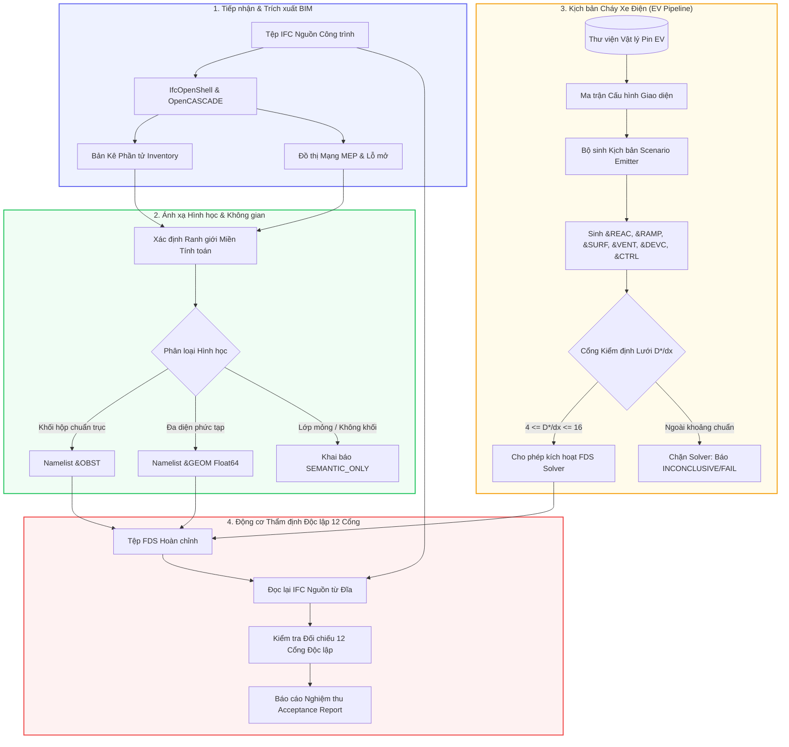

<a id="top"></a>

<div align="center">

# IFCtoFDS: Nền Tảng Ánh Xạ Hình Học BIM-sang-FDS & Mô Phỏng Cháy Xe Điện

**Từ mô hình hình học BIM đến ánh xạ FDS có thể truy xuất nguồn gốc, kiểm chứng độc lập và mô phỏng cháy pin Li-ion hàng loạt.**

[English Version (Tài liệu Tiếng Anh)](README.en.md) · [Báo Cáo Nghiên Cứu](docs/COMPREHENSIVE_AUDIT_REPORT.md) · [Đóng Góp Sự Cố](https://github.com/fire-digital-twin-lab/IFCtoFDS/issues)

[](https://github.com/fire-digital-twin-lab/IFCtoFDS/actions/workflows/verified.yml)
[](pyproject.toml)
[](LICENSE)
[](https://pages.nist.gov/fds-smv/)
[](https://technical.buildingsmart.org/)

<br>


*Giao diện nghiên cứu IFCtoFDS Workbench hiển thị mô hình công trình mẫu công khai KIT AC20-FZK-Haus.*

</div>

---

## Mục lục

1. [Tổng quan dự án](#1-tổng-quan-dự-án)
2. [Sơ đồ quy trình tổng thể](#2-sơ-đồ-quy-trình-tổng-thể)
3. [Bốn trụ cột công nghệ cốt lõi](#3-bốn-trụ-cột-công-nghệ-cốt-lõi)
4. [Cơ sở khoa học & Tiêu chuẩn tính toán](#4-cơ-sở-khoa-học--tiêu-chuẩn-tính-toán)
5. [Cài đặt & Bắt đầu nhanh trong 3 phút](#5-cài-đặt--bắt-đầu-nhanh-trong-3-phút)
6. [Hướng dẫn quy trình thao tác thực tế](#6-hướng-dẫn-quy-trình-thao-tác-thực-tế)
7. [Đặc tả Artifacts & Hệ thống Cổng Kiểm định](#7-đặc-tả-artifacts--hệ-thống-cổng-kiểm-định)
8. [Đặc tả REST API & Giao diện Dòng lệnh (CLI)](#8-đặc-tả-rest-api--giao-diện-dòng-lệnh-cli)
9. [Khả năng, Giới hạn & Tính toàn vẹn Fail-Closed](#9-khả-năng-giới-hạn--tính-toàn-vẹn-fail-closed)
10. [Kiểm thử tự động & Phát triển mã nguồn](#10-kiểm-thử-tự-động--phát-triển-mã-nguồn)
11. [Ghi công, Trích dẫn Khoa học & Giấy phép](#11-ghi-công-trích-dẫn-khoa-học--giấy-phép)

---

## 1. Tổng quan dự án

**IFCtoFDS** là phần mềm mã nguồn mở chuyên sâu phục vụ nghiên cứu và thực hành kỹ thuật an toàn phòng cháy chữa cháy (PCCC), đóng vai trò cầu nối chuẩn xác giữa mô hình Thông tin Công trình (**BIM - Industry Foundation Classes**) và công cụ tính toán động lực học khói lửa hàng đầu thế giới (**NIST Fire Dynamics Simulator - FDS**).

Kho lưu trữ này là **bản fork nghiên cứu chính thức của Fire Digital Twin Lab**, phát triển kế thừa và mở rộng toàn diện từ công trình khởi nguyên của [GS. Rino Lovreglio (Đại học Massey)](https://github.com/ProfRino/IFCtoFDS).

### 1.1. Trạng thái hiện tại & Hạn chế sử dụng (Current Status & Usage Guidelines)

Nhằm đảm bảo tính trung thực khoa học và tuyệt đối không tạo cảm giác an toàn giả trong thiết kế PCCC, hệ thống phân định rõ ràng 3 nhóm trạng thái:

#### Nhóm A: Đã hoạt động & Được kiểm chứng tự động (Verified & Production-Ready for Research)
- **Nhân hình học Verified Python (`ifc_to_fds`)**: Trích xuất thể tích BREP 64-bit qua IfcOpenShell/OpenCASCADE. Áp dụng triệt để nguyên tắc *fail-closed*: từ chối tự động vá lỗi bằng hộp bao AABB để không tạo "vách ngăn ảo" (phantom fire barriers) cản trở dòng khói.
- **Động cơ thẩm định độc lập 14 Cổng (Independent Audit Engine)**: Tái phân tích độc lập từ đĩa cứng (không tin bộ nhớ xuất), kiểm tra cú pháp, miền tính toán, truy nguyên GUID nguồn, độ hoàn thiện kết cấu, mạng MEP, rò rỉ khí (`air_path`) và đối chiếu gói nhị phân.
- **Thuật toán chia miền Multi-Mesh (`partition_simulation_domain`)**: Tự động chia miền tính toán vượt quá 500.000 ô thành các submesh song song dọc theo các trục toạ độ cho FDS MPI, bảo đảm biên lưới khớp hoàn hảo với bội số kích thước ô $\Delta x$.
- **Hạ tầng Job Service cách ly tiến trình**: Lưu trữ SQLite WAL, giám sát bộ nhớ RSS bằng `psutil`, timeout và huỷ tác vụ an toàn trên môi trường Windows/Linux.

#### Nhóm B: Đã hiện thực nhưng có giới hạn kỹ thuật / Cần kỹ sư PCCC thẩm định (Implemented with Boundaries)
- **Kịch bản Cháy Xe Điện (EV Scenario Emitter)**: Đã nối dây trực tiếp vào worker, sinh tệp `scenario.fds`, hỗ trợ phản ứng composite đơn `&REAC` cho FDS simple chemistry, đường cong $t^2$ chuẩn hoá 20 mốc RAMP đơn điệu ngặt, cân bằng năng lượng pack pin và điều khiển cửa FDS Section 15.3 (`INITIAL_STATE=.TRUE.` trên `&DEVC`).  
  *Giới hạn*: Khí độc HF được phát dưới dạng `&SPEC` thụ động; các tham số $t_\alpha$, công suất đỉnh bắt buộc phải được kỹ sư PCCC có chứng chỉ thẩm định theo từng loại phương tiện và thiết kế thông gió cụ thể.
- **Cổng Kiểm định Hình học Hiệu dụng (`effective_geometry`)**:  
  *Giới hạn*: Adapter đọc chỉ số từ tệp `.smv` của FDS hiện chỉ hỗ trợ chướng ngại vật dạng `&OBST` trên một mesh duy nhất. Với các công trình thực tế có cửa sổ/cửa đi (90%+ cấu kiện xuất thành `&GEOM` cut-cell), cổng này trả về `INCONCLUSIVE`. Hệ thống bảo vệ rủi ro này bằng công cụ heuristic tiên nghiệm `check_opening_grid_alignment` (cảnh báo khi bề rộng mở $< 2 \cdot \Delta x$).
- **Cổng Kiểm tra Rò rỉ Bao che (`air_path`)**:  
  *Giới hạn*: Phép tính Boolean CSG giữa các khoang khí có thể trả về thể tích có dấu do chiều cuộn tam giác. Hệ thống bắt buộc $V_{leak} \ge 0$; nếu $V_{leak} < -10^{-12}\text{ m}^3$, cổng trả về `INCONCLUSIVE` (thay vì cấp PASS sai).
- **Cấp độ Thẩm duyệt (`SIMULATION_VERIFIED`)**:  
  Hệ thống hiện tại chỉ cấp trạng thái `MAPPING_VERIFIED` (xác thực tính toàn vẹn hình học sang FDS). Trạng thái `SIMULATION_VERIFIED` chưa bao giờ được tự động phát hành vì yêu cầu kết quả chạy solver và thẩm định chuyên gia.

#### Nhóm C: Kế hoạch phát triển dài hạn (Roadmap)
- Tự động hóa thiết lập đầu phun Sprinkler tự động và hệ thống hút khói sự cố tầng hầm.
- Adapter cut-cell đọc biên dạng lưới solver SMV cho cấu kiện dạng `&GEOM`.
- Phân tán MPI tự động trên cụm máy chủ điện toán đám mây.

> ⚠️ **Quy định về phạm vi "Độc lập" (Audit Independence):**  
> Động cơ audit đạt tính độc lập tuyệt đối ở khâu **đọc lại tệp IFC nguồn từ đĩa** và **phân tích cú pháp lại tệp FDS vừa xuất** mà không sử dụng dữ liệu bộ nhớ của trình xuất. Tuy nhiên, cấu hình audit (phạm vi tầng, bounding box, dung sai) được kế thừa từ chính cấu hình tác vụ chuyển đổi ban đầu.

---

## 2. Sơ đồ quy trình tổng thể



---

## 3. Bốn trụ cột công nghệ cốt lõi

### 3.1. Chuyển đổi Hình học BIM sang FDS Chính xác Tuyệt đối
- **Nhân hình học OpenCASCADE nguyên bản**: Trích xuất toàn bộ thể tích hình khối 3D với độ chính xác số thực dấu phẩy động 64-bit chuẩn (`float64`).
- **Phân định chiến lược thông minh**:
  - `&OBST`: Áp dụng cho các cấu kiện khối hộp thụ động kín, song song tuyệt đối với các trục tọa độ và không chứa lỗ mở khoét thủng.
  - `&GEOM`: Tự động áp dụng cho các cấu kiện có hình học phức tạp, tường/sàn vát góc, hoặc tường bị đục thủng bởi cửa sổ, cửa đi nhằm bảo toàn chính xác biên dạng khoét rỗng CAD.
  - `SEMANTIC_ONLY`: Tự động nhận diện các lớp trát, sơn tường trang trí mỏng (`IfcCovering` có bề dày $< 0.02\text{ m}$) thành hình học tham chiếu ngữ nghĩa, không biến chúng thành khối vật cản nhân tạo làm nghẽn dòng khí FDS.

### 3.2. Động cơ Thẩm định Độc lập 12 Cổng (Independent Audit Engine)
Tuân thủ nguyên tắc độc lập kiểm toán: Động cơ thẩm định **không bao giờ tin cậy dữ liệu tạm trong bộ nhớ** của trình xuất mà trực tiếp phân tích cú pháp lại tệp FDS xuất ra và nạp lại tệp IFC gốc từ ổ cứng để đối soát chéo:
1. **Cổng Cú pháp (`syntax`)**: Kiểm tra ngữ pháp namelist FDS 6+, phát hiện trùng lặp định danh, ký tự bất hợp lệ và kiểm tra danh mục trường hợp lệ.
2. **Cổng Miền tính toán (`domain`)**: Đối chiếu tọa độ lưới `&MESH` với phạm vi không gian công trình đã phê duyệt.
3. **Cổng Truy xuất nguồn gốc (`traceability`)**: Truy nguyên từng khối `&OBST` và `&GEOM` về đúng thực thể IFC gốc (mã băm tệp, `step_id`, `GlobalId`), phát hiện các vật thể lạ phát sinh không rõ nguồn gốc.
4. **Cổng Phạm vi (`scope`)**: Đảm bảo các tầng và không gian được chọn không bị cắt xén làm thay đổi tính toàn vẹn cấu trúc.
5. **Cổng Hình học (`geometry`)**: Kiểm tra tính đa tạp kín (manifold), phát hiện mặt tam giác suy biến, cạnh hở và thể tích dương.
6. **Cổng Bảo toàn Lỗ mở (`openings`)**: Đảm bảo cửa sổ, cửa đi và các lỗ mở thông tầng không bị lấp kín do lỗi chuyển đổi hình học (CAD silent reseal).
7. **Cổng Mạng MEP (`mep`)**: Xác thực đồ thị kết nối hệ thống thông gió hút khói và đường ống chữa cháy.
8. **Cổng Bao che & Rò rỉ Không khí (`air_path`)**: Thuật toán quét thể tích không gian tự do 3D phát hiện rò rỉ khí qua vỏ bao che công trình (phát hiện lỗ rò rỉ dù chỉ $1.0\text{ m}^3$).
9. **Cổng Thẩm quyền Vật cản (`representation`)**: Ngăn chặn các vật thể tham chiếu bị gán sai thành vật cản dòng khí.
10. **Cổng Điều kiện Biên (`boundary`)**: Xác minh tương tác hình học giữa biên công trình và mặt giới hạn tính toán FDS.
11. **Cổng Tương đồng Đối chứng (`golden_reference_parity`)**: So sánh với tập dữ liệu tham chiếu chuẩn đã được chuyên gia phê duyệt.
12. **Cổng Trình giải CFD (`solver`)**: Chạy kiểm tra khởi tạo nghiệm thức dry-run với NIST FDS chính thức.

### 3.3. Hệ thống Mô phỏng Kịch bản Cháy Xe Điện Hàng loạt (EV Fire Pipeline)
- **Thư viện Vật lý Cháy Pin Chuẩn hóa (`ifc_to_fds/fire/ev_library.py`)**: Lưu trữ các bản ghi tham số cháy có phiên bản, bao gồm công suất tỏa nhiệt cực đại ($HRR_{peak}$), hệ số tăng trưởng $t^2$, năng lượng gói pin (kWh), và hệ số phát thải khí độc hại ($CO$, $Soot$, $HF$) được thẩm định từ các nghiên cứu cháy thực nghiệm quy mô lớn (RISE, v.v.).
- **Bộ sinh Kịch bản FDS Động (`ifc_to_fds/fire/scenario_emitter.py`)**: Tự động tạo mã FDS hoàn chỉnh bao gồm phản ứng cháy `&REAC`, đường cong công suất `&RAMP`, bề mặt đốt `&SURF` tính toán công suất trên đơn vị diện tích ($HRRPUA$), khối xe `&OBST`, mặt lửa `&VENT`, cùng hệ thống cảm biến báo cháy `&DEVC` và điều khiển đóng mở cửa thoát nạn `&CTRL`.
- **Cổng Kiểm Định Độ Mịn Lưới Plume ($D^*/\Delta x$)**: Tự động tính toán đường kính đặc trưng đám cháy cho từng xe theo chuẩn quốc tế và ngăn chặn chạy FDS nếu kích thước lưới ô tính toán quá thô hoặc quá mịn ngoài khoảng tiêu chuẩn.
- **Bảo toàn Nguyên tắc A3**: Mọi kịch bản sinh ra liên kết chặt chẽ qua mã băm `bundle_sha256` mà **tuyệt đối không làm thay đổi hay sai lệch mô hình hình học nền**.

### 3.4. Vòng đời Tác vụ Bền vững & Chống Lỗi (Job Engine & Resiliency)
- **Cơ sở dữ liệu SQLite chế độ WAL (Write-Ahead Logging)**: Lưu vết trạng thái tác vụ an toàn, tự động phục hồi về `FAILED` khi máy chủ khởi động lại đột ngột.
- **Hợp đồng API phân tách rõ ràng**: Phân định rành mạch giữa `POST /api/jobs/{id}/cancel` (hủy xử lý an toàn, giữ nguyên dữ liệu đã xuất) và `DELETE /api/jobs/{id}?purge=true` (yêu cầu xác nhận rõ ràng mới xóa vĩnh viễn tệp trên đĩa).
- **Cơ chế chống tràn hàng đợi**: Xử lý tự động lỗi HTTP 429 với giải thuật lũy thừa thời gian chờ (exponential backoff retry) giúp quá trình gửi batch hàng chục kịch bản diễn ra trơn tru.

---

## 4. Cơ sở khoa học & Tiêu chuẩn tính toán

### 4.1. Đường kính Đặc trưng Đám cháy ($D^*$) và Tỷ lệ Độ phân giải Lưới ($D^*/\Delta x$)
Trong mô phỏng số động lực học chất lưu CFD đám cháy bằng FDS, kích thước ô lưới tính toán ($\Delta x$) quyết định trực tiếp đến độ chính xác của trường nhiệt độ, vận tốc dòng khói và áp suất. Theo các tài liệu kỹ thuật chuẩn mực quốc tế:
- **NFPA 92**: Standard for Smoke Control Systems.
- **NUREG-1824**: Verification and Validation of Selected Fire Models for Nuclear Power Plant Applications.
- **FDS User's Guide / FDS Validation Guide** (NIST).

Đường kính đặc trưng của đám cháy $D^*$ được xác định theo phương trình:

$$D^* = \left( \frac{\dot{Q}}{\rho_\infty \cdot c_p \cdot T_\infty \cdot \sqrt{g}} \right)^{\frac{2}{5}}$$

Trong đó:
- $\dot{Q}$: Công suất tỏa nhiệt cực đại của đám cháy ($kW$).
- $\rho_\infty$: Khối lượng riêng của không khí ở điều kiện chuẩn ($\approx 1.204 \text{ kg/m}^3$).
- $c_p$: Nhiệt dung riêng đẳng áp của không khí ($\approx 1.005 \text{ kJ/(kg}\cdot\text{K)}$).
- $T_\infty$: Nhiệt độ môi trường ban đầu ($\approx 293.15 \text{ K}$).
- $g$: Gia tốc trọng trường ($9.81 \text{ m/s}^2$).

Mẫu số chuẩn ở điều kiện khí quyển tiêu chuẩn: $\rho_\infty c_p T_\infty \sqrt{g} \approx 1111.4$.

Khoảng tỷ lệ độ mịn lưới được khuyến nghị bắt buộc trong kiểm định:

$$4 \le \frac{D^*}{\Delta x} \le 16$$

- Khi $\frac{D^*}{\Delta x} < 4$: Ô lưới quá thô, FDS không giải quyết được các cấu trúc cuộn xoáy cột khói plume, kết quả sai lệch nghiêm trọng $\rightarrow$ **Cổng kiểm định đánh lỗi `FAIL` và chặn chạy FDS**.
- Khi $4 \le \frac{D^*}{\Delta x} \le 16$: Độ phân giải lưới đạt chuẩn hội tụ nghiệm khí động học $\rightarrow$ **Cổng kiểm định xác nhận `PASS`**.
- Khi $\frac{D^*}{\Delta x} > 16$: Ô lưới quá mịn, chi phí tính toán bùng nổ vượt ngoài giới hạn kiểm chứng $\rightarrow$ **Hệ thống cảnh báo hoặc chuyển `INCONCLUSIVE`**.

### 4.2. Dữ liệu Đặc tính Cháy Pin Xe Điện (EV Fire Physics Reference)

Hệ thống tích hợp sẵn các bộ tham số cháy chuẩn hóa theo thực nghiệm:

| Loại phương tiện | Loại hóa học Pin | Dung lượng gói (kWh) | Công suất đỉnh $HRR_{peak}$ (MW) | Thời gian đạt đỉnh $t_\alpha$ (s) | Hệ số khói $Y_{soot}$ | Hệ số khí $Y_{CO}$ | Khí độc $Y_{HF}$ | Mức tin cậy (Confidence) |
|---|---|---|---|---|---|---|---|---|
| **Xe máy điện / Xe đạp điện** | LFP (Lithium Iron Phosphate) | 0.5 – 3.0 | 0.02 – 0.15 | 75 – 300 | 0.05 – 0.15 | 0.05 – 0.20 | 0.00 – 0.02 | `low` *(Giả định kỹ thuật)* |
| **Xe ô tô điện du lịch** | NMC (Nickel Manganese Cobalt) | 40.0 – 100.0 | 2.0 – 7.0 | 150 – 600 | 0.08 – 0.20 | 0.05 – 0.20 | 0.01 – 0.05 | `medium` *(Thực nghiệm RISE)* |

---

## 5. Cài đặt & Bắt đầu nhanh trong 3 phút

### Yêu cầu hệ thống:
- Hệ điều hành: Windows 10/11 (64-bit), Ubuntu Linux 22.04/24.04, hoặc macOS.
- **Python**: Phiên bản 3.10, 3.11 hoặc 3.12.
- Trình duyệt: Chrome, Edge, Firefox hoặc Safari phiên bản mới hỗ trợ WebGL.

### Bước 1: Sao chép mã nguồn
```bash
git clone https://github.com/fire-digital-twin-lab/IFCtoFDS.git
cd IFCtoFDS
```

### Bước 2: Thiết lập môi trường ảo Python

**Trên Windows (PowerShell):**
```powershell
python -m venv .venv
.\.venv\Scripts\Activate.ps1
python -m pip install -e ".[test]"
```

**Trên Linux / macOS:**
```bash
python3 -m venv .venv
source .venv/bin/activate
python -m pip install -e ".[test]"
```

### Bước 3: Khởi chạy Giao diện Nghiên cứu (Workbench)
```bash
python -m ifc_to_fds serve --port 8000
```
Truy cập trình duyệt tại địa chỉ: **[http://127.0.0.1:8000](http://127.0.0.1:8000)**.

*(Tùy chọn)* Cài đặt NIST FDS chính thức để chạy mô phỏng nghiệm thức:
```bash
python scripts/install-fds.py
```

---

## 6. Hướng dẫn quy trình thao tác thực tế

### Quy trình A: Ánh xạ Hình học & Kiểm định Toàn vẹn (Verified Mapping)
1. Tại tab **Upload/Select IFC**, chọn tệp công trình BIM (có sẵn mẫu trong thư mục `examples/`).
2. Chọn tầng cần phân tích hoặc thiết lập miền tính toán FDS (`simulation_domain`).
3. Nhấp nút **Run Verified Mapping**:
   - Hệ thống ngầm nạp hình học qua IfcOpenShell.
   - Xuất tệp `model.fds` và các gói hình học nhị phân `.payloads`.
   - Động cơ kiểm tra tự động chạy 12 cổng đối soát chéo.
4. Mở ngăn kéo **Audit Drawer** để xem chi tiết từng cổng kiểm tra và tải báo cáo nghiệm thu `.md` hoặc `.json`.

### Quy trình B: Thiết lập Ma trận & Chạy Batch Cháy Xe Điện (EV Fire Batch)
1. Sau khi mô hình đạt kết quả kiểm định hình học hợp lệ (`MAPPING_VERIFIED`), mở tab **Kịch bản Cháy Xe Điện (EV Fire Scenarios)** ở thanh công cụ bên trái.
2. Thiết lập dải thông số ma trận thực nghiệm:
   - **Số lượng xe**: Ví dụ `1, 3, 5`.
   - **Khoảng cách đỗ xe**: Ví dụ `0.8, 1.2` mét (hệ thống tự động tính toán bù chiều rộng xe để chống giao cắt hình học).
   - **Mức sạc pin (SoC %)**: Ví dụ `50, 80, 100` %.
   - **Cơ cấu loại pin**: LFP xe máy điện, NMC ô tô điện.
   - **Trạng thái cửa thoát nạn**: `CLOSED` hoặc `OPEN` (kèm thời gian kích hoạt điều khiển).
3. Nhấp nút **Generate EV Fire Batch**:
   - Hệ thống tự động tính toán $D^*$, kiểm tra điều kiện lưới $4 \le D^*/\Delta x \le 16$.
   - Tự động sinh hàng loạt kịch bản và xếp vào hàng đợi xử lý nền qua `JobService`.
4. Xem bảng tổng hợp kết quả từng kịch bản: Trạng thái lưới, công suất nhiệt cực đại, và kết luận nghiệm thu tổng hợp.

---

## 7. Đặc tả Artifacts & Hệ thống Cổng Kiểm định

Mỗi lượt chạy Verified sinh ra một **Gói Ánh xạ Hoàn chỉnh (Mapping Bundle)** đồng bộ:

| Tệp đầu ra | Ý nghĩa và Nội dung kỹ thuật |
|---|---|
| `model.fds` | Tệp FDS hoàn chỉnh bao gồm hình học, chú thích nguồn IFC và các namelist cháy |
| `model_manifest.json` | Bản kê phân công thực thể: ánh xạ 1-1 giữa ID IFC và định danh FDS |
| `model_acceptance_report.json` | Kết quả chi tiết 12 cổng kiểm tra, mức độ lỗi và danh mục phát hiện |
| `model_geometry.json` | Chỉ mục hình học nhị phân lưu trữ tọa độ đỉnh và mặt lưới nguyên bản |
| `model_inventory.json` | Toàn bộ danh mục 100% phần tử trích xuất từ IFC nguồn |
| `model_mep_graph.json` | Đồ thị kết nối cổng (port-to-port) của hệ thống thông gió và chữa cháy |
| `model_timings.json` | Thời gian thực thi chi tiết của từng giai đoạn chuyển đổi và kiểm tra |

### Bảng Ý nghĩa Trạng thái Nghiệm thu (Acceptance Status)
- **`MAPPING_VERIFIED`**: Mọi cổng kiểm tra hình học và truy xuất bắt buộc đều đạt chuẩn (`PASS`) hoặc có lý giải miễn trừ hợp lệ (`NOT_APPLICABLE`).
- **`REJECTED`**: Có ít nhất một sai lệch hình học nghiêm trọng (như rò rỉ bao che, vật cản trái phép, cấu kiện tự giao).
- **`INCONCLUSIVE`**: Thiếu dữ liệu đầu vào hoặc chưa hoàn thành bước kiểm chứng độc lập.

### 7.2. Hướng dẫn Đọc & Đánh giá Kết quả Nghiệm thu (Audit Interpretation Protocol)

Để đánh giá chính xác một mô hình FDS đã qua kiểm định, quy trình khuyến nghị gồm 6 bước:

1. **Không bao giờ đọc `model.fds` đơn lẻ**: Luôn mở kèm tệp báo cáo nghiệm thu `model_acceptance_report.md` (bản định dạng dễ đọc) hoặc `model_acceptance_report.json` (bản dữ liệu máy học đầy đủ).
2. **Kiểm tra trạng thái tổng thể (`status`)**:
   - `MAPPING_VERIFIED`: Đạt chuẩn tất cả cổng kiểm định bắt buộc.
   - `REJECTED`: Bị từ chối do vi phạm tính toàn vẹn hình học (Ví dụ: tệp mẫu `AC20-FZK-Haus.ifc` bị từ chối vì chứa 10+ cấu kiện tự giao trong CAD gốc; hệ thống từ chối vá ngầm bằng bounding box).
   - `INCONCLUSIVE`: Chưa đủ điều kiện kết luận (Ví dụ: chưa cài FDS để chạy cổng `solver`, hoặc công trình có tường khoét lỗ mở chuyển thành `&GEOM` qua cổng `effective_geometry`).
3. **Đối chiếu bảng các cổng (`gates`)**:
   - Tra cứu từng cổng có `required: true`. Một cổng bắt buộc không đạt `PASS` hoặc `NOT_APPLICABLE` sẽ chặn toàn bộ kết quả nghiệm thu.
   - Khi cổng `openings` báo `FAIL`: mở danh mục `findings` và `metrics` để xem chi tiết sai số diện tích và dung sai khoét rỗng.
4. **Kiểm tra chỉ số rò rỉ khí (`air_path`)**:
   - Xem trường `evidence.leak_volume_m3`. Hệ thống bắt buộc $V_{leak} \ge 0$; nếu kết quả mang dấu âm hoặc vượt quá dung sai bao che, cổng sẽ chuyển `INCONCLUSIVE` hoặc `FAIL`.
5. **Tra cứu danh mục phát hiện (`findings`)**:
   - Mỗi phát hiện đều gán kèm mã phần tử nguồn (`GlobalId` / `entity_key`). Kỹ sư có thể dùng mã này mở trực tiếp mô hình trên Revit / ArchiCAD để sửa lỗi hình học gốc.
6. **Xác minh toàn vẹn tệp qua băm SHA-256 (`model_checksums.json`)**:
   - Chứa chuỗi băm SHA-256 của từng tệp đầu ra trong gói. Nếu băm không khớp, gói dữ liệu đã bị can thiệp ngoài luồng.

---

## 8. Đặc tả REST API & Giao diện Dòng lệnh (CLI)

### Bảng Tra cứu REST API

| Giao thức | Đường dẫn Endpoint | Tham số chính | Chức năng |
|---|---|---|---|
| `POST` | `/api/jobs` | `files`, `configuration` | Đưa tệp IFC vào hàng đợi chuyển đổi Verified Mapping |
| `POST` | `/api/scenario-jobs` | JSON payload kịch bản | Gửi kịch bản cháy xe điện vào hàng đợi tính toán ma trận |
| `GET` | `/api/jobs/{id}` | - | Lấy trạng thái tiến độ thời gian thực của tác vụ |
| `GET` | `/api/jobs/{id}/result` | - | Lấy kết quả hoàn chỉnh sau khi tác vụ kết thúc |
| `POST` | `/api/jobs/{id}/cancel` | - | **Hủy tác vụ an toàn** (không xóa kết quả tệp trên đĩa) |
| `DELETE` | `/api/jobs/{id}` | `purge=true` | Xóa vĩnh viễn tệp và bản ghi tác vụ (bắt buộc cờ `purge`) |
| `POST` | `/api/inventory` | `files` | Trích xuất nhanh danh mục phần tử BIM mà không chuyển đổi |

### Lệnh CLI Thường dùng

```bash
# Xem trợ giúp tổng quát
python -m ifc_to_fds --help

# Trích xuất danh mục phần tử IFC dạng JSON
python -m ifc_to_fds inventory examples/AC20-FZK-Haus.ifc --json

# Chuyển đổi toàn bộ mô hình sang FDS với kích thước ô lưới 0.2m
python -m ifc_to_fds convert examples/AC20-FZK-Haus.ifc -o out/fzk.fds --cell-size 0.2

# Kiểm định độc lập một tệp FDS đã xuất kèm manifest
python -m ifc_to_fds audit examples/AC20-FZK-Haus.ifc --fds out/fzk.fds --manifest out/fzk_manifest.json --geometry-package out/fzk_geometry.json
```

---

## 9. Khả năng, Giới hạn & Tính toàn vẹn Fail-Closed

1. **Nguyên tắc Từ chối Trung thực (Fail-Closed Integrity)**:
   Nếu một mô hình IFC thực tế chứa lỗi mô hình hóa (ví dụ: các tấm ốp tường 2D hở biên, tay vịn cầu thang tự cắt), hệ thống sẽ **báo lỗi trung thực và từ chối cấp chứng nhận (`REJECTED`)**. Hệ thống tuyệt đối không áp dụng các giải thuật "vá víu ngầm" (như tự động thay mặt hở bằng hộp đặc AABB) vì điều này sẽ tạo ra các vật cản khói giả tạo, làm sai lệch hoàn toàn kết quả mô phỏng cháy CFD.
2. **Xử lý Không gian Khoét rỗng (Openings) & Phân định Nhánh Legacy**:
   - Trong nhân Python chuẩn xác (**Verified Pipeline**), các lỗ mở cửa sổ/cửa đi được trừ khối trực tiếp qua CSG Manifold3D và xuất thành `&GEOM` (hoặc `&OBST` nếu là khối hộp thẳng trục). Các chiến lược `VOXEL` và `HOLE` cắt tường thủ công chỉ thuộc về nhánh giao diện duyệt nhanh JavaScript (**Quick Preview Legacy**) và không được cấp thẩm quyền kiểm định nghiên cứu.
   - Các sự kiện mở/đóng cửa trong kịch bản cháy được điều khiển thông qua `&OBST` kết hợp `&CTRL` và `&DEVC` có `INITIAL_STATE` theo chuẩn FDS User Guide Section 15.3, hoạt động đồng nhất trên cả tường `&GEOM` lẫn `&OBST`.
3. **Mạng MEP và Đầu phun**:
   Hệ thống giữ lại kết nối cổng nguyên bản. Việc kích hoạt phun nước dập lửa của đầu phun Sprinkler được liên kết theo trường nhiệt độ và vận tốc khí thông qua namelist `&DEVC` đặc thù.

---

## 10. Kiểm thử tự động & Phát triển mã nguồn

Dự án áp dụng phương pháp Phát triển Hướng Kiểm thử nghiêm ngặt (**Test-Driven Development - TDD**) với tỷ lệ bao phủ kiểm thử cao.

```bash
# Chạy toàn bộ 420+ ca kiểm thử tự động của Python
python -m pytest tests/ -q -m "not solver and not browser"

# Chạy kiểm tra các bộ thử nghiệm giao diện người dùng bằng Node.js
node scripts/test-ev-scenario-panel.js
node scripts/test-artifact-viewer.js
node scripts/test-ui-recovery.js
node scripts/test-workbench-feature4.js
```

---

## 11. Ghi công, Trích dẫn Khoa học & Giấy phép

### Dự án Khởi nguyên (Upstream Attribution)
Dự án IFCtoFDS nguyên bản được sáng lập và phát triển bởi **GS. Rino Lovreglio** (Đại học Massey, New Zealand) cùng cộng sự **resilienceengineer**. Tham khảo kho lưu trữ gốc tại [ProfRino/IFCtoFDS](https://github.com/ProfRino/IFCtoFDS) và trích dẫn theo tệp [CITATION.cff](CITATION.cff).

### Bản quyền Khoa học Fork Nghiên cứu (Research Fork)
Bản fork nghiên cứu chuyển đổi hình học xác minh và mô phỏng cháy xe điện được phát triển bởi **Fire Digital Twin Lab** (Trường Đại học Xây dựng Hà Nội - HUCE). Khi sử dụng phần mềm trong các công trình nghiên cứu khoa học, luận văn hoặc bài báo hội thảo, vui lòng trích dẫn:

```bibtex
@software{ifctofds_fire_digital_twin_lab,
  author = {Fire Digital Twin Lab},
  title = {IFCtoFDS: Verified BIM Geometry Mapping and Electric Vehicle Fire Scenario Simulation},
  url = {https://github.com/fire-digital-twin-lab/IFCtoFDS},
  version = {0.5.0},
  year = {2026}
}
```

### Giấy phép Phân phối (License)
Phần mềm được phát hành theo giấy phép bản quyền nguồn mở **GNU Affero General Public License phiên bản 3 trở lên (AGPL-3.0-or-later)**. Xem chi tiết tại tệp [LICENSE](LICENSE).

---

<div align="center">
  <sub>Phát triển vì mục tiêu an toàn sinh mạng và tiến bộ khoa học kỹ thuật phòng cháy chữa cháy công trình.</sub><br>
  <b><a href="#top">↑ Về đầu trang</a></b>
</div>
