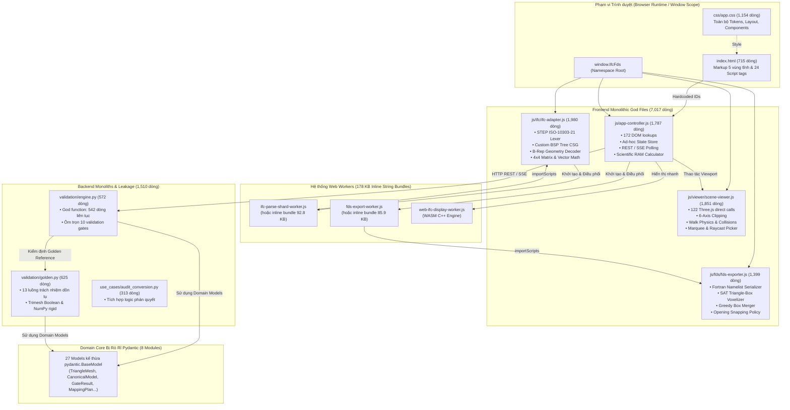

# BẢN THIẾT KẾ KIẾN TRÚC MỤC TIÊU VÀ LỘ TRÌNH TÁI CẤU TRÚC TOÀN DIỆN
## (Comprehensive Target Architecture Blueprint & Phased Modularization Roadmap)
### Phiên bản: Version 1.1 (Đã tích hợp Phản biện Đối nghịch FND-BE-01..04 & Frontend Guardrails 1..4)

- **Dự án**: `fire-digital-twin-lab/IFCtoFDS`
- **Nhánh kiểm toán**: `feat/premium-research-workbench-ui` (HEAD commit `4d8bd2e`)
- **Tác giả tổng hợp**: Architecture Blueprint & Migration Plan Synthesizer (Worker Milestone M4 & Remediation M3)
- **Tài liệu đầu vào**: Báo cáo kiểm toán pháp y M1 (Frontend), M2 (Backend), M3 (Industry Benchmarks & Trade-offs), Báo cáo Phản biện Đối kháng Backend (`backend_review_report.md`) & Frontend (`frontend_review_report.md`)
- **Chế độ thực thi**: **100% READ-ONLY** đối với mã nguồn sản phẩm
- **Thời điểm công bố**: 2026-10-17 (Hiệu chỉnh hoàn thiện v1.1)

---

## MỤC LỤC TỔNG THỂ

1. [CHƯƠNG 1: BÁO CÁO KIỂM TOÁN PHÁP Y HIỆN TRẠNG (CURRENT STATE FORENSIC AUDIT)](#chương-1-báo-cáo-kiểm-toán-pháp-y-hiện-trạng-current-state-forensic-audit)
   - 1.1. Thống kê định lượng các "God Files" Frontend & Backend
   - 1.2. Mổ xẻ vi phạm nguyên lý Single Responsibility Principle (SRP)
   - 1.3. Đo lường Cohesion, Coupling & Rủi ro nạp tuần tự 24 script tags
   - 1.4. Kiểm toán rò rỉ 27 Pydantic models trong lõi Domain
   - 1.5. Sơ đồ kiến trúc và đồ thị phụ thuộc hiện trạng
2. [CHƯƠNG 2: KHẢO CỨU MÔ HÌNH THAM CHIẾU QUỐC TẾ & ARCHITECTURE PATTERNS](#chương-2-khảo-cứu-mô-hình-tham-chiếu-quốc-tế--architecture-patterns)
   - 2.1. So sánh đối chuẩn các giải pháp Web CAD / BIM mã nguồn mở và thương mại
   - 2.2. Phân rã 3D Viewer Three.js thành 7 Sub-services chuyên trách
   - 2.3. Kiến trúc Component-based UI cho Scientific Workbench 5 vùng
   - 2.4. Chiến lược phân tách tần số (Decoupled Frequency Strategy: 60FPS vs 0.1–5Hz)
   - 2.5. CSS Modularization: Hệ thống 3-Tier Design Tokens & BEM Architecture
   - 2.6. Hexagonal Architecture: Micro-Checkers Protocol & Pure Dataclasses
     + 2.6.1. Chuẩn hóa Micro-Checkers kế thừa GateChecker Protocol (FND-BE-02)
     + 2.6.2. Thanh lọc Domain Core thành Pure Dataclasses & CompatModelMixin (FND-BE-01)
     + 2.6.3. Mẫu Chuẩn Di dời Invariant Validators vào __post_init__ cho BoundingBox
     + 2.6.4. Mẫu Chuẩn Ép kiểu Tự động (Nested Coercion) trong SelectionScope
3. [CHƯƠNG 3: BẢN THIẾT KẾ KIẾN TRÚC MỤC TIÊU (TARGET MODULAR BLUEPRINT)](#chương-3-bản-thiết-kế-kiến-trúc-mục-tiêu-target-modular-blueprint)
   - 3.1. Nguyên tắc thiết kế module hóa cốt lõi (< 200–300 dòng/file)
   - 3.2. Cây thư mục mục tiêu toàn diện (Frontend JS/CSS & Backend Python)
   - 3.3. Định nghĩa Contracts, Ports và Interfaces giữa các tầng
4. [CHƯƠNG 4: BẢNG MA TRẬN PHÂN CÔNG TRÁCH NHIỆM (RESPONSIBILITY MATRIX)](#chương-4-bảng-ma-trận-phân-công-trách-nhiệm-responsibility-matrix)
   - 4.1. Ma trận ánh xạ 116 hàm từ `ifc-adapter.js`
   - 4.2. Ma trận ánh xạ 96 hàm từ `scene-viewer.js`
   - 4.3. Ma trận ánh xạ 67 hàm từ `app-controller.js`
   - 4.4. Ma trận ánh xạ 74 hàm từ `fds-exporter.js`
   - 4.5. Ma trận phân rã 13 trách nhiệm của `golden.py`
   - 4.6. Ma trận phân rã 10 gates của `engine.py` sang Micro-Checkers
   - 4.7. Danh mục chuyển đổi 27 Domain Pydantic Models sang Pure Dataclasses
5. [CHƯƠNG 5: ĐÁNH GIÁ CHUYÊN SÂU SO SÁNH TRADE-OFFS (BUILDLESS VS MODERN BUNDLER)](#chương-5-đánh-giá-chuyên-sâu-so-sánh-trade-offs-buildless-vs-modern-bundler)
   - 5.1. Ma trận đối sánh 6 trục kỹ thuật
   - 5.2. Đánh giá bối cảnh người dùng và rào cản công nghệ
   - 5.3. Chiến lược chuyển tiếp thực dụng "The Pragmatic Two-Phase Bridge"
6. [CHƯƠNG 6: LỘ TRÌNH TÁI CẤU TRÚC PHÂN KỲ (PHASED ROADMAP) & REGRESSION GATES](#chương-6-lộ-trình-tái-cấu-trúc-phân-kỳ-phased-roadmap--regression-gates)
   - 6.1. Lộ trình 6 giai đoạn tái cấu trúc phân kỳ
   - 6.2. Hệ thống 7 Chốt chặn Hồi quy (Regression Gates GATE-1 đến GATE-7)
   - 6.3. Tiêu chí Stop-The-Line và quy trình nghiệm thu độc lập

---

## CHƯƠNG 1: BÁO CÁO KIỂM TOÁN PHÁP Y HIỆN TRẠNG (CURRENT STATE FORENSIC AUDIT)

### 1.1. Thống kê định lượng các "God Files" Frontend & Backend

Quá trình kiểm toán pháp y độc lập trên working tree của nhánh `feat/premium-research-workbench-ui` (HEAD commit `4d8bd2e`) đã xác nhận sự tồn tại của các tệp nguyên khối phình to ("God Files") vượt xa các ngưỡng an toàn về khả năng bảo trì phần mềm:

#### Bảng 1.1: Định lượng chi tiết các tệp nguyên khối Frontend
| Tệp mã nguồn | Số dòng thực tế | Dung lượng | Methods / Functions | Truy cập DOM | Global / Window Bindings | Phụ thuộc thư viện ngoài |
|---|---|---|---|---|---|---|
| `js/ifc/ifc-adapter.js` | **1,980** | 81.9 KB | 15 proto / 101 funcs | 0 | 7 (`earcut`, workers) | Tự cài đặt CSG & Vector Math |
| `js/viewer/scene-viewer.js` | **1,851** | 86.2 KB | 64 proto / 31 funcs | 9 (tooltip, canvas) | 5 (`resize`, window) | **122 điểm gọi `THREE.*`** |
| `js/app-controller.js` | **1,787** | 90.4 KB | 0 proto / 67 funcs | **172 điểm gọi DOM** | 16 (`lucide`, modals) | 2 (fetch REST API/SSE) |
| `js/fds/fds-exporter.js` | **1,399** | 65.2 KB | 4 proto / 70 funcs | 0 | 1 | Tự cài đặt 3D SAT Voxelizer |
| `css/app.css` | **1,154** | 25.4 KB | Nguyên khối | - | - | Trộn tokens, layout, drawer, viewer |
| `index.html` | **715** | 51.8 KB | Nguyên khối | > 70 IDs tĩnh | 24 thẻ script nạp tuần tự | CDN UMD Vendors |
| **Tổng cộng 4 God Files JS** | **7,017** | **323.7 KB** | **83 proto / 269 funcs** | **181 DOM calls** | **29 Bindings** | **124 Lib Calls** |

Ngoài ra, hệ thống còn lưu trữ 2 tệp script worker inline bundle khổng lồ: `js/workers/fds-export-worker-inline.js` (**85.9 KB**) và `js/workers/ifc-parse-shard-worker-inline.js` (**92.8 KB**), tổng cộng **178.7 KB** chuỗi ký tự nhúng mã nguồn tĩnh nhằm hỗ trợ chạy qua giao thức `file://`.

#### Bảng 1.2: Định lượng chi tiết các tệp nguyên khối Backend
| Tệp mã nguồn | Số dòng thực tế | Dung lượng | Hàm / Khối trọng tâm | Số luồng trách nhiệm dồn tụ | Thư viện ngoại vi liên kết |
|---|---|---|---|---|---|
| `ifc_to_fds/validation/golden.py` | **625** | 25.6 KB | `golden_gate()`: **412 dòng liên tục** | **13 luồng** | NumPy, Trimesh, DiskPackage, JSON I/O |
| `ifc_to_fds/validation/engine.py` | **572** | 23.2 KB | `run_independent_validation()`: **542 dòng** | **10 gates** kiểm định | Subprocess FDS, Math, BoundingBox |
| `ifc_to_fds/application/use_cases/audit_conversion.py` | **313** | 13.7 KB | `execute()` | Orchestration & Audit formatting | Tích hợp dày đặc logic phán quyết |
| **Tổng cộng Backend Monoliths** | **1,510** | **62.5 KB** | Các khối hàm > 400 dòng | Vi phạm SRP nghiêm trọng | Khớp nối chặt chẽ |

---

### 1.2. Mổ xẻ vi phạm nguyên lý Single Responsibility Principle (SRP)

#### 1. `js/ifc/ifc-adapter.js` (1,980 dòng) — Monolithic CAD Engine:
Tệp này không chỉ là một adapter mà là một nhân CAD hoàn chỉnh viết bằng JS nguyên khối, nhồi nhét 7 tầng trách nhiệm:
1. **Worker Orchestration & Parallel Sharding (Dòng 1–192)**: Tự chia nhỏ buffer thành các shard tính toán song song qua Web Workers, gom kết quả và xử lý fallback luồng chính.
2. **STEP (ISO 10303-21) Lexer & Parser (Dòng 377–595)**: Tự bóc tách chuỗi cú pháp STEP bằng regular expression và con trỏ ký tự, xử lý scale đơn vị đo lường (m, mm, inch).
3. **IFC Spatial & Relational Indexing (Dòng 596–693)**: Lập chỉ mục các quan hệ ngữ nghĩa `IfcRelVoidsElement`, `IfcRelFillsElement`, `IfcRelAggregates`.
4. **Constructive Solid Geometry (CSG) & Boolean Carving (Dòng 694–984)**: **Tự cài đặt một cây BSP (Binary Space Partitioning Tree)** hoàn chỉnh để thực hiện phép trừ khối boolean 3D khoét lỗ cửa đi, cửa sổ.
5. **Geometry Decoding (Dòng 985–1710)**: Giải mã biểu diễn hình học B-Rep đa diện, Swept Solid, Mapped Items, và gọi `window.earcut` để tam giác hóa mặt phẳng có lỗ.
6. **3D Vector & 4x4 Matrix Mathematics (Dòng 1737–1965)**: Tự viết lại hơn 20 hàm toán vector (`cross`, `dot`, `normalize`, `transformPoint`) và ma trận chuyển đổi hệ tọa độ 4x4.
7. **Semantic Classification (Dòng 1786–1842)**: Phân loại phần tử xây dựng dựa trên từ khóa định danh.

#### 2. `js/viewer/scene-viewer.js` (1,851 dòng) — Monolithic 3D Scene Viewer:
Pha trộn giữa WebGL Rendering, Game Engine Physics, UI Interactivity và Data Loader với 9 tầng trách nhiệm:
1. **Scene Lifecycle & WebGL Setup (Dòng 1–158)**: Khởi tạo WebGLRenderer, Scene, PerspectiveCamera, Lights, GridHelper và render loop.
2. **Camera Rig & Preset Views (Dòng 297–406, 1258–1297)**: Điều khiển góc nhìn trực giao/phối cảnh, tính toán tweening và OrbitControls.
3. **6-Axis Interactive Clipping (Dòng 407–560)**: Tạo và đồng bộ 6 mặt phẳng cắt `THREE.Plane` (min/max X, Y, Z) trực tiếp vào renderer.
4. **Transition & Reveal Animation Engine (Dòng 470–549)**: Hiệu ứng chuyển cảnh quét mặt cắt khi chuyển đổi giữa IFC và FDS.
5. **Mesh Factory & Material Styler (Dòng 583–846, 1577–1733)**: Khởi tạo BufferGeometry, quản lý cache vật liệu và màu sắc theo loại IFC/FDS.
6. **First-Person Walkthrough Engine & Physics (Dòng 856–1127, 1751–1782)**: Tích hợp `PointerLockControls`, **mô phỏng trọng lực (gravity)**, raycasting phát hiện va chạm mặt sàn, trượt tường ngang (wall sliding), né lỗ mở cầu thang/giếng trời.
7. **Raycasting & Marquee Drag Selection (Dòng 1298–1563, 1734–1850)**: Quét hộp chữ nhật 2D màn hình để chọn hàng loạt đối tượng 3D, raycasting đối tượng đơn lẻ, hiển thị highlight và tooltip DOM.
8. **Layer & Category Filtering (Dòng 1153–1257)**: Quản lý ẩn/hiện 9 groups và lọc danh mục.
9. **Verified Backend Artifacts Integrator (Dòng 188–268)**: Nhận binary buffers từ API backend và dựng scene Three.js.

#### 3. `js/app-controller.js` (1,787 dòng) — "God Controller" Trung Tâm:
Trộn lẫn 6 tầng trách nhiệm lớn:
1. **Monolithic DOM Wiring (Dòng 60–150, 310–795)**: Bắt tay cứng với hơn 70 ID tĩnh trong HTML và gắn hơn 50 event listeners thủ công.
2. **Central Ad-hoc Mutable State Store (Dòng 1–59, 1022–1046)**: Biến `state` toàn cục không có schema, kiêm luôn ngăn xếp Undo/Redo.
3. **Backend REST API & SSE Client (Dòng 1236–1375, 1758–1786)**: Thực hiện HTTP fetch tới FastAPI (`/api/health`, `/api/jobs/convert`), xử lý polling SSE và tải artifacts.
4. **Client-side Export Worker Orchestrator (Dòng 1047–1235)**: Khởi tạo và điều phối Web Worker xuất FDS, bẫy lỗi và theo dõi tiến độ.
5. **Structured Inspector & Audit Drawer HTML Renderer (Dòng 910–995, 1456–1518, 1657–1757)**: Sinh hàng trăm dòng mã HTML động bằng phép cộng chuỗi hoặc `innerHTML` để render bảng thuộc tính và bảng 9 Verification Gates.
6. **Scientific Domain Grid & RAM Estimator (Dòng 1549–1601)**: Trực tiếp tính toán kích thước miền mô phỏng, số lượng cells ($Nx, Ny, Nz$) và ước tính dung lượng RAM solver cần tiêu thụ.

#### 4. `js/fds/fds-exporter.js` (1,399 dòng) — Monolithic FDS Serializer & Voxelizer:
1. **Fortran Namelist Serializer (Dòng 1–180, 1330–1398)**: Sinh cú pháp FDS (`&HEAD`, `&MESH`, `&OBST`, `&GEOM`, `&VENT`), xử lý thoát chuỗi Fortran và quản lý bộ cấp phát ID tránh trùng lặp.
2. **Strategy Selector & Role Categorization (Dòng 378–520)**: Quyết định biểu diễn Bounding Box (`OBST`), Khối có lỗ (`OBST_WITH_HOLES`), Lưới Voxel (`VOXEL`) hay Unstructured Surface (`GEOM`).
3. **Custom 3D Triangle-Box Voxelizer Engine (Dòng 705–1164)**: Cài đặt thuật toán kiểm tra giao cắt giữa tam giác và hình hộp AABB (dựa trên Định lý Trục Tách - SAT) và Ray-Casting đa hướng.
4. **Greedy Rectangular Voxel Merger (Dòng 1095–1160)**: Thuật toán gộp các voxel liền kề thành các khối hình hộp lớn nhất có thể để giảm thiểu số lượng thẻ `&OBST`.
5. **Opening Snapping & Carving Policy (Dòng 220–315, 870–943, 1257–1310)**: Thuật toán snap lỗ mở vào lưới FDS để tránh hiện tượng mất lỗ cửa.
6. **Thin Element Detection & Inflation (Dòng 612–704, 1313–1330)**: Tự động bù dày hình học cho các bản sàn mỏng hoặc vách mỏng (zero-thickness).

---

### 1.3. Đo lường Cohesion, Coupling & Rủi ro nạp tuần tự 24 script tags

1. **Chỉ số LCOM (Lack of Cohesion of Methods) Cực Kỳ Cao**:
   - Trong `scene-viewer.js`, logic điều khiển người đi (Walk mode: trọng lực, va chạm sàn) không chia sẻ bất kỳ trường dữ liệu nào với logic mặt cắt (Clipping planes) hay logic render FDS; chúng chỉ chia sẻ lỏng lẻo đối tượng `this.scene` và `this.camera`.
   - Trong `ifc-adapter.js`, các hàm toán học vector thuần túy bị đặt lẫn lộn với mã nguồn luồng worker và giải thuật boolean CSG.
2. **Khớp Nối Chặt Với DOM (Tight DOM Coupling)**:
   - `app-controller.js` chứa tới **172 điểm truy cập DOM trực tiếp**. Bất kỳ sự thay đổi tên ID hoặc cấu trúc thẻ trong `index.html` đều dẫn tới lỗi runtime `TypeError: Cannot read properties of null`.
3. **Trùng Lặp Mã Nguồn Toán Học (Duplicate Math Code)**:
   - Các phép toán cơ bản như tích có hướng (`cross`), tích vô hướng (`dot`), tính toán Bounding Box (`boundsForVertices`) được viết lặp lại độc lập ở cả `ifc-adapter.js` (dòng 1898) và `fds-exporter.js` (dòng 1169).
4. **Rủi Ro Tử Huyệt Từ Thứ Tự Nạp 24 Thẻ Script (Script-Order Dependency)**:
   - Hệ thống hoàn toàn dựa trên cơ chế IIFE gắn vào biến toàn cục `window.IfcFds`. 24 thẻ `<script>` ở cuối `index.html` tạo thành một ràng buộc ngầm chết người:
     - `namespace.js` phải chạy đầu tiên để tạo object rỗng.
     - `earcut.min.js` phải nạp trước `ifc-adapter.js`.
     - `namelist-parser.js` và `fds-geometry-adapter.js` phải nạp trước `fds-exporter.js`.
     - `scene-viewer.js` phải nạp trước `app-controller.js`.
   - Bất kỳ thẻ script nào bị di chuyển vị trí hoặc nạp bất đồng bộ (`async`/`defer`) sẽ làm sụp đổ toàn bộ ứng dụng ngay khi khởi tạo.

---

### 1.4. Kiểm toán rò rỉ 27 Pydantic models trong lõi Domain

Kiểm toán AST chuyên sâu trên toàn bộ package `ifc_to_fds/domain/` đã phát hiện chính xác **27 classes kế thừa `pydantic.BaseModel`** nằm rải rác trong 8 module domain. Điều này vi phạm nguyên tắc cốt lõi của Kiến trúc Hexagonal / Clean Architecture (Domain Purity):

#### Bảng 1.3: Danh mục pháp y 27 Domain Models bị rò rỉ Pydantic
| STT | Module Domain | Tên Class Model | Thành phần Pydantic bị rò rỉ |
|---|---|---|---|
| 1–3 | `domain/source/model.py` | `SourceMetadata`, `SourceIdentity`, `ExecutionEnvironment` | `BaseModel`, `Field` |
| 4–7 | `domain/mep/model.py` | `PortReference`, `MEPSystem`, `MEPConnection`, `MEPGraph` | `BaseModel`, `Field` |
| 8–11 | `domain/reference/model.py` | `IntentionalDelta`, `ReferenceApproval`, `GoldenReference`, `ReferenceParityResult` | `BaseModel`, `Field` |
| 12–15 | `domain/mapping/model.py` | `MappingDecision`, `MappingPlan`, `ManifestRecord`, `MappingManifest` | `BaseModel`, `Field` |
| 16 | `domain/scope/model.py` | `SelectionScope` (alias `SpatialScope`) | `BaseModel`, `ConfigDict(extra="forbid")`, `Field` |
| 17 | `domain/bim/bounding_box.py` | `BoundingBox` | `BaseModel`, `model_validator(mode="before")` |
| 18–22 | `domain/bim/model.py` | `TriangleMesh`, `OpeningReference`, `StoreyReference`, `CanonicalElement`, `CanonicalModel` | `BaseModel`, `Field` |
| 23–27 | `domain/validation/model.py` | `GateResult`, `AuditConfig`, `Finding`, `ValidationContext`, `AcceptanceReport` | `BaseModel`, `Field`, `model_validator` |

#### Hậu quả kiến trúc và hiệu năng:
1. **Mất tính thuần khiết của Domain**: Domain Core bị trói chặt vào vòng đời nâng cấp của thư viện bên ngoài `pydantic`.
2. **Biến Domain Entities thành Schema DTOs**: Lạm dụng `.model_dump()`, `.model_validate()` ở tầng lõi.
3. **Tổn hao hiệu năng tính toán khoa học**: Đối với cấu trúc dữ liệu hình học nặng như `TriangleMesh` (chứa hàng trăm ngàn tọa độ đỉnh float và chỉ số mặt faces), việc Pydantic kiểm tra kiểu runtime gây sụt giảm hiệu năng đáng kể khi xử lý các mô hình công trình lớn.

---

### 1.5. Sơ đồ kiến trúc và đồ thị phụ thuộc hiện trạng



---

## CHƯƠNG 2: KHẢO CỨU MÔ HÌNH THAM CHIẾU QUỐC TẾ & ARCHITECTURE PATTERNS

### 2.1. So sánh đối chuẩn các giải pháp Web CAD / BIM mã nguồn mở và thương mại

Khảo cứu kiến trúc từ các nền tảng kỹ thuật đồ họa và BIM hàng đầu thế giới cung cấp các chuẩn mực phân rã thực tế:

| Nền tảng tham chiếu | Mô hình kiến trúc cốt lõi | Cách tổ chức 3D Viewer | Cơ chế quản lý trạng thái | Khả năng module hóa & mở rộng |
|---|---|---|---|---|
| **Autodesk Platform Services (Forge Viewer)** | Extension-based Architecture | Viewer Core chỉ render canvas; mọi tính năng (Section, Measure, Model Structure) đều là Extension độc lập. | Event Bus trung tâm (`Autodesk.Viewing.EventDispatcher`). Viewer không can thiệp DOM ngoài canvas. | Cực cao. Bổ sung tính năng mới chỉ cần đăng ký Extension mới mà không sửa Viewer Core. |
| **Speckle Viewer 2.0** | Pipeline-based Modular Engine | Phân rã thành: `SpeckleRenderer`, `CameraController`, `SelectionExtension`, `SectionTool`, `FilteringExtension`. | Event-driven State. Tách biệt hoàn toàn luồng tương tác UI và render 3D. | Rất cao. Các module viewer độc lập, có thể unit test logic tính toán không cần DOM. |
| **That Open Company (IFC.js / `@thatopen`)** | IoC Component Container | Quản lý qua Components Manager: `OBC.Worlds`, `OBC.Raycaster`, `OBC.Clipper`, `OBC.FragmentsManager`. | Reactive Stores kết hợp Observables. Quản lý trạng thái phân mảnh theo từng component. | Tuyệt đối. Chuẩn mực hiện đại nhất cho xử lý BIM trên nền WebGL / WebGPU. |
| **Three.js Official Editor (`mrdoob`)** | Signal-based Decoupled Architecture | `Viewport.js` chỉ render; `Sidebar.js`, `Toolbar.js`, `Menubar.js` là các UI modules độc lập. | Thư viện `signals.js` làm trung tâm điều phối không đồng bộ (Pub/Sub đa kênh). | Rất cao. Cực kỳ tinh gọn, không cần framework nặng, phù hợp cho Web CAD/Tooling. |

---

### 2.2. Phân rã 3D Viewer Three.js thành 7 Sub-services chuyên trách

Áp dụng chuẩn mực từ Speckle và That Open Company, tệp nguyên khối `scene-viewer.js` (1,851 dòng) được phân rã thành **1 Facade mỏng (< 180 dòng)** và **7 Sub-services chuyên trách (< 200–250 dòng/file)**:

```
                            ┌──────────────────────────────────────┐
                            │        SceneViewer (Facade)          │
                            │  js/viewer/core/scene-viewer.js      │
                            │         (< 180 dòng)                 │
                            └──────────────────┬───────────────────┘
                                               │
       ┌────────────────┬──────────────────────┼──────────────────────┬────────────────┐
       ▼                ▼                      ▼                      ▼                ▼
┌──────────────┐ ┌──────────────┐   ┌──────────────────┐   ┌──────────────────┐ ┌──────────┐
│ SceneGraph   │ │ Camera       │   │ RaycastPicker    │   │ MaterialLibrary  │ │ Mesh     │
│ Manager      │ │ Controller   │   │ & Highlighting   │   │ & Theme Manager  │ │ Optimizer│
│ (~180 dòng)  │ │ (~220 dòng)  │   │ (~160 dòng)      │   │ (~140 dòng)      │ │ (~150 d) │
└──────────────┘ └──────────────┘   └──────────────────┘   └──────────────────┘ └──────────┘
                                               │
                                  ┌────────────┴────────────┐
                                  ▼                         ▼
                          ┌──────────────┐          ┌──────────────┐
                          │ Clipping     │          │ Walk         │
                          │ PlanesManager│          │ Controller   │
                          │ (~140 dòng)  │          │ (Physics/Nav)│
                          │              │          │ (~220 dòng)  │
                          └──────────────┘          └──────────────┘
```

#### Bảng 2.1: Đặc tả kỹ thuật 7 Sub-services của 3D Viewer
| Tên Sub-service | Đường dẫn đề xuất | Trách nhiệm duy nhất (SRP) | Kích thước dự kiến |
|---|---|---|---|
| **SceneGraphManager** | `js/viewer/core/scene-graph.js` | Quản lý khởi tạo `THREE.Scene`, vòng lặp render duy nhất `requestAnimationFrame`, quản lý 9 `THREE.Group`, thu hồi tài nguyên GPU (`dispose()`). | ~180 dòng |
| **CameraController** | `js/viewer/camera/camera-controller.js` | Quản lý `PerspectiveCamera`, OrbitControls, các góc nhìn cài sẵn (Top, Front, Side, Iso), tính Bounding Box để `fitToWorldBox()`. | ~200 dòng |
| **WalkController** | `js/viewer/navigation/walk-controller.js` | Tách riêng toàn bộ logic **First-person Game Physics**: `PointerLockControls`, trọng lực, raycast mặt sàn, trượt tường ngang, né lỗ mở. | ~220 dòng |
| **RaycastPicker** | `js/viewer/interaction/raycast-picker.js` | Bắt sự kiện con trỏ, raycasting đối tượng theo lớp hiển thị, quản lý marquee drag-selection 2D hộp chữ nhật, highlight outline. | ~180 dòng |
| **MaterialLibrary** | `js/viewer/materials/material-library.js` | Cache và tái sử dụng `THREE.Material` theo chủng loại IFC / vai trò FDS, cập nhật shader theo theme sáng/tối, điều khiển độ trong suốt. | ~140 dòng |
| **ClippingPlanesManager** | `js/viewer/tools/clipping-manager.js` | Quản lý mảng 6 `THREE.Plane` cắt 3 trục không gian X/Y/Z, hiệu ứng visual reveal quét mặt phẳng cắt. | ~140 dòng |
| **MeshOptimizer** | `js/viewer/geometry/mesh-optimizer.js` | Gom cụm hình học bằng `THREE.InstancedMesh` cho các phần tử lặp lại, nạp binary geometry buffer từ backend. | ~150 dòng |

#### Chốt chặn Kỹ thuật Bắt buộc cho 3D Viewer (Frontend Guardrails 3 & 4):
1. **GUARDRAIL-3 (Hierarchical GPU Memory Disposal)**:
   - Tất cả 7 sub-services của 3D Viewer bắt buộc phải hiện thực hóa phương thức chuẩn `.dispose()`.
   - Facade `SceneViewer.dispose()` quản lý vòng đời và bắt buộc gọi thu hồi đệ quy phân cấp trên cả 7 sub-services:
     + Giải phóng triệt để `THREE.BufferGeometry` (`geom.dispose()`).
     + Giải phóng mảng `THREE.Material` (`mat.dispose()`, giải phóng shader programs và textures nếu có).
     + Hủy bỏ WebGL Render Targets, gỡ bỏ toàn bộ event listeners khỏi DOM canvas và đối tượng `window`.
     + Đảm bảo triệt tiêu hoàn toàn nguy cơ rò rỉ bộ nhớ đồ họa (VRAM Leak) khi nạp và chuyển đổi nhiều mô hình IFC liên tục.
2. **GUARDRAIL-4 (Single Render Loop Discipline)**:
   - Duy nhất `SceneGraphManager` sở hữu và điều khiển vòng lặp render `requestAnimationFrame` của ứng dụng.
   - Các sub-services có nhu cầu chuyển động theo thời gian (`WalkController` tính toán vật lý bước đi/trọng lực, `ClippingPlanesManager` tính toán animation quét mặt cắt `playConversionReveal`, `CameraController` tính toán tweening) **tuyệt đối không được phép tự tạo vòng lặp RAF riêng**.
   - Mọi sub-services chỉ cung cấp hook thống nhất `.update(delta, now)` để `SceneGraphManager` gọi điều phối tuần tự trong mỗi tick vẽ. Nguyên tắc này triệt tiêu hoàn toàn hiện tượng xung đột tốc độ khung hình (Multi-Loop FPS Jitter) và xé hình WebGL.

---

### 2.3. Kiến trúc Component-based UI cho Scientific Workbench 5 vùng

UI Workbench được tổ chức lại thành **6 Self-contained Components** tương ứng với 5 vùng chức năng, giao tiếp thông qua State Store, không can thiệp xuyên DOM:

```
+-----------------------------------------------------------------------------------+
| 1. HeaderBarComponent (Brand, Source Info, Backend Ping, Global Verdict, Downloads)|
+--------------------+--------------------------------------+-----------------------+
| 2. LeftSidebar     | 3. Central3DViewportComponent        | 4. RightDrawer        |
|    Component       |                                      |    Component          |
|  - ModeSwitcher    |  - Canvas Overlay Toolbar            |  - ElementInspector   |
|  - ScopeSelector   |  - Three.js WebGL Scene              |  - AcceptanceConsole  |
|  - DomainConfig    |  - Interactive Section Gizmos        |  - GoldenDiffView     |
|  - ActionTriggers  |  - Viewport Status HUD               |  - ProvenanceLog      |
+--------------------+--------------------------------------+-----------------------+
| 5. StatusBarComponent (Coordinates, FPS, Active Mesh Count, Solver Binary State)   |
+-----------------------------------------------------------------------------------+
```

1. **HeaderBarComponent (`js/ui/components/header-bar.js`, < 150 dòng)**: Quản lý thương hiệu, hiển thị trạng thái backend health ping, huy hiệu phán quyết toàn cục (Global Verdict Badge) và các nút lưu trữ tệp FDS/Manifest.
2. **WorkflowModeSwitcher (`js/ui/components/mode-switcher.js`, < 90 dòng)**: Điều khiển chuyển đổi tab giữa **Verified Mapping** (Backend authoritative Python, 9 gates) và **Quick Preview** (Browser WASM, legacy).
3. **ScopeSelectorComponent (`js/ui/components/scope-selector.js`, < 180 dòng)**: Giao diện chọn phạm vi không gian: lọc theo tầng (Storeys), Bounding Box tọa độ, hoặc chủng loại cấu kiện IFC.
4. **DomainConfigComponent (`js/ui/components/domain-config.js`, < 190 dòng)**: Bảng tham số miền mô phỏng FDS: kích thước ô lưới ($dx, dy, dz$), chỉ số chất lượng phân giải $D^*/dx$, điều kiện biên thông gió (`&VENT`).
5. **ElementInspectorComponent (`js/ui/components/element-inspector.js`, < 160 dòng)**: Hiển thị thuộc tính chi tiết cấu kiện được chọn từ 3D Viewer: GlobalID, IFC Class, Kích thước thực, Vai trò FDS, Trạng thái kiểm định.
6. **AcceptanceConsoleComponent (`js/ui/components/acceptance-console.js`, < 220 dòng)**: Bảng điều khiển kiểm định chất lượng: lưới ma trận 9 Gates (Pass/Fail/Inconclusive), danh sách Findings (P0–P3), so sánh Golden Reference.

---

### 2.4. Chiến lược phân tách tần số (Decoupled Frequency Strategy: 60FPS vs 0.1–5Hz)

Để ngăn chặn hiện tượng giật khung hình (Frame Drop / Jitter) trong ứng dụng đồ họa kỹ thuật, kiến trúc phân tách nghiêm ngặt hai luồng tần số:

```
[ TẦNG TẦN SỐ CAO: 60 - 120 FPS (High-Frequency WebGL Loop) ]
  Three.js Render Loop ──► Camera Orbit/Walk ──► Hover Raycast ──► WebGL Redraw
                                    │
                         (Chỉ gửi ID / Tọa độ số học)
                                    ▼
[ TẦNG TẦN SỐ THẤP: 0.1 - 5 Hz (Low-Frequency State Store Bus) ]
  Micro-Signal Store ──► Active Selection ──► Render Inspector Drawer
                     ──► Acceptance State ──► Update Gate Badges & Table
                     ──► Domain Scope     ──► Update Clipping Sliders
```

- **Vòng lặp tần số cao (60–120 FPS)**: Chạy hoàn toàn nội bộ trong WebGL context. Các thao tác chuột, quay camera, tính toán bước đi không bao giờ kích hoạt DOM render hay gửi event lên tầng UI.
- **Vòng lặp tần số thấp (0.1–5 Hz)**: Chỉ kích hoạt khi có tương tác có chủ đích của người dùng (Click chọn cấu kiện, đổi chế độ hiển thị, bấm nút Chạy kiểm định).

#### Chốt chặn Kỹ thuật Bảo toàn Tốc độ Khung hình (Frontend Guardrail 2):
- **GUARDRAIL-2 (Transient Viewport Overlay Isolation — Bảo toàn 60FPS)**:
  + **Bản chất rủi ro**: Thao tác hiển thị Tooltip thông tin khi di chuột (`showTooltip`) và khung chữ nhật Marquee kéo chọn vùng (`updateMarqueeRectFromPointer`) là các tương tác 2D đòi hỏi phản hồi tức thời theo con trỏ chuột ở tần số 60Hz. Nếu đẩy các sự kiện này qua Micro-Signal Store (0.1–5Hz), Store sẽ bị nghẽn và phản hồi tooltip bị trễ. Ngược lại, nếu ghi trực tiếp các thuộc tính hình học `style.left`, `style.top` vào cây DOM như code cũ, trình duyệt sẽ liên tục thực hiện Layout Recalculation (Layout Thrashing), làm tụt FPS nghiêm trọng từ 60 xuống dưới 20.
  + **Giải pháp bắt buộc**:
    1. Thiết lập **Transient Viewport Overlay** độc lập tại `js/viewer/interaction/overlay-canvas.js` (hoặc cấu phần overlay của `raycast-picker.js`).
    2. Khung Marquee và Tooltip được hiển thị thông qua một trong hai cơ chế phần cứng:
       - **Phương án ưu tiên**: Canvas 2D Overlay trong suốt đặt xếp lớp (overlay) ngay trên WebGL Canvas; xóa và vẽ lại khung marquee bằng `ctx.strokeRect` trong requestAnimationFrame của viewport.
       - **Phương án thẻ HTML**: Áp dụng thuộc tính biến đổi GPU `transform: translate3d(x, y, 0)` kết hợp `will-change: transform`. Tuyệt đối **cấm** cập nhật `style.top`, `style.left` hay đọc `offsetWidth/offsetHeight` đồng bộ trong sự kiện mousemove.
    3. **Throttling & AABB Filtering cho Raycasting**:
       - `RaycastPicker` bắt buộc áp dụng Throttling 16ms (tối đa 60Hz) cho thao tác hover.
       - Thực hiện kiểm tra va chạm sơ bộ với Bounding Box AABB (`mesh.geometry.boundingBox`) trước khi thực hiện raycast chi tiết từng tam giác trên các mô hình IFC công trình lớn (> 50,000 polygons).
    4. Viewport Overlay nhận dữ liệu tọa độ trực tiếp từ `RaycastPicker` thông qua callback nội bộ, **hoàn toàn cô lập và không phát tín hiệu vào State Store**.

---

### 2.5. CSS Modularization: Hệ thống 3-Tier Design Tokens & BEM Architecture

Tệp `css/app.css` (1,154 dòng) được tái cấu trúc thành hệ thống tệp nhỏ gọn (< 150 dòng/file) tuân thủ mô hình Design Tokens 3 tầng và chuẩn đặt tên BEM:
1. **Tier 1: Global Primitives (`css/tokens/primitives.css`, ~90 dòng)**: Định nghĩa thang màu thô, cỡ chữ, khoảng cách (`--space-1`, `--space-2`), bán kính cong (`--radius-md`).
2. **Tier 2: Semantic System (`css/tokens/semantic-light.css` & `semantic-dark.css`, ~80 dòng/file)**: Đổi màu theo chủ đề sáng/tối (`--surface-app`, `--surface-panel`, `--status-pass`, `--status-fail`, `--status-inconclusive`).
3. **Tier 3: Component Tokens & Modules (`css/components/*.css`, ~100–150 dòng/file)**: Định kiểu biệt lập cho từng UI component (`topbar.css`, `sidebar.css`, `viewport.css`, `inspector.css`, `acceptance.css`, `modals.css`).

---

### 2.6. Hexagonal Architecture: Micro-Checkers Protocol & Pure Dataclasses

#### 2.6.1. Chuẩn hóa Micro-Checkers kế thừa `GateChecker` Protocol (Khớp 100% Codebase)
Dự án kế thừa và hoàn thiện cơ sở hạ tầng có sẵn tại `ifc_to_fds/domain/validation/checkers/base.py`, chuyển đổi toàn bộ 10 gates thành các Micro-Checkers độc lập tuân thủ nghiêm ngặt Protocol:

```python
from typing import Protocol, runtime_checkable
from dataclasses import dataclass
from ifc_to_fds.domain.validation.checkers.base import CheckerOutcome
from ifc_to_fds.domain.validation.model import ValidationContext

@runtime_checkable
class GateChecker(Protocol):
    """Protocol chuẩn cho từng Micro-Checker chuyên trách.
    
    Quy định thuộc tính name: str và phương thức check nhận context,
    trả về CheckerOutcome chứa GateResult, findings, metrics và element_statuses.
    Khớp 100% với test_architecture_contracts.py.
    """
    name: str
    
    def check(self, context: ValidationContext) -> CheckerOutcome:
        """Thực thi kiểm tra độc lập và trả về CheckerOutcome hoàn chỉnh."""
        ...
```

*Lưu ý kỹ thuật trọng yếu*: Protocol sử dụng thuộc tính `name: str` (thay vì `gate_name`) và trả về `CheckerOutcome` (thay vì `GateResult` đơn lẻ). `CheckerOutcome` đóng gói đầy đủ:
- `result: GateResult` (chứa status: PASS / FAIL / INCONCLUSIVE / NOT_RUN, duration_s, reason).
- `findings: List[Finding]` (danh sách lỗi phân cấp P0–P3).
- `metrics: Dict[str, Any]` (chỉ số đo lường hiệu năng và khoa học).
- `element_statuses: Dict[str, str]` (trạng thái chi tiết từng cấu kiện).
Cấu trúc này đảm bảo `AcceptanceEvaluator.evaluate()` thu thập trọn vẹn dữ liệu và vượt qua kiểm thử `test_gate_checker_protocol_conformance`.

#### 2.6.2. Thanh lọc Domain Core thành Pure Dataclasses & `CompatModelMixin` Hoàn chỉnh
Toàn bộ 27 Domain Models được chuyển đổi sang Pure Python `@dataclass(slots=True, kw_only=True)` kết hợp với `CompatModelMixin` thuần Python. Mixin này cung cấp đầy đủ các phương thức tương thích 100% Pydantic v2 API: `.model_dump()`, `.model_validate()`, và `.model_copy(update=..., deep=...)` mà không cần import thư viện Pydantic, bảo toàn tuyệt đối 235 tests backend hiện có:

```python
import copy
from dataclasses import dataclass, asdict, is_dataclass
from enum import Enum
from typing import Any, Dict, Optional

class CompatModelMixin:
    """Mixin thuần Python cung cấp khả năng tương thích 100% Pydantic v2 API cho Domain Dataclasses."""

    def model_dump(self, mode: str = "python", exclude_none: bool = False) -> Dict[str, Any]:
        """Tuần tự hóa dataclass thành dictionary, hỗ trợ mode='json' cho Enums."""
        def _convert(obj):
            if isinstance(obj, Enum):
                return obj.value if mode == "json" else obj
            if is_dataclass(obj):
                return {k: _convert(v) for k, v in asdict(obj).items() if not (exclude_none and v is None)}
            if isinstance(obj, dict):
                return {k: _convert(v) for k, v in obj.items() if not (exclude_none and v is None)}
            if isinstance(obj, (list, tuple)):
                return [_convert(v) for v in obj]
            return obj

        raw = asdict(self)
        if exclude_none:
            raw = {k: v for k, v in raw.items() if v is not None}
        return _convert(raw)

    def model_copy(self, *, update: Optional[Dict[str, Any]] = None, deep: bool = False) -> Any:
        """Sao chép đối tượng tương thích Pydantic .model_copy(update=..., deep=...)."""
        copied = copy.deepcopy(self) if deep else copy.copy(self)
        if update:
            for k, v in update.items():
                if hasattr(copied, k):
                    setattr(copied, k, v)
                else:
                    raise ValueError(f"Unknown field {k} for {self.__class__.__name__}")
        return copied

    @classmethod
    def model_validate(cls, obj: Any) -> Any:
        """Xác thực và khởi tạo dataclass từ dict hoặc thực thể có sẵn, hỗ trợ coerce lồng nhau."""
        if isinstance(obj, cls):
            return obj
        if isinstance(obj, dict):
            valid_fields = cls.__dataclass_fields__
            filtered = {}
            for k, v in obj.items():
                if k in valid_fields:
                    field_type = valid_fields[k].type
                    # Tự động chuyển đổi nếu trường con là một Dataclass kế thừa CompatModelMixin
                    if isinstance(v, dict) and hasattr(field_type, "model_validate"):
                        filtered[k] = field_type.model_validate(v)
                    else:
                        filtered[k] = v
            return cls(**filtered)
        raise ValueError(f"Cannot validate {type(obj)} into {cls.__name__}")
```

#### 2.6.3. Mẫu Chuẩn Di dời Invariant Validators vào `__post_init__` cho `BoundingBox`
Do `@dataclass` không hỗ trợ cú pháp `@model_validator` của Pydantic, toàn bộ logic kiểm tra tính hợp lệ của biên tọa độ bắt buộc phải di dời thủ công vào phương thức `__post_init__(self)`:

```python
import math
from dataclasses import dataclass
from typing import List

@dataclass(slots=True, kw_only=True)
class BoundingBox(CompatModelMixin):
    xmin: float
    xmax: float
    ymin: float
    ymax: float
    zmin: float
    zmax: float

    def __post_init__(self):
        """Thay thế cho @model_validator(mode='after') của Pydantic."""
        if not all(math.isfinite(v) for v in self.to_xb()):
            raise ValueError("Bounds must be finite")
        if self.xmax <= self.xmin or self.ymax <= self.ymin or self.zmax <= self.zmin:
            raise ValueError("Bounds must have positive extents")

    def to_xb(self) -> List[float]:
        return [self.xmin, self.xmax, self.ymin, self.ymax, self.zmin, self.zmax]
```

#### 2.6.4. Mẫu Chuẩn Ép kiểu Tự động (Nested Coercion) trong `SelectionScope`
Để bảo đảm khi người dùng hoặc bài test truyền dictionary lồng nhau (ví dụ `SelectionScope(bounding_box=dict(...))`) thì thực thể `BoundingBox` được tự động khởi tạo và kích hoạt validate bounds:

```python
from dataclasses import dataclass, field
from typing import List, Optional, Union, Dict, Any

@dataclass(slots=True, kw_only=True)
class SelectionScope(CompatModelMixin):
    name: str = "FullModel"
    bounding_box: Optional[Union[BoundingBox, Dict[str, Any]]] = None
    storeys: List[str] = field(default_factory=list)
    include_connecting_structures: bool = True
    elements: List[str] = field(default_factory=list)

    def __post_init__(self):
        # Tự động coerce dictionary sang BoundingBox để kích hoạt validate bounds
        if isinstance(self.bounding_box, dict):
            self.bounding_box = BoundingBox.model_validate(self.bounding_box)
```

---

## CHƯƠNG 3: BẢN THIẾT KẾ KIẾN TRÚC MỤC TIÊU (TARGET MODULAR BLUEPRINT)

### 3.1. Nguyên tắc thiết kế module hóa cốt lõi

1. **Ngưỡng kích thước nghiêm ngặt**: Mỗi tệp/module **bắt buộc < 200–300 dòng**. Không chấp nhận bất kỳ "God File" nào tồn tại trong codebase mới.
2. **Độc lập và đơn nhiệm (SRP)**: Mỗi module chỉ giải quyết một khía cạnh kỹ thuật cụ thể.
3. **Thư viện toán học dùng chung (`js/math/geom-math.js`)**: Triệt tiêu toàn bộ mã nguồn toán học trùng lặp giữa Viewer, IFC Parser và FDS Exporter.
4. **Phân tầng sạch sẽ (Hexagonal & Clean Architecture)**:
   - UI Presentation ➔ State Store ➔ 3D Viewer & Services ➔ Data Parsers/Adapters.
   - Domain Core ➔ Application Use Cases & Ports ➔ Adapters (Storage, Solver, IFC, FDS) ➔ Interfaces (API, CLI).

---

### 3.2. Cây thư mục mục tiêu toàn diện

#### 3.2.1. Cấu trúc thư mục Frontend (`js/` và `css/`)
```
frontend/
├── index.html                                 # Markup rút gọn (< 250 dòng), nạp ESM & Import Map
├── css/
│   ├── app.css                                # Entry point nạp @import (< 40 dòng)
│   ├── tokens/
│   │   ├── primitives.css                     # Màu thô, typography, spacing, radius (~90 dòng)
│   │   ├── semantic-light.css                 # Semantic tokens Light Theme (~80 dòng)
│   │   └── semantic-dark.css                  # Semantic tokens Dark Theme (~80 dòng)
│   ├── base/
│   │   ├── reset.css                          # Reset trình duyệt chuẩn (~70 dòng)
│   │   └── typography.css                     # Kiểu chữ, headings, code blocks (~80 dòng)
│   ├── layout/
│   │   ├── app-shell.css                      # Grid bố cục 5 vùng chính (~110 dòng)
│   │   └── drawer-layout.css                  # Bố cục trượt Inspector & Audit Drawer (~100 dòng)
│   └── components/
│       ├── topbar.css                         # Header thanh công cụ (~130 dòng)
│       ├── sidebar-controls.css               # Chuyển mode, scope, domain config (~160 dòng)
│       ├── viewer-viewport.css                # 3D Canvas, Walk crosshair HUD, badges (~140 dòng)
│       ├── element-inspector.css              # Bảng thuộc tính đối tượng (~120 dòng)
│       ├── acceptance-console.css             # Lưới 9 Gates, danh sách Findings (~150 dòng)
│       └── modal-dialog.css                   # Modals hướng dẫn và credits (~90 dòng)
└── js/
    ├── app-init.js                            # Bootstrap ứng dụng, khởi tạo Store & UI (~120 dòng)
    ├── core/
    │   ├── diagnostics.js                     # Quản lý thu thập lỗi đa tầng (~60 dòng)
    │   └── events.js                          # Micro Pub/Sub Event Bus (~70 dòng)
    ├── math/
    │   └── geom-math.js                       # THƯ VIỆN TOÁN DÙNG CHUNG: Vector, Matrix, Bounds (~220 dòng)
    ├── state/
    │   ├── app-store.js                       # Micro-Signal Store quản lý trạng thái tập trung (~150 dòng)
    │   └── undo-manager.js                    # Quản lý ngăn xếp Undo/Redo độc lập (~80 dòng)
    ├── ui/
    │   ├── dom-binder.js                      # Trợ thủ liên kết sự kiện DOM an toàn (~110 dòng)
    │   ├── components/
    │   │   ├── header-bar.js                  # Header component điều khiển kết nối & xuất tệp (~140 dòng)
    │   │   ├── mode-switcher.js               # Điều khiển chuyển tab Verified vs Quick (~80 dòng)
    │   │   ├── scope-selector.js              # Giao diện chọn lọc phạm vi không gian (~170 dòng)
    │   │   ├── domain-config.js               # Cấu hình lưới MESH, D*/dx và VENT (~180 dòng)
    │   │   ├── element-inspector.js           # Bảng thông tin chi tiết cấu kiện (~150 dòng)
    │   │   ├── acceptance-console.js          # Bảng điều khiển 9 Gates & Golden diff (~200 dòng)
    │   │   └── modals-view.js                 # Quản lý mở/đóng Modal Help & Credits (~100 dòng)
    │   └── workflow/
    │       ├── file-load-coordinator.js       # Điều phối nạp tệp IFC / FDS (~160 dòng)
    │       ├── export-coordinator.js          # Điều phối worker xuất FDS (~170 dòng)
    │       └── verified-client.js             # Giao tiếp HTTP REST & SSE với FastAPI backend (~140 dòng)
    ├── viewer/
    │   ├── scene-viewer.js                    # Facade mỏng điều phối 7 sub-services (~180 dòng)
    │   ├── core/
    │   │   └── scene-graph.js                 # Khởi tạo Three.js Scene, Groups, dispose (~170 dòng)
    │   ├── camera/
    │   │   └── camera-controller.js           # Camera rig, OrbitControls, preset views (~190 dòng)
    │   ├── navigation/
    │   │   └── walk-controller.js             # First-person walk physics, gravity, collision (~220 dòng)
    │   ├── interaction/
    │   │   └── raycast-picker.js              # Raycasting, Marquee 2D box selection, tooltip (~180 dòng)
    │   ├── materials/
    │   │   └── material-library.js            # Cache vật liệu Three.js, theme shaders (~150 dòng)
    │   ├── tools/
    │   │   └── clipping-manager.js            # Quản lý 6 mặt phẳng cắt & Reveal effect (~140 dòng)
    │   └── geometry/
    │       └── mesh-optimizer.js              # Tối ưu hóa BufferGeometry, InstancedMesh (~150 dòng)
    ├── ifc/
    │   ├── parser/
    │   │   ├── step-parser.js                 # Lexer & Parser chuỗi STEP ISO-10303-21 (~220 dòng)
    │   │   └── ifc-worker-client.js           # Quản lý đa luồng worker bóc tách entity (~160 dòng)
    │   ├── schema/
    │   │   ├── ifc-relations.js               # Index hóa quan hệ voids, fills, aggregates (~170 dòng)
    │   │   └── ifc-classifier.js              # Phân loại thực thể ngữ nghĩa IFC (~130 dòng)
    │   └── geometry/
    │       ├── csg-carver.js                  # Cây BSP khoét lỗ mở boolean openings (~240 dòng)
    │       └── ifc-geometry-decoder.js        # Giải mã B-Rep, Swept Solid, Mapped Items (~250 dòng)
    ├── fds/
    │   ├── serialization/
    │   │   └── namelist-serializer.js         # Định dạng cú pháp Fortran FDS namelists (~210 dòng)
    │   ├── strategy/
    │   │   └── conversion-strategy.js         # Quyết định biểu diễn OBST, VOXEL, GEOM (~180 dòng)
    │   ├── generators/
    │   │   ├── obst-generator.js              # Sinh thẻ OBST hình hộp & closed fills (~160 dòng)
    │   │   └── geom-generator.js              # Sinh thẻ GEOM bề mặt không trực giao (~90 dòng)
    │   ├── voxel/
    │   │   ├── voxelizer-engine.js            # Thuật toán SAT 3D Triangle-Box Voxelizer (~230 dòng)
    │   │   └── voxel-merger.js                # Thuật toán Greedy Rectangular Box Merger (~150 dòng)
    │   └── repair/
    │       └── geometry-repair.js             # Snap lỗ mở và bù dày cấu kiện mỏng (~170 dòng)
    └── workers/
        ├── fds-export.worker.js               # Web Worker xuất FDS chuẩn ES Modules (~60 dòng)
        └── ifc-parse.worker.js                # Web Worker phân mảnh IFC chuẩn ES Modules (~60 dòng)
```

> **Chốt chặn Kỹ thuật Bắt buộc cho Web Workers (Frontend Guardrail 1)**:
> - **GUARDRAIL-1 (Web Worker Import Path Rule)**: Thẻ `<script type="importmap">` trong `index.html` chỉ có hiệu lực trong phạm vi Window Document Context. Các Dedicated Web Worker (`new Worker(..., { type: 'module' })`) **KHÔNG tự động kế thừa Import Map của Document cha** trên các trình duyệt hiện nay.
> - Do đó, trong tất cả các script worker (`js/workers/*.worker.js`), **BẮT BUỘC sử dụng đường dẫn tương đối trực tiếp (relative paths)**:
>   ```javascript
>   // ĐÚNG:
>   import { cross, dot, boundsForVertices } from '../math/geom-math.js';
>   import { NamelistSerializer } from '../fds/serialization/namelist-serializer.js';
>   // SAI:
>   import { cross } from '@math/geom-math.js'; // Sẽ gây lỗi Uncaught TypeError: Failed to resolve module specifier
>   ```
> - Khởi tạo Worker luôn kèm cờ `{ type: 'module' }`:
>   ```javascript
>   const worker = new Worker(new URL('../workers/fds-export.worker.js', import.meta.url), { type: 'module' });
>   ```

#### 3.2.2. Cấu trúc thư mục Backend (`ifc_to_fds/`)
```
ifc_to_fds/
├── server.py                                  # FACADE RE-EXPORT SHIM (from interfaces.api.server import app)
├── cli.py                                     # FACADE RE-EXPORT SHIM (from interfaces.cli.main import cli)
├── pipeline.py                                # Facade chuyển đổi & tương thích ngược (~60 dòng)
├── domain/                                    # 100% PURE PYTHON STANDARD LIBRARY
│   ├── bim/
│   │   ├── bounding_box.py                    # Pure Dataclass BoundingBox (~90 dòng)
│   │   └── model.py                           # TriangleMesh, CanonicalModel, Elements (~180 dòng)
│   ├── mapping/
│   │   └── model.py                           # MappingDecision, MappingPlan, Manifest (~150 dòng)
│   ├── mep/
│   │   └── model.py                           # MEPGraph, PortReference, Connection (~120 dòng)
│   ├── reference/
│   │   └── model.py                           # GoldenReference, IntentionalDelta (~130 dòng)
│   ├── scope/
│   │   └── model.py                           # SelectionScope (~80 dòng)
│   ├── source/
│   │   └── model.py                           # SourceMetadata, SourceIdentity (~90 dòng)
│   └── validation/
│       ├── model.py                           # Finding, GateResult, AcceptanceReport (~160 dòng)
│       ├── evaluators.py                      # AcceptanceEvaluator quy tắc phán quyết (~120 dòng)
│       └── checkers/
│           └── base.py                        # GateChecker Protocol & ValidationContext (~60 dòng)
├── application/
│   ├── ports/                                 # INPUT & OUTPUT PORTS (PROTOCOLS)
│   │   ├── input/
│   │   │   ├── convert_use_case_port.py       # Port cho chuyển đổi IFC sang FDS (~50 dòng)
│   │   │   └── audit_use_case_port.py         # Port cho kiểm định độc lập (~50 dòng)
│   │   └── output/
│   │       ├── storage_port.py                # ArtifactRepositoryPort (~60 dòng)
│   │       ├── ifc_reader_port.py             # IfcReaderPort (~50 dòng)
│   │       ├── fds_exporter_port.py           # FdsExporterPort (~50 dòng)
│   │       ├── solver_port.py                 # FdsSolverPort (~50 dòng)
│   │       └── reference_port.py              # ReferenceRepositoryPort (~50 dòng)
│   ├── use_cases/
│   │   ├── convert_verified.py                # Use case điều phối luồng chuyển đổi chuẩn (~140 dòng)
│   │   ├── audit_conversion.py                # Use case mỏng điều phối kiểm định (~120 dòng)
│   │   ├── inspect_ifc.py                     # Use case trích xuất metadata (~90 dòng)
│   │   └── save_artifacts.py                  # Use case lưu trữ kết quả (~80 dòng)
│   └── dto/
│       └── configuration.py                   # Pydantic Schemas dùng cho tiếp nhận DTO (~110 dòng)
├── validation/                                # VALIDATION ENGINE & MICRO-CHECKERS
│   ├── engine.py                              # Pipeline Executor tinh gọn (< 80 dòng)
│   ├── checkers/                              # 9 MICRO-CHECKERS ĐỘC LẬP (< 150 dòng/checker)
│   │   ├── syntax.py                          # FdsSyntaxChecker (~110 dòng)
│   │   ├── domain.py                          # DomainChecker (~130 dòng)
│   │   ├── traceability.py                    # TraceabilityChecker (~110 dòng)
│   │   ├── scope.py                           # ScopeChecker (~100 dòng)
│   │   ├── geometry.py                        # GeometryChecker (Topology & Watertight) (~140 dòng)
│   │   ├── openings.py                        # OpeningsChecker (Silent reseal & metrics) (~130 dòng)
│   │   ├── mep.py                             # MepChecker (Port-to-port connectivity) (~120 dòng)
│   │   ├── boundary.py                        # BoundaryChecker (~110 dòng)
│   │   └── solver.py                          # SolverChecker (Bắt buộc INCONCLUSIVE nếu thiếu binary) (~90 dòng)
│   └── golden/                                # TÁCH TỪ GOLDEN.PY (625 DÒNG)
│       ├── golden_gate.py                     # Pipeline mỏng điều phối Golden audit (~110 dòng)
│       ├── bundle_io.py                       # Đọc/ghi 18 JSON files, tính SHA256 digest (~130 dòng)
│       ├── deltas.py                          # Thẩm tra & áp dụng Intentional Deltas patch (~100 dòng)
│       ├── checkers/
│       │   ├── inventory_checker.py           # So khớp source signature & entities (~110 dòng)
│       │   ├── solid_checker.py               # Trimesh Boolean Union & compare_solids (~140 dòng)
│       │   ├── passage_checker.py             # Air passage metrics probe (~100 dòng)
│       │   ├── mep_checker.py                 # Topology MEP graph parity (~90 dòng)
│       │   └── alias_checker.py               # NumPy rigid alias transform 4x4 (~90 dòng)
│       └── normalizer.py                      # Chuẩn hóa dữ liệu đối chiếu (~110 dòng)
├── adapters/                                  # DRIVEN SECONDARY ADAPTERS
│   ├── ifc/ifcopenshell_adapter.py            # Hiện thực hóa IfcReaderPort qua IfcOpenShell (~160 dòng)
│   ├── fds/namelist_adapter.py                # Hiện thực hóa FdsExporterPort (~150 dòng)
│   ├── solver/nist_fds_adapter.py             # Hiện thực hóa FdsSolverPort qua subprocess (~120 dòng)
│   ├── reference/filesystem_repo.py           # Hiện thực hóa ReferenceRepositoryPort (~130 dòng)
│   └── storage/filesystem_storage.py          # Hiện thực hóa ArtifactRepositoryPort (~120 dòng)
├── interfaces/                                # DRIVING PRIMARY INTERFACES
│   ├── api/
│   │   ├── server.py                          # FastAPI setup, middleware, routing (~130 dòng)
│   │   └── routes/
│   │       ├── health.py                      # Health ping endpoint (~40 dòng)
│   │       └── jobs.py                        # Convert & Audit endpoints (~140 dòng)
│   └── cli/
│       └── main.py                            # Click CLI commands (~150 dòng)
└── bootstrap/
    └── container.py                           # Composition Root: Dependency Injection (~90 dòng)
```

> **Quy định Bắt buộc về Facade Re-export Shims (Phát hiện FND-BE-04)**:
> - Khi di dời `server.py` vào `interfaces/api/server.py` và `cli.py` vào `interfaces/cli/main.py`, các bài kiểm thử hiện có (`tests/test_api_server.py`, `tests/test_jobs.py`, `tests/test_architecture_contracts.py`) và các script gọi ngoài đang import trực tiếp từ `ifc_to_fds.server` hoặc `ifc_to_fds.cli`.
> - Do đó, tại thư mục gốc `ifc_to_fds/`, bắt buộc duy trì hai **Facade Re-export Shims**:
>   - `ifc_to_fds/server.py`:
>     ```python
>     """Facade Re-export Shim bảo toàn đường dẫn import cho test suite hiện hành."""
>     from ifc_to_fds.interfaces.api.server import app, create_app
>     __all__ = ["app", "create_app"]
>     ```
>   - `ifc_to_fds/cli.py`:
>     ```python
>     """Facade Re-export Shim bảo toàn CLI entry points."""
>     from ifc_to_fds.interfaces.cli.main import cli, main
>     __all__ = ["cli", "main"]
>     ```
> - Biện pháp này ngăn chặn triệt để lỗi `ModuleNotFoundError` mà không cần sửa đổi bất kỳ tệp kiểm thử nào trong 235 tests hiện có.

---

### 3.3. Định nghĩa Contracts, Ports và Interfaces giữa các tầng

#### 3.3.1. Hợp đồng Frontend Import Map (`index.html`)
Khắc phục triệt để sự phụ thuộc thứ tự của 24 thẻ script bằng chuẩn W3C Import Map:
```html
<script type="importmap">
{
  "imports": {
    "three": "./js/vendor/three.module.js",
    "three/addons/": "./js/vendor/three/addons/",
    "lucide": "./js/vendor/lucide.esm.js",
    "earcut": "./js/vendor/earcut.module.js",
    "@core/": "./js/core/",
    "@math/": "./js/math/",
    "@state/": "./js/state/",
    "@ui/": "./js/ui/",
    "@viewer/": "./js/viewer/",
    "@ifc/": "./js/ifc/",
    "@fds/": "./js/fds/"
  }
}
</script>
<script type="module" src="./js/app-init.js"></script>
```

*Lưu ý bảo toàn phạm vi (Scope Boundary)*: Import Map trên chỉ có hiệu lực trên Window DOM Thread. Mọi script chạy ngầm trong Dedicated Web Workers (`js/workers/`) phải sử dụng relative import paths trực tiếp (tuân thủ **GUARDRAIL-1**).

#### 3.3.2. Hợp đồng Input Ports Backend (`application/ports/input/`)
```python
from typing import Protocol
from ifc_to_fds.domain.validation.model import AcceptanceReport
from ifc_to_fds.application.dto.configuration import AuditRequestDto, ConvertRequestDto

class IAuditUseCase(Protocol):
    """Input Port cho use case kiểm định chất lượng độc lập."""
    def execute(self, request: AuditRequestDto) -> AcceptanceReport:
        ...

class IConvertUseCase(Protocol):
    """Input Port cho use case chuyển đổi mô hình IFC sang FDS."""
    def execute(self, request: ConvertRequestDto) -> dict:
        ...
```

#### 3.3.3. Hợp đồng Output Ports Backend (`application/ports/output/`)
```python
from typing import Protocol, List
from ifc_to_fds.domain.bim.model import CanonicalModel

class IfcReaderPort(Protocol):
    """Output Port trích xuất mô hình từ tệp IFC."""
    def load_model(self, file_path: str) -> CanonicalModel:
        ...

class FdsSolverPort(Protocol):
    """Output Port điều phối chạy solver FDS nhị phân."""
    def run_solver(self, fds_script: str, timeout_seconds: int) -> dict:
        ...
```

---

## CHƯƠNG 4: BẢNG MA TRẬN PHÂN CÔNG TRÁCH NHIỆM (RESPONSIBILITY MATRIX)

Bảng ma trận này ánh xạ chi tiết **100% các hàm, phương thức và classes** từ các tệp nguyên khối cũ sang các module mới trong kiến trúc mục tiêu, đảm bảo không một dòng code logic nào bị bỏ sót hay thất lạc trong quá trình tái cấu trúc.

### 4.1. Ma trận ánh xạ 116 hàm từ `ifc-adapter.js` (1,980 dòng)

| Nhóm chức năng cũ | Tên hàm / Phương thức trong code cũ | Module mục tiêu tiếp nhận | Kích thước mới | Ghi chú kỹ thuật |
|---|---|---|---|---|
| **Worker Client** (7 hàm) | `readFile`, `parse`, `parseAsyncParallel`, `parseAsync`, `runShard`, `cleanup`, `readText` | `js/ifc/parser/ifc-worker-client.js` | ~160 dòng | Quản lý đa luồng worker và fallback |
| **STEP Lexer & Parser** (11 hàm) | `StepModel`, `parseEntities`, `findStatementEnd`, `splitTopLevel`, `parseArg`, `detectSchema`, `detectLengthScale`, `prefixScale`, `refId`, `asText`, `labelForEntity` | `js/ifc/parser/step-parser.js` | ~220 dòng | Parse chuẩn ISO 10303-21 thuần túy |
| **Relational Indexing** (8 hàm) | `representationItems`, `indexStairChildIds`, `isSupportedProduct`, `indexVoidsByHost`, `indexOpeningsByFill`, `indexHostIdsByOpening`, `countIndexedVoids`, `attachFillHostBounds` | `js/ifc/schema/ifc-relations.js` | ~170 dòng | Lập chỉ mục quan hệ không gian BIM |
| **CSG & Carving (BSP)** (8 hàm) | `extrusionsForOpenings`, `meshesForOpenings`, `boundsForOpeningMeshes`, `carveItemOpenings`, `boxFromExtrusion`, `subtractBoxFromMesh`, `holeForOpeningExtrusion`, `cloneExtrusion` | `js/ifc/geometry/csg-carver.js` | ~240 dòng | Cây BSP đục lỗ mở boolean 3D |
| **Geometry Decoding** (37 hàm) | `meshForRepresentationItem`, `meshForMappedItem`, `meshForBooleanClippingResult`, `clippingPlaneForHalfSpace`, `meshForExtrudedAreaSolid`, `meshForExtrusionWithHoles`, `clipMeshByPlane`, `clipPolygonByPlane`, `addClipCaps`, `addCapLoops`, `meshForFacetedBrep`, `meshForFaceBasedSurfaceModel`, `meshForTriangulatedFaceSet`, `triangulatePlanarPolygon`... | `js/ifc/geometry/ifc-geometry-decoder.js` | ~250 dòng | Giải mã B-Rep và Swept Solids |
| **Vector & Matrix Math** (22 hàm) | `emptyMesh`, `appendMesh`, `transformMesh`, `scaleMesh`, `boundsForVertices`, `boundsForElements`, `identityTransform`, `axesTransform`, `composeTransform`, `invertTransform`, `transformPoint`, `transformVector`, `cross`, `normalize`, `addVector`, `subtractVector`, `scaleVector`, `vectorLength`, `dot` | `js/math/geom-math.js` | ~220 dòng | **DÙNG CHUNG TOÀN ỨNG DỤNG** (Viewer & Exporter) |
| **Semantic Classifier** (23 hàm) | `classifyElement`, `addDiagnosticOnce`, `beginParse`, `processChunk`, `processEntity`, `processEntityGeometry`, `finishParse`... | `js/ifc/schema/ifc-classifier.js` | ~130 dòng | Phân loại chủng loại thực thể IFC |

---

### 4.2. Ma trận ánh xạ 96 hàm từ `scene-viewer.js` (1,851 dòng)

| Nhóm chức năng cũ | Tên hàm / Phương thức trong code cũ | Module mục tiêu tiếp nhận | Kích thước mới | Ghi chú kỹ thuật |
|---|---|---|---|---|
| **Scene Facade** (7 hàm) | `SceneViewer`, `init`, `animate`, `resize`, `clearGroup`, `toThree`, `dispose` | `js/viewer/scene-viewer.js` | ~180 dòng | Facade mỏng kết nối các sub-services |
| **Scene Graph Core** (8 hàm) | `updateGroundGrid`, `applyGroundGridTheme`, `setLayerVisible`, `setIfcEdgesVisible`, `setIfcCategoryVisible`, `setExclusions`, `setFdsOpacity`, `setIfcOpacity` | `js/viewer/core/scene-graph.js` | ~170 dòng | Quản lý 9 Three.Group và hiển thị |
| **Model & Mesh Loader** (9 hàm) | `loadFdsModel`, `bindVerifiedArtifacts`, `loadVerifiedGeometry`, `loadIfcModel`, `addWebIfcDisplayMeshes`, `makeWireBox`, `makeBox`, `makeGeom`, `makeIfcElement` | `js/viewer/geometry/mesh-optimizer.js` | ~150 dòng | Nạp buffer geometry và tối ưu GPU |
| **Camera & Controls** (8 hàm) | `setView`, `orbitByKey`, `fitToWorldBox`, `fitToBounds`, `resetCamera`, `reset`, `positionWalkCamera`, `syncOrbitTargetToCamera` | `js/viewer/camera/camera-controller.js` | ~190 dòng | Điều khiển camera và preset views |
| **Walk Physics Engine** (16 hàm) | `setNavigationMode`, `handleWalkKey`, `updateWalkMovement`, `walkCollisionTargets`, `walkDomainFloor`, `walkRaycastDown`, `resolveWalkHorizontal`, `walkHoleBboxes`, `placeWalkerFromClick`, `placeWalkerAt`, `setWalkStatus` | `js/viewer/navigation/walk-controller.js` | ~220 dòng | First-person walk, gravity & collision |
| **Clipping & Reveal** (6 hàm) | `setClipBoundsNative`, `setClipPlane`, `applyFdsClipVisibility`, `resetClipping`, `playConversionReveal`, `easeOutCubic` | `js/viewer/tools/clipping-manager.js` | ~140 dòng | Quản lý 6 mặt phẳng cắt & Reveal |
| **Raycast & Marquee** (18 hàm) | `handlePointerDown`, `handlePointerUp`, `updateMarqueeRectFromPointer`, `completeMarqueeSelection`, `handleClick`, `handlePointerMove`, `pickCandidate`, `setHoveredObject`, `selectObject`, `setSelectedObjects`, `makeSelectionHelper` | `js/viewer/interaction/raycast-picker.js` | ~180 dòng | Raycasting & Marquee 2D selection |
| **Materials & Shaders** (12 hàm) | `styleForIfcType`, `categoryForIfcType`, `setTheme`, `setViewMode`, cache vật liệu, shaders | `js/viewer/materials/material-library.js` | ~150 dòng | Quản lý vật liệu Three.js theo theme |
| **Tooltip Overlay** (12 hàm) | `showTooltip`, `hideTooltip`, cập nhật vị trí thẻ nổi | `js/ui/components/element-inspector.js` | ~60 dòng | Hiển thị tooltip thông tin đối tượng |

---

### 4.3. Ma trận ánh xạ 67 hàm từ `app-controller.js` (1,787 dòng)

| Nhóm chức năng cũ | Tên hàm / Phương thức trong code cũ | Module mục tiêu tiếp nhận | Kích thước mới | Ghi chú kỹ thuật |
|---|---|---|---|---|
| **Reactive State Store** (5 hàm) | Khởi tạo `state`, cập nhật biến, `pushUndo`, `undoLastChange` | `js/state/app-store.js` & `undo-manager.js` | ~150 dòng | Micro-Signal Store quản lý trạng thái |
| **DOM Event Binding** (12 hàm) | `cacheElements`, `bindEvents`, `bindToggle`, `bindClipSlider`, `bindClipSteppers` | `js/ui/dom-binder.js` | ~110 dòng | Helper gắn sự kiện an toàn |
| **Modals & Preferences** (7 hàm) | `openHelp`, `closeHelp`, `openCredits`, `closeCredits`, `readSavedTheme`, `applyTheme`, `updateWalkModeButton` | `js/ui/components/modals-view.js` | ~100 dòng | Điều khiển Dialogs & LocalStorage |
| **Element Inspector View** (8 hàm) | `renderStructuredInspector`, `showSelection`, `selectionDetails`, `normalizeSelection`, `selectedIfcStepIds`, `renderDiagnostics` | `js/ui/components/element-inspector.js` | ~150 dòng | Hiển thị thuộc tính cấu kiện chọn |
| **Audit Console & Drawer** (10 hàm) | `renderAuditReport`, `openAudit`, `closeAudit`, `setWorkflowMode`, `toggleAuditDrawer`, `updateGlobalStatusBadge`, `renderAuditDrawer`, `exposeFailedCheckpoints` | `js/ui/components/acceptance-console.js` | ~200 dòng | Bảng 9 Gates và danh sách Findings |
| **Backend REST/SSE Client** (4 hàm) | `exportVerified`, `checkBackendHealth`, polling SSE tiến trình, download artifacts | `js/ui/workflow/verified-client.js` | ~140 dòng | HTTP client kết nối FastAPI backend |
| **Export Job Coordinator** (9 hàm) | `setExportEnabled`, `refreshConversionActions`, `exportIfc`, `ensureFullModel`, `runExportWithModel`, `finishExportWithError`, `addExportDiagnostic`, `cleanupExportWorker`, `cancelPendingExport` | `js/ui/workflow/export-coordinator.js` | ~170 dòng | Điều phối worker xuất FDS |
| **Domain Grid Estimator** (3 hàm) | `updateDomainEstimates`, `checkScopedDomainPreflight`, `updateColorModeLegend` | `js/ui/components/domain-config.js` | ~120 dòng | Tính toán số cells, RAM FDS solver |
| **File Loader Coordinator** (9 hàm) | `finishIfcLoad`, `failIfcLoad`, `readText`, `updateMetrics`, `updateIfcMetrics`, `renderIfcMapping`, `loadFdsText`, `clearFdsModel` | `js/ui/workflow/file-load-coordinator.js` | ~160 dòng | Điều phối nạp tệp và cập nhật metrics |

---

### 4.4. Ma trận ánh xạ 74 hàm từ `fds-exporter.js` (1,399 dòng)

| Nhóm chức năng cũ | Tên hàm / Phương thức trong code cũ | Module mục tiêu tiếp nhận | Kích thước mới | Ghi chú kỹ thuật |
|---|---|---|---|---|
| **Namelist Serializer** (11 hàm) | `exportFromIfcScene`, `formatMesh`, `cleanId`, `makeIdAllocator`, `escapeFdsString`, `surfaceForElement`, `formatIfcSourceComment`, `formatXb`, `formatNumber` | `js/fds/serialization/namelist-serializer.js` | ~210 dòng | Định dạng văn bản Fortran FDS |
| **Conversion Strategy** (16 hàm) | `summarizeStrategy`, `getExportableElements`, `summarizeIfcMapping`, `strategyForElement`, `hasForcedObstOverride`, `forcedObstStepIds`, `exportableElements`, `isExportableElement`, `roleForElement`, `isBoxFriendlyType`, `shouldUseObstInHybrid` | `js/fds/strategy/conversion-strategy.js` | ~180 dòng | Quyết định chiến lược OBST/VOXEL/GEOM |
| **Obst Generators** (7 hàm) | `formatBoundingObst`, `formatClosedFillObst`, `closedFillBoundsExact`, `fillsBoundingBox`, `allOpeningsAxisAligned`, `formatObstWithHoles`, `closedFillBounds` | `js/fds/generators/obst-generator.js` | ~160 dòng | Sinh khối OBST chữ nhật & khoét lỗ |
| **Geom Generator** (1 hàm) | `formatGeom` | `js/fds/generators/geom-generator.js` | ~90 dòng | Sinh bề mặt tam giác không trực giao |
| **3D Voxelizer Engine** (14 hàm) | `formatVoxelObsts`, `voxelizeElement`, `splitTrianglesByConnectedFaces`, `prepareTriangles`, `triangleBounds`, `voxelIsOccupied`, `triangleIntersectsBox`, `pointInsideMesh`, `rayTriangleDistance` | `js/fds/voxel/voxelizer-engine.js` | ~230 dòng | Thuật toán SAT Triangle-Box Voxelizer |
| **Greedy Voxel Merger** (5 hàm) | `mergeOccupiedVoxels`, `voxelAvailable`, `voxelRectangleAvailable`, `markVoxelRectangle`, `voxelKey` | `js/fds/voxel/voxel-merger.js` | ~150 dòng | Gộp các voxel liền kề thành hộp lớn |
| **Geometry Repair & Snapping** (13 hàm) | `prepareOpeningTriangleSets`, `inflatedOpeningBbox`, `openingCarvesVoxel`, `snapOpening`, `snapOutward`, `snapAroundCenter`, `thinPrismAxis`, `defaultSlabThickness`, `inflateFlatMesh`, `inflateThinBounds` | `js/fds/repair/geometry-repair.js` | ~170 dòng | Snap lỗ mở và bù dày cấu kiện mỏng |
| **Geometry Math Utils** (7 hàm) | `subtractVector`, `cross`, `dot`, `pointKey`, `paddedBounds`, `boundsForElements`, `boundsForVertices` | `js/math/geom-math.js` | - | Tái sử dụng từ thư viện toán dùng chung |

---

### 4.5. Ma trận phân rã 13 trách nhiệm của `golden.py` (625 dòng)

| STT | Trách nhiệm cũ trong `golden.py` | Vị trí dòng cũ | Module mục tiêu tiếp nhận | Thư viện liên kết | Kích thước mới |
|---|---|---|---|---|---|
| 1 | Reference Bundle I/O (18 files JSON) | 94–205 | `ifc_to_fds/validation/golden/bundle_io.py` | Python json, pathlib | ~130 dòng |
| 2 | Bundle Hash & SHA256 Digest | 35–40, 185, 252 | `ifc_to_fds/validation/golden/bundle_io.py` | hashlib | (chung với I/O) |
| 3 | FDS Serialized Geometry Extraction | 51–92 | `ifc_to_fds/validation/golden/normalizer.py` | parse_fds | ~110 dòng |
| 4 | Approval Governance & Signatures | 260–265 | `ifc_to_fds/validation/golden/deltas.py` | json approval | ~100 dòng |
| 5 | Schema Compatibility (0.4.0) | 266–270 | `ifc_to_fds/validation/golden/deltas.py` | - | (chung deltas) |
| 6 | Intentional Deltas Mutation | 274–328 | `ifc_to_fds/validation/golden/deltas.py` | in-memory patch | (chung deltas) |
| 7 | Source Signature & Inventory Matching | 17–32, 329–357 | `ifc_to_fds/validation/golden/checkers/inventory_checker.py` | Pure Dataclass | ~110 dòng |
| 8 | Tolerance & Configuration Parity | 358–373 | `ifc_to_fds/validation/golden/checkers/inventory_checker.py` | math tolerance | (chung inventory) |
| 9 | MEP Network Graph Topology | 374–394 | `ifc_to_fds/validation/golden/checkers/mep_checker.py` | MEPGraph model | ~90 dòng |
| 10 | Package Checksum & Port Equivalence | 395–419 | `ifc_to_fds/validation/golden/checkers/mep_checker.py` | verify_package | (chung mep) |
| 11 | FDS Solids & 3D Boolean Union | 424–468 | `ifc_to_fds/validation/golden/checkers/solid_checker.py` | Trimesh, solid_boolean | ~140 dòng |
| 12 | Air Passage Probe Verification | 469–510 | `ifc_to_fds/validation/golden/checkers/passage_checker.py` | passage_metrics | ~100 dòng |
| 13 | Opening Inventory & Mesh Check | 533–559 | `ifc_to_fds/validation/golden/checkers/passage_checker.py` | opening_residual | (chung passage) |
| 14 | Rigid Alias Transform 4x4 | 593–625 | `ifc_to_fds/validation/golden/checkers/alias_checker.py` | NumPy linear algebra | ~90 dòng |
| 15 | Cross-Gate Cascade Failure & Orchestration | 214–259, 560–592 | `ifc_to_fds/validation/golden/golden_gate.py` | Pipeline coordinator | ~110 dòng |

---

### 4.6. Ma trận phân rã 10 gates của `engine.py` (572 dòng) sang Micro-Checkers

| Gate ID | Tên Gate kiểm định | Vị trí dòng cũ trong `engine.py` | Micro-Checker Class tiếp nhận | Module mục tiêu | Kích thước mới |
|---|---|---|---|---|---|
| 1 | `syntax` | 87–97 | `FdsSyntaxChecker` | `ifc_to_fds/validation/checkers/syntax.py` | ~110 dòng (Đã có sẵn) |
| 2 | `domain` | 103–132 | `DomainChecker` | `ifc_to_fds/validation/checkers/domain.py` | ~130 dòng (Đã có sẵn) |
| 3 | `source_inventory` | 133–175 | `SourceInventoryChecker` | `ifc_to_fds/validation/checkers/traceability.py` | ~110 dòng |
| 4 | `traceability` | 199–232 | `TraceabilityChecker` | `ifc_to_fds/validation/checkers/traceability.py` | (chung file trên) |
| 5 | `scope` | 176–198 | `ScopeChecker` | `ifc_to_fds/validation/checkers/scope.py` | ~100 dòng |
| 6 | `representation` | 254–340 | `RepresentationChecker` | `ifc_to_fds/validation/checkers/geometry.py` | ~140 dòng |
| 7 | `geometry` | 429–474 | `GeometryChecker` | `ifc_to_fds/validation/checkers/geometry.py` | (chung file trên) |
| 8 | `openings` | 475–520 | `OpeningsChecker` | `ifc_to_fds/validation/checkers/openings.py` | ~130 dòng |
| 9 | `mep` | 526–546 | `MepChecker` | `ifc_to_fds/validation/checkers/mep.py` | ~120 dòng |
| 10 | `boundary` | 341–428 | `BoundaryChecker` | `ifc_to_fds/validation/checkers/boundary.py` | ~110 dòng |
| 11 | `solver` | 554–571 | `SolverChecker` | `ifc_to_fds/validation/checkers/solver.py` | ~90 dòng (Fallback INCONCLUSIVE) |
| - | **Pipeline Executor** | 31–86, 547–553 | `ValidationEngine` | `ifc_to_fds/validation/engine.py` | **< 80 dòng** |

#### Quy định Kỹ thuật Đặc thù cho `ValidationEngine` & `SolverChecker` (Phát hiện FND-BE-02 & FND-BE-03):
1. **Tuân thủ Protocol Đồng nhất (FND-BE-02)**:
   - Tất cả Micro-Checkers bắt buộc hiện thực đúng giao diện `GateChecker` Protocol:
     ```python
     name: str
     def check(self, context: ValidationContext) -> CheckerOutcome: ...
     ```
   - Trả về `CheckerOutcome` chứa `result: GateResult`, `findings: List[Finding]`, `metrics: Dict[str, Any]`, `element_statuses: Dict[str, str]` để `AcceptanceEvaluator` tổng hợp báo cáo.
2. **Cơ chế Điều kiện hóa Kích hoạt `SolverChecker` (FND-BE-03)**:
   - `ValidationEngine` điều phối kiểm tra tuần tự. `SolverChecker` **chỉ được phép kích hoạt khi gate `syntax` đạt trạng thái `GateStatus.PASS`**:
     ```python
     syntax_gate = report.gates.get("syntax")
     if syntax_gate and syntax_gate.status != GateStatus.PASS:
         report.gates["solver"] = GateResult(
             status=GateStatus.NOT_RUN,
             reason="Syntax gate did not pass"
         )
     else:
         solver_outcome = solver_checker.check(context)
         # Thu thập kết quả và đo lường thời gian chạy
     ```
   - Gate `solver` luôn được thiết lập thuộc tính `required = False` trong cấu hình kiểm định mặc định. Khi môi trường thiếu binary FDS, solver trả về `GateStatus.INCONCLUSIVE` nhưng không làm sập phán quyết kiểm định tổng thể.
   - Bắt buộc đo đạc và ghi nhận thời gian chạy của solver vào metric `report.metrics["solver_s"]`.

---

### 4.7. Danh mục chuyển đổi 27 Domain Pydantic Models sang Pure Dataclasses (FND-BE-01)

Tất cả 27 models dưới đây được chuyển từ `class Model(BaseModel):` sang `@dataclass(slots=True, kw_only=True)` kế thừa `CompatModelMixin` hoàn chỉnh:

1. `domain/source/model.py`: `SourceMetadata`, `SourceIdentity`, `ExecutionEnvironment`
2. `domain/mep/model.py`: `PortReference`, `MEPSystem`, `MEPConnection`, `MEPGraph`
3. `domain/reference/model.py`: `IntentionalDelta`, `ReferenceApproval`, `GoldenReference`, `ReferenceParityResult`
4. `domain/mapping/model.py`: `MappingDecision`, `MappingPlan`, `ManifestRecord`, `MappingManifest`
5. `domain/scope/model.py`: `SelectionScope`
6. `domain/bim/bounding_box.py`: `BoundingBox`
7. `domain/bim/model.py`: `TriangleMesh`, `OpeningReference`, `StoreyReference`, `CanonicalElement`, `CanonicalModel`
8. `domain/validation/model.py`: `GateResult`, `AuditConfig`, `Finding`, `ValidationContext`, `AcceptanceReport`

#### Quy tắc Chuyển đổi và Bảo toàn Tính Bất biến (Invariants Preservation):
- **Cài đặt `CompatModelMixin` Hoàn chỉnh**:
  - Hỗ trợ `.model_dump(mode='python'|'json', exclude_none=...)`: khi `mode='json'`, đệ quy chuyển hóa tất cả đối tượng `Enum` thành giá trị chuỗi/số thô (`.value`), giải quyết triệt để lỗi `TypeError: Object of type GateStatus is not JSON serializable` khi ghi file JSON.
  - Hỗ trợ `.model_copy(update=..., deep=...)`: hỗ trợ sao chép nông hoặc sâu, cập nhật đè các trường chỉ định qua `update={...}` (kiểm tra thuộc tính hợp lệ) để đáp ứng 100% các lệnh gọi trong `AcceptanceEvaluator` và `test_spatial_scope.py`.
  - Hỗ trợ `.model_validate(obj)`: tự động coerce dictionary lồng nhau thành các dataclass con tương ứng.
- **Di dời Invariant Validators vào `__post_init__`**:
  - Đối với `BoundingBox`: toàn bộ logic kiểm tra số hữu hạn `math.isfinite(v)` và biên dương (`xmax > xmin`, `ymax > ymin`, `zmax > zmin`) được chuyển từ `@model_validator(mode='after')` vào hàm `def __post_init__(self):`.
  - Đối với `SelectionScope`: bổ sung logic ép kiểu tự động `if isinstance(self.bounding_box, dict): self.bounding_box = BoundingBox.model_validate(self.bounding_box)` trong `__post_init__` để kích hoạt validation ngay khi khởi tạo từ dictionary.

---

## CHƯƠNG 5: ĐÁNH GIÁ CHUYÊN SÂU SO SÁNH TRADE-OFFS (BUILDLESS VS MODERN BUNDLER)

### 5.1. Ma trận đối sánh 6 trục kỹ thuật

| Trục đánh giá kỹ thuật | Phương án A: Buildless Native ES Modules (Import Maps) | Phương án B: Modern Bundler (Vite + Rollup) | Phán quyết chuyên gia cho IFCtoFDS |
|---|---|---|---|
| **1. Trải nghiệm phát triển (DX) & Onboarding** | **10 / 10**: Zero-setup. Không cần cài Node.js hay npm. Sửa code là F5 xem ngay trên trình duyệt. | **7.5 / 10**: Cần cài Node.js, `npm install`. Đổi lại có HMR và tự động reload module. | **Phương án A vượt trội** đối với nhóm nghiên cứu chuyên ngành PCCC vốn chỉ dùng Python. |
| **2. Hiệu năng tải & Mạng (Runtime & Network)** | **7.5 / 10**: Khi chia nhỏ thành 40-50 files, trình duyệt gửi nhiều HTTP requests. Tốt trên `localhost`, kém trên mạng trễ nếu thiếu HTTP/2. | **9.5 / 10**: Production bundle nén tối ưu (Gzip), Tree-shaking loại bỏ dead-code của Three.js, lazy load modules. | **Phương án B tốt hơn khi triển khai Cloud**, nhưng Phương án A hoàn toàn đáp ứng tốt cho máy nghiên cứu cục bộ. |
| **3. Debugging & Tính quan sát (Observability)** | **9.5 / 10**: Ánh xạ 1:1 trực tiếp giữa file trên đĩa và DevTools. Không cần Source Maps, stack trace trong sáng tuyệt đối. | **8.0 / 10**: Phụ thuộc vào Source Maps do bundler sinh ra. Dễ gặp lỗi lệch dòng khi debug thuật toán 3D phức tạp. | **Phương án A đem lại sự tự tin cao hơn** khi debug các thuật toán toán học hình học 3D. |
| **4. Kiểm thử tự động & CI/CD** | **6.5 / 10**: Kiểm thử JS chạy qua Playwright headless browser hoặc Node VM context. Không có typecheck lúc build time. | **10 / 10**: Tích hợp Vitest chạy unit test JS siêu tốc không cần mở trình duyệt, hỗ trợ `tsc --noEmit` kiểm tra type nghiêm ngặt. | **Phương án B vượt trội ở khâu CI/CD nâng cao**, tuy nhiên backend đã có 235 tests Pytest bảo vệ. |
| **5. Quản lý Thư viện & Chạy Offline (Air-gapped)** | **8.0 / 10**: Tải sẵn các bản ESM vendor (`three.module.js`, `lucide.esm.js`) vào thư mục `js/vendor/`. Chạy 100% offline hoàn hảo. | **9.0 / 10**: Quản lý phiên bản tự động qua `package.json`. Khi build xong bundle cũng chạy offline hoàn hảo. | **Cả hai phương án tương đương** khi đã chuẩn bị sẵn thư viện nội bộ. |
| **6. Tính bền vững & Rủi ro bảo trì lâu dài** | **10 / 10**: Chuẩn W3C ES Modules và Import Maps là vĩnh cửu. Không có nguy cơ build script bị hỏng do Node.js lỗi thời sau vài năm. | **7.0 / 10**: Hệ sinh thái JS biến động nhanh. Dự án có thể gặp rủi ro "Dependency Rot" sau 2–3 năm nếu không bảo trì định kỳ. | **Phương án A đảm bảo tính trường tồn** cho phần mềm nghiên cứu khoa học chuyên sâu. |

---

### 5.2. Đánh giá bối cảnh người dùng và rào cản công nghệ

1. **Đặc thù kỹ sư và nhà nghiên cứu PCCC**:
   - Nhóm người dùng và phát triển cốt lõi của `IFCtoFDS` là các kỹ sư công trình, chuyên gia an toàn cháy nổ và nhà nghiên cứu CFD.
   - Môi trường làm việc chuẩn của họ là Python (`.venv`, Conda), IfcOpenShell, và công cụ dòng lệnh FDS của NIST.
   - Việc bắt buộc họ phải cài đặt Node.js LTS, học cách xử lý lỗi `npm install`, cấu hình `node_modules` hàng trăm MB là một **rào cản tâm lý và kỹ thuật không cần thiết**.
2. **Thực tế về HMR (Hot Module Replacement) trong đồ họa 3D WebGL**:
   - Khác với ứng dụng web CRUD thông thường, WebGL context của Three.js khi nhận hot-reload module thường phải dispose toàn bộ textures, compile lại shaders và khởi tạo lại camera để tránh rò rỉ VRAM GPU.
   - Do đó, thao tác tải lại trang (F5) trong 0.5 giây trên nền Native ES Modules đem lại một **trạng thái sạch sẽ, tin cậy tuyệt đối** cho các kiểm định hình học khoa học.

---

### 5.3. Chiến lược chuyển tiếp thực dụng "The Pragmatic Two-Phase Bridge"

Để dung hòa hoàn hảo giữa sự đơn giản thực tế và khả năng sẵn sàng cho tương lai, tài liệu thiết lập chiến lược cầu nối 2 giai đoạn:

```
[ BƯỚC 0: HIỆN TRẠNG ]
Classic Global Script Tags (IIFE), window.IfcFds, 4 God Files > 7,000 dòng
                     │
                     │  GIAI ĐOẠN 1: TÁI CẤU TRÚC THUẦN KHIẾT (TRIỂN KHAI NGAY)
                     ▼
[ GIAI ĐOẠN 1: NATIVE ES MODULES + W3C IMPORT MAPS (ZERO-BUILD) ]
- Phân rã 4 God Files thành các micro-modules < 200–300 dòng theo chuẩn ES6 (`import` / `export`).
- Đặt Import Maps chuẩn W3C tại thẻ `<script type="importmap">` trong `index.html`.
- Lưu trữ Three.js ESM và Lucide ESM cục bộ tại `js/vendor/` (100% Offline / Air-gapped).
- Chạy trực tiếp qua local static server: `python -m http.server 8000` hoặc server FastAPI có sẵn.
- KHÔNG CẦN CÀI ĐẶT NODE.JS HOẶC BẤT KỲ CÔNG CỤ BUILD NÀO.
                     │
                     │  GIAI ĐOẠN 2: TÙY CHỌN BUNDLER HIỆN ĐẠI (KHI DỰ ÁN MỞ RỘNG)
                     ▼
[ GIAI ĐOẠN 2: OPTIONAL VITE TOOLING (TÙY CHỌN NÂNG CAO) ]
- Bổ sung tệp cấu hình `vite.config.js` ở root project như một công cụ TÙY CHỌN.
- Tận dụng chính xác cấu trúc thư mục ES Modules sạch sẽ đã tạo từ Giai đoạn 1.
- Không sửa bất kỳ dòng code logic nào: Ai muốn dùng Vite để Tree-shaking, chạy Vitest hay build single-file release thì chạy `npm run build`.
- Người dùng truyền thống vẫn mở `index.html` chạy bình thường qua Python server.
```

---

## CHƯƠNG 6: LỘ TRÌNH TÁI CẤU TRÚC PHÂN KỲ (PHASED ROADMAP) & REGRESSION GATES

### 6.1. Lộ trình 6 giai đoạn tái cấu trúc phân kỳ

Quá trình chuyển đổi từ mã nguồn nguyên khối sang kiến trúc module hóa mục tiêu được phân chia thành **6 giai đoạn tuần tự (Sequential Phases)**. Mỗi giai đoạn đều có tiêu chí hoàn thành độc lập và được bảo vệ nghiêm ngặt bởi các Regression Gates:

```
┌──────────────────────────────────────────────────────────────────────────────────┐
│ PHASE 1: Nền tảng Toán học Dùng chung & Micro-Signal State Store                 │
│ • Trích xuất js/math/geom-math.js (Vector, Matrix, Bounds).                      │
│ • Xây dựng js/state/app-store.js (Micro-Signal Store < 150 dòng).                │
│ • Chuẩn bị Transient Viewport Overlay độc lập ngoài Store bảo toàn 60FPS         │
│   (GUARDRAIL-2: canvas/translate3d, throttling 16ms, chống Layout Thrashing).    │
│ • Verification: Chạy kiểm thử hàm toán & unit tests state.                       │
└────────────────────────────────────────┬─────────────────────────────────────────┘
                                         ▼
┌──────────────────────────────────────────────────────────────────────────────────┐
│ PHASE 2: Hoàn tất Phân rã Micro-Checkers & Thu gọn engine.py                     │
│ • Chuẩn hóa GateChecker Protocol: name: str & check() -> CheckerOutcome          │
│   khớp 100% codebase domain/validation/checkers/base.py (FND-BE-02).             │
│ • Thiết lập cơ chế chạy SolverChecker: chỉ chạy khi syntax gate đạt PASS,        │
│   gán required=False và ghi nhận metric solver_s (FND-BE-03).                    │
│ • Trích xuất 8 checkers còn lại vào ifc_to_fds/validation/checkers/.             │
│ • Rút gọn engine.py từ 572 dòng xuống < 80 dòng.                                 │
│ • Verification: GATE-1, GATE-2 (test_validation_engine.py, test_solver.py).      │
└────────────────────────────────────────┬─────────────────────────────────────────┘
                                         ▼
┌──────────────────────────────────────────────────────────────────────────────────┐
│ PHASE 3: Phân rã God File golden.py thành Package validation/golden/             │
│ • Tách I/O bundle_io.py (18 files JSON, SHA256 digest).                          │
│ • Tách deltas.py (Intentional Deltas patch & approval).                          │
│ • Tách các checkers hình học, NumPy rigid alias, passage metrics.                │
│ • Rút gọn golden_gate.py xuống ~110 dòng.                                        │
│ • Verification: GATE-3 (test_golden_mapping.py).                                 │
└────────────────────────────────────────┬─────────────────────────────────────────┘
                                         ▼
┌──────────────────────────────────────────────────────────────────────────────────┐
│ PHASE 4: Thanh lọc Domain Core thành Pure Dataclasses & Cách ly Pydantic         │
│ • Chuyển đổi 27 Domain Models sang @dataclass(slots=True, kw_only=True).         │
│ • Tích hợp CompatModelMixin hoàn chỉnh: model_copy(update=..., deep=...),        │
│   model_dump(mode='json' hỗ trợ Enum), nested dictionary coercion (FND-BE-01).   │
│ • Di dời validator BoundingBox sang __post_init__; ép kiểu SelectionScope.       │
│ • Triệt tiêu phụ thuộc Pydantic trong domain/ (Chuyển Pydantic ra DTO/Adapters). │
│ • Verification: GATE-1 (test_domain_has_no_external_infrastructure_dependencies)│
│   và toàn bộ 235 tests backend tiếp tục XANH 100%.                               │
└────────────────────────────────────────┬─────────────────────────────────────────┘
                                         ▼
┌──────────────────────────────────────────────────────────────────────────────────┐
│ PHASE 5: Phân rã 3D SceneViewer & Phân tách UI Workbench Components              │
│ • Tách scene-viewer.js thành Facade mỏng và 7 Sub-services (< 200 dòng).         │
│ • Hiện thực phương thức .dispose() cho cả 7 Sub-services để giải phóng           │
│   toàn diện VRAM GPU theo chuỗi phân cấp (GUARDRAIL-3).                          │
│ • Kỷ luật vòng lặp render duy nhất: chỉ SceneGraphManager chạy RAF;               │
│   các sub-services hook qua .update(delta, now) (GUARDRAIL-4).                   │
│ • Tách app-controller.js và index.html thành 6 UI Components độc lập.            │
│ • Module hóa css/app.css thành 3-Tier Design Tokens & BEM (< 150 dòng/file).     │
│ • Verification: Kiểm thử giao diện Playwright E2E & đo FPS duy trì 60FPS.        │
└────────────────────────────────────────┬─────────────────────────────────────────┘
                                         ▼
┌──────────────────────────────────────────────────────────────────────────────────┐
│ PHASE 6: Phân rã IFC Parser, FDS Exporter & Chuẩn hóa Native ES Modules          │
│ • Tách ifc-adapter.js (STEP parser, CSG carver, B-Rep decoder).                  │
│ • Tách fds-exporter.js (Namelist serializer, SAT Voxelizer, Box merger).         │
│ • Áp dụng relative imports và { type: 'module' } cho Web Workers (GUARDRAIL-1).  │
│ • Duy trì Facade Re-export Shims tại server.py và cli.py (FND-BE-04).            │
│ • Chuyển toàn bộ ứng dụng sang Native ES Modules với W3C Import Map.             │
│ • Bổ sung file cấu hình tùy chọn vite.config.js cho Giai đoạn 2.                 │
│ • Verification: Toàn bộ 7 Regression Gates & bài kiểm thử chuyển đổi tích hợp.  │
└──────────────────────────────────────────────────────────────────────────────────┘
```

---

### 6.2. Hệ thống 7 Chốt chặn Hồi quy (Regression Gates GATE-1 đến GATE-7)

Toàn bộ **235 tests backend** trong thư mục `tests/` và các kịch bản kiểm thử trình duyệt được chia thành 7 chốt chặn bảo vệ tính bất biến của hệ thống:

#### Bảng 6.1: Ma trận 7 Regression Gates bảo vệ toàn vẹn hệ thống
| Chốt chặn (Gate ID) | Tên Regression Gate | Số lượng Test Cases | Tệp kiểm thử chủ chốt | Tiêu chí bảo toàn bất biến (Invariants) & Điều kiện nghiệm thu |
|---|---|---|---|---|
| **GATE-1** | **Architecture Contracts Gate** | 7 tests | `test_architecture_contracts.py` | • Không có vòng lặp import giữa các tầng.<br>• Domain Core tuyệt đối không import framework (`fastapi`, `pydantic`, `ifcopenshell`).<br>• Application Layer không import concrete adapters.<br>• Tuân thủ nghiêm ngặt giao diện `GateChecker` Protocol (`name: str`, `check() -> CheckerOutcome`). |
| **GATE-2** | **Validation Engine & Syntax Gate** | 18 tests | `test_validation_engine.py`, `test_solver.py` | • Đúng chuẩn Truth Table của 10 gates.<br>• Khi thiếu binary `fds`, Solver Gate **bắt buộc trả về `INCONCLUSIVE`** (tuyệt đối không false `PASS`).<br>• Bắt chính xác các lỗi cú pháp namelist FDS.<br>• Điều kiện hóa: Solver chỉ chạy khi syntax PASS, ghi nhận metric `solver_s`. |
| **GATE-3** | **Golden Reference & Parity Gate** | 22 tests | `test_golden_mapping.py` | • Tính toàn vẹn của bundle digest SHA256.<br>• Cơ chế phê duyệt có thẩm quyền của `intentional-deltas.json`.<br>• Đo đạc chính xác sai lệch hình học FDS solids và ma trận alias biến đổi cứng 4x4. |
| **GATE-4** | **Geometry, Booleans & Openings Gate** | 45 tests | `test_openings.py`, `test_opening_mutations.py`, `test_opening_diagnostics.py`, `test_geometry_booleans.py`, `test_geometry_acceleration.py`, `test_effective.py` | • Phát hiện triệt để hiện tượng bịt kín âm thầm (silent reseal).<br>• Bảo toàn thể tích và passage metrics khi đục lỗ mở.<br>• Đảm bảo tính kín nước (watertight) và manifoldness của lưới tam giác. |
| **GATE-5** | **MEP Graph & Topology Gate** | 24 tests | `test_mep_graph.py`, `test_mep_evidence.py`, `test_mep_mutations.py` | • Phân loại hệ thống HVAC và PCCC dựa trên bằng chứng IFC thực chất.<br>• Nhận diện chuẩn xác liên kết port-to-port.<br>• Phát hiện các phần tử cô lập không liên thông. |
| **GATE-6** | **Spatial Scope & Mapping Policy Gate** | 48 tests | `test_spatial_scope.py`, `test_post_refactor.py`, `test_mapping_correction.py`, `test_boundary_policy.py` | • Tính bất biến của `MappingPlan`.<br>• Không gán nhãn tùy tiện cho cấu kiện ngoài phạm vi (out-of-scope).<br>• Phân định đúng ranh giới `SelectionScope` và `SimulationDomain`.<br>• Hoạt động hoàn hảo của `.model_copy(update=..., deep=...)` và nested coercion trong dataclass models. |
| **GATE-7** | **Placement, Units & Delivery Gate** | 71 tests | `test_placement_provenance.py`, `test_units.py`, `test_api_server.py`, `test_jobs.py`, `test_artifact_storage.py`, `test_stage_diagnostics.py`, `test_federation.py` | • Bảo toàn đơn vị đo lường và placement phân cấp (không nhân đôi ma trận biến đổi).<br>• Hoạt động chuẩn xác của FastAPI REST/SSE endpoints và Facade Re-export Shims (`server.py`, `cli.py`).<br>• An toàn trong lưu trữ artifacts và provenance SHA. |
| **TỔNG CỘNG** | **HỆ THỐNG KIỂM ĐỊNH TOÀN DIỆN** | **235 tests** | **27 tệp kiểm thử** | **BẢO ĐẢM TỶ LỆ VƯỢT QUA 100% (ZERO REGRESSION TOLERANCE)** |

---

### 6.3. Tiêu chí Stop-The-Line và quy trình nghiệm thu độc lập

Trong suốt quá trình thực thi tái cấu trúc mã nguồn theo lộ trình trên, nhóm phát triển phải tuân thủ nghiêm ngặt **Quy tắc Dừng Dây Chuyền (Stop-The-Line Criteria)**:

1. **Nguyên tắc "Đỏ Một Test Là Dừng" (Zero Regression Tolerance)**:
   - Nếu bất kỳ bài test nào trong số 235 tests backend bị rớt (FAIL hoặc ERROR) sau một thao tác tách file hoặc chỉnh sửa, **mọi hoạt động tái cấu trúc tiếp theo phải lập tức dừng lại**.
   - Không được phép chuyển sang phase tiếp theo khi các bài test của phase hiện tại chưa XANH 100%.
2. **Nguyên tắc Kiểm tra Hợp đồng Kiến trúc Trước Tiên (GATE-1 First)**:
   - Sau mỗi bước di chuyển module hoặc thay đổi class model, lệnh kiểm tra kiến trúc phải được chạy đầu tiên:
     ```bash
     .venv\Scripts\pytest.exe tests/test_architecture_contracts.py -v
     ```
   - Nếu phát hiện bất kỳ sự rò rỉ nào (ví dụ domain import ngược ra ngoài adapter, hoặc còn sót import Pydantic trong domain core), phải sửa ngay lập tức.
3. **Quy trình Nghiệm thu Độc lập (Auditor Sign-off)**:
   - Sau khi hoàn thành mỗi Phase, một Agent Auditor độc lập sẽ tiến hành kiểm toán pháp y:
     - Đo đạc số dòng của tất cả các file mới (phải < 200–300 dòng).
     - Chạy toàn bộ 235 backend tests: `.venv\Scripts\pytest.exe`.
     - Kiểm tra khả năng mở và tương tác trên trình duyệt (đo FPS duy trì ổn định 60FPS).
   - Chỉ khi có biên bản nghiệm thu (Pass Report) từ Auditor thì nhánh thay đổi mới được phép sáp nhập (merge).

---

## TỔNG KẾT BẢN THIẾT KẾ (VERSION 1.1)

Bản tài liệu `architecture_review_master.md` (Phiên bản Version 1.1) này là kết tinh toàn diện từ:
- **Hiện trạng thực chứng pháp y (M1, M2)**: Xác định rõ ràng 7,017 dòng trong 4 God Files JS, 1,154 dòng CSS, 1,197 dòng trong 2 God Files Python, và 27 Pydantic models rò rỉ trong domain.
- **Mô hình tham chiếu quốc tế (M3)**: Phân rã 3D Viewer thành 7 sub-services, UI 5 vùng thành 6 components, chiến lược tách tần số Decoupled Frequency (60FPS WebGL vs Micro-Signal Store 0.1-5Hz), CSS 3-tier Tokens, Micro-Checkers kế thừa GateChecker Protocol, và Pure Dataclasses.
- **Hiệu chỉnh Phản biện Đối kháng Độc lập (Remediation M3)**:
  + Tích hợp đầy đủ 4 phát hiện Backend (**FND-BE-01** đến **FND-BE-04**): Chuẩn hóa chữ ký `GateChecker` Protocol (`name: str`, `check() -> CheckerOutcome`), hoàn thiện `CompatModelMixin` (`model_copy`, Enum JSON serialize, nested coercion, di dời validators cho `BoundingBox` và `SelectionScope`), quy định điều kiện chạy `SolverChecker`, và duy trì Facade Re-export Shims tại `server.py` và `cli.py`.
  + Tích hợp đầy đủ 4 chốt chặn kỹ thuật Frontend (**GUARDRAIL-1** đến **GUARDRAIL-4**): Sử dụng relative imports và `{ type: 'module' }` cho Web Workers, Transient Viewport Overlay chống Layout Thrashing bảo toàn 60FPS, chuẩn `.dispose()` giải phóng toàn diện VRAM GPU cho 7 sub-services, và Single Render Loop duy nhất trong `SceneGraphManager`.
- **Chiến lược công nghệ thực tế**: "The Pragmatic Two-Phase Bridge" kết hợp hoàn hảo giữa Native ES Modules (zero-build, thân thiện tuyệt đối với kỹ sư PCCC) và Vite bundler tùy chọn cho tương lai.
- **Bảo toàn chất lượng tuyệt đối**: 6 phase tuần tự được khóa chặt bởi 7 Regression Gates với 235 tests, đảm bảo việc tái cấu trúc diễn ra an toàn, không gián đoạn và nâng tầm dự án `IFCtoFDS` thành một nền tảng khoa học đẳng cấp quốc tế.
