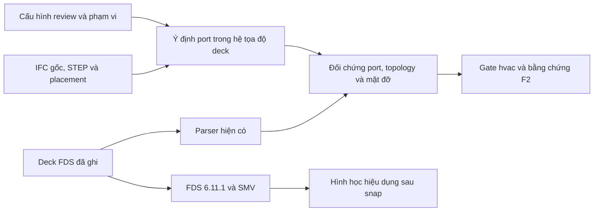

# Audit F2 — Đối chứng độc lập tọa độ VENT HVAC

- Thời điểm lập báo cáo · 2026-11-15 17:34:57 +07:00 (Asia/Bangkok, UTC+7).
- Công cụ · Codex, IfcOpenShell, FDS 6.11.1.
- Mốc phân tích · `e448e11d43d2fe004dff28d95f0fb18cfb58b903`. Đối chiếu bản vá lúc xuất tại `cd64c0959ed4e3cb4d6eed6f91e124bbc11affa3`.
- Phạm vi · F2 (P1), thiết kế cổng kiểm định ánh xạ và kiểm chứng từng phần bằng ca tổng hợp. Xem [audit gốc](AUDIT_2026-11-15_ifctofds-chuyen-doi-hvac-fds.md) và [audit kiến trúc, Docker](AUDIT_2026-11-15_kien-truc-docker.md).

## 1. F2 lọt qua ở đâu

`ConvertVerifiedUseCase` đã ghi checkpoint, đóng gói manifest, đọc lại deck từ đĩa và gọi use case audit. `reference=True` đọc lại IFC và hình học tham chiếu. Tuy nhiên, việc **chuẩn bị audit** gọi `plan_mapping → build_hvac_network`, sau đó **checker HVAC** gọi lại `build_hvac_network → network_records`. Hai lần dựng mạng có cùng `on_face`. Thay import trực tiếp trong checker sẽ vẫn để lỗi hoặc ngoại lệ của compiler chi phối đường audit ở bước chuẩn bị.

**`ifc_to_fds/application/use_cases/convert_verified.py` tại `e448e11`, L93–104**

<!-- source e448e11:ifc_to_fds/application/use_cases/convert_verified.py:93:104 -->
```text
  93 |         manifest.reseal()
  94 |         manifest = workspace.write_draft(model, configuration, manifest)
  95 |         # The auditor reopens the source. Release the converter's full meshes
  96 |         # before constructing that independent model, rather than retaining both.
  97 |         source_timings = dict(model.timings)
  98 |         exported_bounds = model.exported_bounds
  99 |         del mapping_plan, model
 100 |         gc.collect()
 101 |         fds = workspace.read_fds()
 102 |         audited, manifest, report = self.audit_use_case.execute(
 103 |             paths, fds, manifest, configuration, geometry_package
 104 |         )
```

**`ifc_to_fds/application/use_cases/audit_conversion.py` tại `e448e11`, L45–61**

<!-- source e448e11:ifc_to_fds/application/use_cases/audit_conversion.py:45:61 -->
```text
  45 |         if configuration is None:
  46 |             # An artifact can reproduce placement and mapping, but cannot set
  47 |             # the tolerance or choose an executable for its own audit.
  48 |             manifest_config = manifest.configuration or {}
  49 |             configuration = {k: v for k, v in manifest_config.items() if k not in ARTIFACT_CONFIG_EXCLUDED}
  50 |         configuration = validate_configuration(configuration)
  51 |         manifest_config = manifest.configuration or {}
  52 |         if "mep_graph" not in configuration and "mep_graph" in manifest_config:
  53 |             configuration["mep_graph"] = manifest_config["mep_graph"]
  54 |         source_start = perf_counter()
  55 |         model = prepare_model(paths, configuration, reference=True)
  56 |         source_done = perf_counter()
  57 |         digests, stale = self._reviewed_defects(model, configuration)
  58 |         with accepted_source_defects(digests):
  59 |             config = AuditConfig.model_validate(configuration.get("audit", {}))
  60 |             audit_start = perf_counter()
  61 |             report = run_independent_validation(model, fds_text, manifest, config)
```

**`ifc_to_fds/application/services/model_preparer.py` tại `e448e11`, L84–93**

<!-- source e448e11:ifc_to_fds/application/services/model_preparer.py:84:93 -->
```text
  84 |     mapping_start = perf_counter()
  85 |     plan_mapping(
  86 |         model,
  87 |         configuration.get("all_geom", False),
  88 |         configuration.get("include_review", False),
  89 |         configuration.get("decisions", {}),
  90 |         configuration.get("boundary_policy"),
  91 |         geometry_fidelity=configuration.get("profile") == "geometry-fidelity",
  92 |         system_decisions=configuration.get("system_decisions", {}),
  93 |     )
```

**`ifc_to_fds/mapping/policy.py` tại `e448e11`, L355–362**

<!-- source e448e11:ifc_to_fds/mapping/policy.py:355:362 -->
```text
 355 |         ):
 356 |             e.mapping_rationale += (
 357 |                 "; valid IFC host solid retained, including kernel-applied voids; "
 358 |                 "opening evidence incomplete, opening verification INCONCLUSIVE"
 359 |             )
 360 |     from ifc_to_fds.mep.network import build_hvac_network
 361 |     model.hvac_network = build_hvac_network(model)  # Validated independently of serialization.
 362 |     return model
```

**`ifc_to_fds/validation/checkers/hvac.py` tại `e448e11`, L36–55**

<!-- source e448e11:ifc_to_fds/validation/checkers/hvac.py:36:55 -->
```text
  36 |     def check(self, context):
  37 |         if context.parsed is None or context.model is None:
  38 |             return CheckerOutcome(self.name, GateResult(status=GateStatus.INCONCLUSIVE, reason="FDS text/source missing"))
  39 |         try:
  40 |             plan = build_hvac_network(context.model)
  41 |             expected = {(kind, tuple(values.get("TYPE_ID", [])), values["ID"][0]): (values, keys)
  42 |                         for kind, values, keys in network_records(plan)}
  43 |             actual = {(r.kind, tuple(r.values.get("TYPE_ID", [])), r.id): r
  44 |                       for r in context.parsed.operational_records}
  45 |             if set(expected) != set(actual):
  46 |                 raise ValueError("Serialized HVAC record set differs from reviewed source network")
  47 |             for identity, (values, keys) in expected.items():
  48 |                 r = actual[identity]
  49 |                 if r.values != values or sorted(r.source.get("entity_keys", [])) != sorted(keys):
  50 |                     raise ValueError(f"HVAC parameters, topology or provenance changed: {identity}")
  51 |             if context.manifest:
  52 |                 expected_assignments = plan.assignments()
  53 |                 for record in context.manifest.records:
  54 |                     if record.entity_key in expected_assignments and sorted(record.fds_primitive_ids) != sorted(expected_assignments[record.entity_key]):
  55 |                         raise ValueError(f"Manifest HVAC assignments changed: {record.entity_key}")
```

Ở `e448e11`, `on_face` chấp nhận mặt hộp bao của cả phần tử `OBST`. Tường có ô cửa vẫn có hộp bao chứa hình chữ nhật VENT. Exporter chia tường thành hai hộp và để khí ở ô cửa. Các tham số, topology và provenance có thể khớp hoàn toàn với mạng do cùng compiler dựng, trong khi VENT ở giữa hai vùng khí. Đây là **common-mode failure**. Kiểm tra lại đúng bytes FDS là cần thiết vì lần dựng mạng từ IFC chưa quan sát các hộp được ghi trong deck.

**`ifc_to_fds/mep/network.py` tại `e448e11`, L101–114**

<!-- source e448e11:ifc_to_fds/mep/network.py:101:114 -->
```text
 101 |         if node.boundary and node.boundary.kind == "VENT":
 102 |             xb = node.boundary.vent_xb
 103 |             domain = model.simulation_domain
 104 |             if domain is None or any(xb[i] < domain.to_xb()[i] - 1e-8 if i % 2 == 0 else xb[i] > domain.to_xb()[i] + 1e-8 for i in range(6)):
 105 |                 raise ValueError("HVAC CFD vent must lie within the declared simulation domain")
 106 |             if any(node.xyz[i] < xb[2*i] - 0.001 or node.xyz[i] > xb[2*i+1] + 0.001 for i in range(3)):
 107 |                 raise ValueError("HVAC source endpoint must lie on its CFD vent")
 108 |             axis = next(i for i in range(3) if xb[2*i] == xb[2*i+1])
 109 |             def on_face(bounds):
 110 |                 box = bounds.to_xb()
 111 |                 return (any(abs(xb[2*axis] - box[j]) < 1e-8 for j in (2*axis, 2*axis+1))
 112 |                         and all(box[2*i] <= xb[2*i] + 1e-8 and box[2*i+1] >= xb[2*i+1] - 1e-8 for i in range(3) if i != axis))
 113 |             if not on_face(domain) and not any(e.mapping_strategy == MappingStrategy.OBST and e.bounding_box and on_face(e.representation_bounds or e.bounding_box) for e in model.elements):
 114 |                 raise ValueError("HVAC vent must lie on a supported OBST or mesh boundary face; GEOM vent coupling is not yet supported")
```

Bản vá `cd64c09` dùng `emitted_obst_boxes` cho cả exporter và compiler và từ chối VENT trong ô cửa ngay lúc xuất. Đây là lớp bảo vệ khi tạo deck mới. `pipeline.audit(...)` ở commit đó vẫn đi qua compiler, nên ca deck cũ có thể dừng ở `prepare_model` thay vì nhận kết quả F2 gắn với bản ghi VENT đã đọc. Hàm kiểm mặt của bản vá xét các hộp **có mặt kết thúc hoặc bắt đầu tại mặt phẳng VENT**. Ví dụ, nếu một OBST thứ hai xuyên qua mặt phẳng này và phủ toàn bộ VENT, cả hai phía của VENT đều là rắn dù phép hiệu đối xứng chỉ thấy mặt của OBST thứ nhất. Phép đối chứng bên dưới xét cả hộp xuyên mặt phẳng. Probe gọi riêng helper ở `cd64c09` cho VENT `[2,2.6,0,0,0.8,1.2]` và hai hộp `[1,4,0,0.3,0,2.1]`, `[1,4,-0.1,0.1,0,2.1]` trả `True` dù hai phía đều là rắn. Đây là kết quả kiểm helper. Các cổng hình học khác vẫn kiểm tính hợp lệ của từng vật cản.

**`ifc_to_fds/mapping/obst_boxes.py` tại `cd64c09`, L26–46**

<!-- source cd64c09:ifc_to_fds/mapping/obst_boxes.py:26:46 -->
```text
  26 |     return list(box_set_for(element.mesh) or [])
  27 |
  28 |
  29 | def vent_rests_on_solid_face(vent_xb, boxes) -> bool:
  30 |     """True when the whole VENT rectangle lies on a face with solid on exactly one side.
  31 |
  32 |     A plane shared by two touching boxes is not a solid/gas interface: FDS has no exposed surface there to
  33 |     attach a VENT to (ERROR 818), so only the area covered by boxes on exactly one side of the plane counts.
  34 |     """
  35 |     axis = next(a for a in range(3) if vent_xb[2 * a] == vent_xb[2 * a + 1])
  36 |     plane = vent_xb[2 * axis]
  37 |     u, v = [a for a in range(3) if a != axis]
  38 |
  39 |     def footprint(b):
  40 |         return _rectangle(b[2 * u], b[2 * v], b[2 * u + 1], b[2 * v + 1])
  41 |
  42 |     below = [footprint(b) for b in boxes if abs(b[2 * axis + 1] - plane) < FACE_TOLERANCE_M]
  43 |     above = [footprint(b) for b in boxes if abs(b[2 * axis] - plane) < FACE_TOLERANCE_M]
  44 |     exposed = unary_union(below).symmetric_difference(unary_union(above))
  45 |     rectangle = _rectangle(vent_xb[2 * u], vent_xb[2 * v], vent_xb[2 * u + 1], vent_xb[2 * v + 1])
  46 |     return rectangle.difference(exposed).area <= COVERAGE_RELATIVE_TOLERANCE * rectangle.area
```

## 2. Ba nguồn bằng chứng và điểm tích hợp

| Đầu vào | Bằng chứng lấy trực tiếp | Phép kiểm |
| --- | --- | --- |
| IFC nguồn + cấu hình review | SHA-256, quan hệ chủ sở hữu và kết nối port, `ObjectPlacement`, đơn vị, transform từng nguồn, rebase, phạm vi export và `EndpointSpec` | Xác định duy nhất port và tọa độ thiết kế trong hệ tọa độ deck |
| Deck đã serialize + manifest | `VENT.XB`, `VENT_ID`, `SURF_ID`, `DUCT_ID`/`NODE_ID`, `MESH`, `OBST`, provenance và gán primitive | Kiểm vị trí, phía khí và diện tích phủ từ hình học khai báo thực tế |
| FDS 6.11.1 + SMV cùng lần chạy | Trạng thái solver, danh tính VENT, chỉ số ô và hình học hiệu dụng ở từng MESH | Đối chứng phần vẫn tồn tại và bám đúng mặt sau khi lên lưới |

**Lựa chọn thiết kế.** Tái sử dụng parser FDS và trình đọc IFC ở nhánh tham chiếu. Đọc VENT và vật cản từ deck, đọc port từ IFC, rồi đối chiếu hai phía. Dùng helper OBST của exporter trong checker sẽ giữ chung phép chọn hình học với compiler. Dùng mỗi solver sẽ bỏ lọt VENT gắn được lên một mặt hợp lệ nhưng nằm sai port, như phép thử ở `7. Phần solver được ghi riêng trong `solver` và `effective_geometry`.



### Đường gọi đề xuất

1. Tách điểm gọi cuối `build_hvac_network` khỏi phần áp chính sách mapping dùng chung cho đọc nguồn. Dùng đoạn áp chính sách đó trong `prepare_model(..., reference=True)` để giữ scope, quyết định review, vai trò HVAC và quy tắc biên. Đường chuẩn bị xuất tiếp tục có bước kiểm compile như hiện nay. Kiểm xuất sớm của `prepare`/`convert` vẫn chặn nguồn HVAC cấu hình sai.
2. Trong lúc IFC tham chiếu đang mở, lấy dữ liệu port theo STEP với quan hệ gốc. Chuyển dữ liệu đã đọc và bằng chứng hệ tọa độ qua context audit. Hình học tham chiếu và MEP inventory hiện có vẫn dùng cho các cổng khác. Phép đối chứng VENT dùng transform đã được định danh và số đo nguồn, với khả năng thử bằng điểm mốc độc lập. `ValidationContext` đã có deck đã parse và manifest. Bổ sung đầu vào nội bộ cho nguồn đối chứng ở đúng đường gọi audit, giữ chữ ký công khai của CLI/API.
3. Trong `HvacNetworkChecker`, tính kết quả tọa độ từ bản ghi parse và bằng chứng nguồn. Chuyển đối chiếu topology, thông số thủy lực và assignment vốn phụ thuộc `plan` sang các bất biến trực tiếp ở `5. Khi hai phần cùng chạy được, `hvac` giữ thứ tự `FAIL > INCONCLUSIVE > PASS`. Đường `pipeline.audit` hoàn chỉnh có **0 lần gọi** `build_hvac_network`, `network_records` và `emitted_obst_boxes`. Bài kiểm spy bắt cả alias đã import và lời gọi gián tiếp. Đặt spy sau khi tạo và lưu fixture chuẩn để phép thử chỉ quan sát audit, rồi gọi cả khi thiếu cache. Trong rollout theo hai bước, phép kiểm VENT có thể được kiểm thử riêng trước. Chỉ đánh dấu hoàn thành tiêu chí đường audit sau khi bản ghi thủy lực cũng chuyển sang phép đối chứng trực tiếp.
4. Dùng `GateResult.evidence` và báo cáo hiện có. `hvac` mặc định là gate bắt buộc theo `GateResult.required` dù tên này nằm ngoài `MAPPING_GATE_ORDER`. Đăng ký tường minh như hiện tại và kiểm `finalize` từ lối vào công khai. `FAIL` dù solver chưa chạy phải chặn `MAPPING_VERIFIED`. `INCONCLUSIVE` khi VENT có yêu cầu nhưng thiếu bằng chứng cũng chặn cấp kết luận này. Giữ trạng thái solver tách khỏi verdict ánh xạ.

**`ifc_to_fds/validation/engine.py` tại `e448e11`, L727–743**

<!-- source e448e11:ifc_to_fds/validation/engine.py:727:743 -->
```text
 727 |     validation_ctx = ValidationContext(
 728 |         model=model,
 729 |         fds_text=fds_text,
 730 |         manifest=manifest,
 731 |         parsed_fds=parsed,
 732 |         config=config,
 733 |         exact_elements=frozenset(
 734 |             k for k in completed_comparisons if k not in comparison_deviations and is_exact_match(report.metrics[k])
 735 |         ),
 736 |     )
 737 |     from .checkers.hvac import HvacNetworkChecker
 738 |     from .checkers.mesh_resolution import MeshResolutionChecker
 739 |     for checker in (HvacNetworkChecker(), MeshResolutionChecker(), PassageResolutionChecker()):
 740 |         outcome = checker.check(validation_ctx)
 741 |         report.gates[outcome.gate_name] = outcome.result
 742 |         report.findings.extend(outcome.findings)
 743 |         report.metrics.update(outcome.metrics)
```

**`ifc_to_fds/domain/validation/model.py` tại `e448e11`, L210–218**

<!-- source e448e11:ifc_to_fds/domain/validation/model.py:210:218 -->
```text
 210 |         simulation = SIMULATION_GATES
 211 |         required = [
 212 |             g for name, g in self.gates.items() if g.required and name not in simulation
 213 |         ]
 214 |         failed = any(g.status == GateStatus.FAIL for g in required) or any(
 215 |             f.severity in (Severity.P0, Severity.P1)
 216 |             and f.verification_level == "mapping"
 217 |             for f in self.findings
 218 |         )
```

**`ifc_to_fds/domain/validation/model.py` tại `e448e11`, L235–244**

<!-- source e448e11:ifc_to_fds/domain/validation/model.py:235:244 -->
```text
 235 |         if failed:
 236 |             self.mapping_status = AcceptanceStatus.REJECTED
 237 |         elif mandatory_complete and required and all(
 238 |             g.status in (GateStatus.PASS, GateStatus.NOT_APPLICABLE)
 239 |             and (g.status != GateStatus.NOT_APPLICABLE or g.reason.strip())
 240 |             for g in required
 241 |         ):
 242 |             self.mapping_status = AcceptanceStatus.MAPPING_VERIFIED
 243 |         else:
 244 |             self.mapping_status = AcceptanceStatus.INCONCLUSIVE
```

## 3. Định danh VENT và tọa độ nguồn

1. Ghép mỗi nguồn đối chứng theo `source_id` là SHA-256 của IFC đã mở, giữ tuyệt đối cặp `source_id:step_id`. Kiểm IFC, deck và manifest cùng bộ dữ liệu dự kiến, gồm SHA deck nếu có. Băm lại artifact sau khi sửa deck chỉ xác nhận được bytes. Khi người chạy audit cung cấp cấu hình review, dùng nó làm đầu vào có thẩm quyền. Khi replay từ manifest, ghi rõ nguồn quyết định replay. Khớp ID và provenance là điều kiện join, tọa độ vẫn phải đọc từ IFC. Manifest có thể ghi lại cách đặt mô hình nhưng `ARTIFACT_CONFIG_EXCLUDED` đã chặn việc tự cấp dung sai hoặc chấp nhận lỗi nguồn.
2. Tạo chỉ mục owner và port theo các quan hệ gốc `IfcRelNests` hoặc `IfcRelConnectsPortToElement` có trong schema nguồn. Dùng `IfcRelConnectsPorts` để biết đầu trong mạng hoặc đầu hở sau khi áp scope. Đầu scope cắt cần quyết định biên tường minh. Các quan hệ xung đột, thiếu placement hay không chứng minh được một owner duy nhất nhận reason cụ thể. Với dữ liệu đã biết, một quyết định tham chiếu port của owner khác là sai định danh. Trùng STEP giữa các nguồn vẫn cho hai khóa riêng.
3. Đọc `IfcLocalPlacement` theo cây `PlacementRelTo` bằng IfcOpenShell. Gọi `p_IFC` là vector lấy từ cột tịnh tiến ma trận đã hợp thành trong **đơn vị của tệp**, `s` là hệ số đổi sang m, `R,t` là transform nguồn sang hệ chung, `r` là rebase của lần audit. Tính theo đúng thứ tự

   `p_model = R · (s · p_IFC) + t − r`

   `t` và `r` đều tính bằng m. Dùng transform hữu hạn, cứng, thuận tay và có nguồn gốc đã xác nhận. Khi ghép nhiều IFC, đối chiếu `common_coordinates` hoặc transform từng `source_id`. Nếu cấu hình cũ dùng chỉ số tệp, kiểm thứ tự nguồn trước khi tra transform. `vent_xb` đã khóa trong hệ tọa độ mô hình sau biến đổi theo README. So trực tiếp với `VENT.XB` đã parse. Phép thử mm ở `7 dùng tọa độ nguồn được tính trước bằng tay và có placement lồng nhau.

**`ifc_to_fds/mep/mep_graph.py` tại `e448e11`, L104–132**

<!-- source e448e11:ifc_to_fds/mep/mep_graph.py:104:132 -->
```text
 104 |     def register(port, owner, rel):
 105 |         if port.id() in owners and owners[port.id()] != owner.id():
 106 |             graph.issues.append(f"Conflicting port owner: {key(port)}")
 107 |         owners[port.id()] = owner.id()
 108 |         ownership_rel_keys.setdefault(port.id(), []).append(key(rel))
 109 |         ownership_rel_types[port.id()] = rel.is_a()
 110 |
 111 |     for rel in safe_by_type(file, "IfcRelConnectsPortToElement"):
 112 |         register(rel.RelatingPort, rel.RelatedElement, rel)
 113 |     for rel in safe_by_type(file, "IfcRelNests"):
 114 |         for child in rel.RelatedObjects:
 115 |             if child.is_a("IfcDistributionPort"):
 116 |                 register(child, rel.RelatingObject, rel)
 117 |     ports = {}
 118 |     for port in safe_by_type(file, "IfcDistributionPort"):
 119 |         owner = by_step.get(owners.get(port.id()))
 120 |         if not owner:
 121 |             graph.issues.append(f"Orphan port: {key(port)}")
 122 |             continue
 123 |         local = world = None
 124 |         if port.ObjectPlacement:
 125 |             placement = ifcopenshell.util.placement.get_local_placement(
 126 |                 port.ObjectPlacement
 127 |             )
 128 |             world = placement[:3, 3] * source.unit_scale_to_meters
 129 |             owner_ifc = file.by_id(owner.step_id)
 130 |             owner_matrix = ifcopenshell.util.placement.get_local_placement(
 131 |                 owner_ifc.ObjectPlacement
 132 |             )
```

**`ifc_to_fds/core/federation.py` tại `e448e11`, L124–128**

<!-- source e448e11:ifc_to_fds/core/federation.py:124:128 -->
```text
 124 |                 for port in e.ports:
 125 |                     if port.world_position is not None:
 126 |                         port.world_position = (
 127 |                             matrix[:3, :3] @ port.world_position + matrix[:3, 3]
 128 |                         ).tolist()
```

**`ifc_to_fds/core/federation.py` tại `e448e11`, L267–273**

<!-- source e448e11:ifc_to_fds/core/federation.py:267:273 -->
```text
 267 |             for port in e.ports:
 268 |                 if port.world_position:
 269 |                     port.world_position = [
 270 |                         port.world_position[0] - dx,
 271 |                         port.world_position[1] - dy,
 272 |                         port.world_position[2] - dz,
 273 |                     ]
```

4. Đọc namespace `(kind, TYPE_ID, ID)` và kiểm ID trùng trước khi tạo dict. Từ `VENT.ID` truy ngược chính xác một `HVAC TYPE_ID='NODE'` có `VENT_ID` đó, `SURF_ID='HVAC'`, một cạnh `DUCT` và quan hệ `NODE_ID`/`DUCT_ID` hai chiều. Kiểm node đầu mạng của cấu hình đã review và loại biên `VENT`. Kiểm hai chiều số đầu VENT đã duyệt và số VENT được deck nối. VENT mồ côi, VENT bị dùng lại bởi nhiều node trong profile hiện hành, node đầu VENT bị đổi sang AMBIENT, provenance sai hoặc thiếu bản ghi mà cấu hình đã chứng minh phải có đều có thể kết luận `FAIL`.
5. Trên deck `hvac-v1` của repo, `! IFC_SOURCE` lưu khóa **owner**, và VENT node thường chỉ có `VENT_ID`. Định danh legacy của node đầu một ống được suy ra theo giao ước `N_ + sha256(port_key)[:20]` khi đầu đã được chứng minh chỉ có một port. Sau khi kiểm điều kiện này bằng IFC, dùng ID, owner, và duyệt `endpoints[port_key]` đối chiếu độc lập. Nếu cần đọc deck legacy có khóa owner và thiếu danh tính port khả kiểm, lập tập ứng viên từ owner, quan hệ endpoint và quyết định review. `vent_xb` có thể xác nhận một tương ứng duy nhất trong tập ứng viên đã biết, nhưng điểm IFC gần VENT nhất không đủ xác lập danh tính. Khi có nhiều tương ứng hợp lệ, trả `INCONCLUSIVE` với danh sách port ứng viên hoặc phạm vi khóa tổng hợp. Giữ ID cũ, schema cũ và khả năng re-audit artifact; xem xét trường provenance mới trong thay đổi riêng nếu tương ứng hiện tại thiếu dữ liệu thực tế.

**`ifc_to_fds/mep/network.py` tại `e448e11`, L79–99**

<!-- source e448e11:ifc_to_fds/mep/network.py:79:99 -->
```text
  79 |     duct_ids = {e.entity_key: "D_" + hashlib.sha256(e.entity_key.encode()).hexdigest()[:20] for e in selected if e.entity_key in specs}
  80 |     for keys in groups.values():
  81 |         node_id = "N_" + hashlib.sha256("|".join(keys).encode()).hexdigest()[:20]
  82 |         here = sorted({owners[k] for k in keys} & junctions.keys())
  83 |         if len(here) > 1:
  84 |             raise ValueError("Adjacent HVAC junctions would share one node; model a duct between them")
  85 |         boundaries = [specs[owners[k]].endpoints[k] for k in keys if owners[k] in specs and k in specs[owners[k]].endpoints]
  86 |         attached = sorted({duct_ids[owners[k]] for k in keys if owners[k] in specs})
  87 |         if len(attached) == 1 and len(keys) > 1:
  88 |             raise ValueError("HVAC duct cannot connect to itself")
  89 |         if len(attached) == 1 and len(boundaries) != 1:
  90 |             raise ValueError(f"Unconfigured HVAC endpoint (including scope cuts): {keys}")
  91 |         if len(attached) > 1 and boundaries:
  92 |             raise ValueError("Internal HVAC junction cannot be AMBIENT or VENT")
  93 |         if len(attached) > 10:
  94 |             raise ValueError("FDS HVAC nodes support at most ten ducts")
  95 |         xyz, junction_loss = ports[keys[0]].world_position, []
  96 |         if here:
  97 |             xyz, junction_loss = _junction(here[0], junctions[here[0]], ports, owners, specs, duct_ids, attached, model)
  98 |         node = HvacNode(id=node_id, port_keys=keys, entity_keys=sorted({owners[k] for k in keys}),
  99 |                         xyz=xyz, duct_ids=attached, boundary=boundaries[0] if boundaries else None,
```

**`ifc_to_fds/mep/fds_records.py` tại `e448e11`, L6–17**

<!-- source e448e11:ifc_to_fds/mep/fds_records.py:6:17 -->
```text
   6 |     for node in plan.nodes:
   7 |         values = dict(TYPE_ID=["NODE"], ID=[node.id], DUCT_ID=node.duct_ids)
   8 |         if node.boundary:
   9 |             values["LOSS"] = list(node.boundary.loss)
  10 |             if node.boundary.kind == "VENT":
  11 |                 vent_id = "V_" + node.id
  12 |                 records.append(("VENT", dict(ID=[vent_id], XB=list(node.boundary.vent_xb), SURF_ID=["HVAC"]), node.entity_keys))
  13 |                 values["VENT_ID"] = [vent_id]
  14 |             else:
  15 |                 values.update(AMBIENT=[True], XYZ=list(node.xyz))
  16 |         else:
  17 |             values["XYZ"] = list(node.xyz)
```

**`ifc_to_fds/mep/fds_records.py` tại `e448e11`, L47–55**

<!-- source e448e11:ifc_to_fds/mep/fds_records.py:47:55 -->
```text
  47 |     lines = []
  48 |     for kind, values, keys in network_records(plan):
  49 |         if not keys or any(key not in by_key for key in keys):
  50 |             raise ValueError(f"HVAC {kind} record has missing source assignments: {values.get('ID')}")
  51 |         e = by_key[keys[0]]
  52 |         source = dict(entity_key=e.entity_key, entity_keys=keys, source_id=e.source_id,
  53 |                       global_id=e.global_id, step_id=e.step_id, ifc_type=e.ifc_type)
  54 |         lines.append("! IFC_SOURCE " + json.dumps(source))
  55 |         lines.append("&" + kind + " " + ", ".join(k + "=" + ",".join(value(v) for v in vs) for k, vs in values.items()) + " /")
```

6. Với `XB` hợp lệ, chọn trục phẳng `a` và mặt phẳng `c`. Hai trục `u,v` còn lại có khoảng tăng và diện tích dương. Đo `d_n = p_model[a] − c` và phần vượt từng cận tiếp tuyến `d_u,d_v`. Kiểm cả mặt phẳng lẫn ô chữ nhật, đồng thời kiểm sáu cận theo quyết định review nếu có. Một port đúng mặt phẳng nhưng nằm ngoài khoảng tiếp tuyến vẫn là F2 sai tọa độ. Nếu có `IOR` trong profile đã hỗ trợ, kiểm hướng từ rắn ra khí từng mảnh và khớp dấu; `FlowDirection` dùng cho thứ tự thủy lực. Khai báo đủ hướng và vị trí để phân biệt hai mặt đối nhau. Quy tắc FDS cho VENT mặt rắn, mặt biên và `IOR`. [FDS User Guide 6.11.1, Applying Surface Properties](https://github.com/firemodels/fds/blob/FDS-6.11.1/Manuals/FDS_User_Guide/FDS_User_Guide.tex#L1590-L1662).

### Sai số đo

Đối với chữ số `XB`/`OBST`/`MESH` trong deck, phân hoạch theo tọa độ đã parse và so bao phủ chính xác ở độ chính xác khai báo. Với tọa độ IFC có đổi đơn vị, phép quay, rebase và làm tròn serialization, lưu độ lệch đo được và ngân sách sai số số học cho chuỗi phép biến đổi. Trường hợp điểm biên bất định cần trạng thái thấy được. Nếu dự án muốn chấp nhận lệch vật lý lớn hơn độ bất định số, cần dung sai do người audit cấp hoặc theo profile đã phê duyệt. Các hằng `0.001` của compiler cũ và ngưỡng helper ở `cd64c09` chỉ mô tả hai phiên bản hiện trạng. `AuditConfig.surface_tolerance_m` hiện đi với đối chiếu hình học, việc áp nó cho port là quyết định về hợp đồng phải được kiểm riêng.

## 4. Kiểm mặt đỡ từ các hộp đã ghi

**Phạm vi chứng minh ban đầu** là VENT chữ nhật, MESH chữ nhật và OBST tĩnh dạng hộp có thể đọc đủ. Một `HOLE`, `GEOM`, OBST điều khiển hoặc có bề dày 0 và khả năng VENT đè nhau cần bằng chứng riêng nếu chúng có thể thay đổi mặt đỡ tại vị trí đang xét. Nếu không xác định được phạm vi ảnh hưởng, báo `INCONCLUSIVE`. Các mảnh khác với một sai phạm đã chứng minh vẫn được ghi là `FAIL`. Đọc cú pháp bằng `parse_fds` và giữ lỗi schema hiện có, kể cả giá trị NaN/vô hạn, tham chiếu sai và namelist nâng cao chưa hỗ trợ.

**Phân hoạch hình chữ nhật.** Lọc mỗi hộp `OBST` hoặc `MESH` có giao tiếp tuyến dương với VENT và có thể chạm mặt phẳng từ một trong hai phía. Chiếu biên các ứng viên lên `u,v`, cắt bằng hai khoảng VENT. Phân ô theo tất cả đầu mút; trong mỗi ô dương diện tích, trạng thái mỗi phía là hằng. Có thể dùng trung điểm của **từng ô đã phân hoạch** để tìm các hộp chứa ô. Phương pháp tương đương là sweep theo `u` và hợp các khoảng theo `v`. Chi tiết chỉ mục được quyết định sau benchmark với fixture lớn. Phân hoạch cơ sở hữu hạn và dễ viết đối chứng.

Với hộp có khoảng pháp tuyến `[lo, hi]` và phủ ô tiếp tuyến, hai phía xét theo quy tắc nửa mở

```text
bên âm của mặt phẳng có hộp nếu lo <  c <= hi
bên dương có hộp               nếu lo <= c <  hi
```

Áp cùng phép thử cho hợp MESH. Một phía là **khí** khi nằm trong ít nhất một MESH và ngoài mọi OBST tác động. Một phía là **rắn** khi nằm trong MESH và trong ít nhất một OBST tác động. Phía nằm ngoài hợp MESH được gắn nhãn riêng. Phân loại trên từng ô áp dụng như sau.

| Hai phía của ô | Kết quả tọa độ trên ô |
| --- | --- |
| Rắn / khí hoặc khí / rắn | Có mặt đỡ OBST. Lưu dấu của phía khí và các ID hộp liên quan. |
| Khí / ngoài hợp MESH hoặc chiều ngược lại | Có mặt đỡ ngoại biên khi ô nằm đúng trên biên ngoài của miền đã duyệt và domain gate xác nhận độ phủ. |
| Khí / khí | Hở mặt đỡ. Ô cửa F2 và mối nối hai MESH vẫn liên tục thuộc trường hợp này. |
| Rắn / rắn | Mặt trong khối, kể cả khi một OBST xuyên mặt phẳng. |
| Rắn / ngoài hợp MESH hoặc ngoài / ngoài | Thiếu phía khí mô phỏng. |
| Trạng thái chưa xác định vì phần hình học hoặc điều khiển liên quan chưa đọc được | Ghi diện tích chưa chứng minh, ID và lý do. |

Lưu `A_vent`, `A_supported`, `A_unsupported` và `A_unknown` theo mét vuông. Các ô rời nhau để một vùng bị nhiều hộp phủ chỉ được đếm một lần. Kiểm `A_vent = A_supported + A_unsupported + A_unknown` theo biểu diễn số dùng trong checker. Một vùng thiếu mặt đỡ dương diện tích vượt sai số tính số học là `FAIL`. Gộp các ô cùng mặt phẳng chỉ khi tất cả có phía khí cùng dấu. Hai hộp cùng phủ mặt phẳng từ một phía và tạo dải liền nhau có thể đỡ một VENT. Hai hộp tiếp nhau ở hai phía tạo mặt trong. Hai nửa VENT có hướng mặt đỡ đối nhau không mô tả một phía trao đổi khí duy nhất. Với MESH chồng nhau hoặc phủ thiếu miền, giữ lỗi tại `domain` (F1) và kết luận được từ phần đủ bằng chứng. Một mặt quay vào «khe» MESH bên trong miền không được gọi là biên ngoài.

Ví dụ tính tay cho F2. MESH phủ `x∈[−1,5], y∈[−1,2], z∈[−1,4]`. VENT trên mặt `y=0` có `x∈[0.2,0.8]`, `z∈[0.8,1.2]`. Hộp trên cửa chỉ bắt đầu ở `z=2.1`, hộp bên cửa bắt đầu ở `x=1`. Toàn bộ VENT có khí ở cả hai phía. `A_vent=(0.8−0.2)(1.2−0.8)=0.24 m²`, `A_supported=0`. Port `(0.5,0,1)` nằm trong VENT nên thất bại là `NO_SUPPORT`. VENT cùng kích cỡ tại `x∈[2,2.6]` có rắn ở phía `+y`, khí ở phía `−y`, mặt đỡ đủ 0,24 m². Nếu vẫn dùng port `(0.5,0,1)`, thất bại là `PORT_OUTSIDE_XB` dù toàn bộ mặt đỡ hợp lệ.

## 5. Giữ đối chiếu mạng và hợp đồng báo cáo

| Kiểm hiện tại dựa vào `plan` | Đối chiếu trực tiếp khi bỏ builder khỏi đường audit |
| --- | --- |
| Bộ thẻ, ID và provenance | Đọc DUCT bằng owner IFC và ID schema cũ. Với NODE, xác định quan hệ cùng nút theo port nối tường minh và bản ghi deck. Kiểm phần tử có yêu cầu HVAC được ghép đúng một lần, quan hệ nút–ống hai chiều, đầy đủ các đầu biên và mỗi junction khai báo thuộc vị trí đã review. Giữ kiểm ID legacy trong một phép kiểm định danh riêng. |
| `LENGTH`, `DIAMETER`/`AREA`/`PERIMETER`, `ROUGHNESS`, `LOSS`, lưu lượng | So từng trường tham số với cấu hình đã review và dây cung IFC tính trực tiếp. Dùng chiều dài tâm tuyến khi đặc tả bắt buộc hoặc đã khai báo. Kiểm thứ tự `SOURCE/SINK` và tham số phụ thuộc hướng. Dùng đúng thứ tự `DUCT_ID` để đối chiếu `LOSS(i,j)` với cặp port review. Giữ hành vi cảnh báo `HVAC-FRICTION-0001/0002` và kiểm hợp đồng F9 riêng theo nhánh đã tích hợp. |
| Manifest assignment | Đối chiếu toàn bộ các ID HVAC liên quan với provenance thực tế và owner nguồn. Kiểm thiếu/thừa từng hướng. Checkpoint, tên artifact và CLI re-audit dùng giao ước cũ. |
| Vị trí và kiểu đầu NODE | Với `VENT` lấy `XB` của thẻ được trỏ và áp `3–4`. Với `AMBIENT` hoặc NODE nội bộ đối chiếu `XYZ` với quan hệ/placement và điểm tham chiếu đã quy định cho loại nút đó. |

Dùng P1/F2 cho sai khác tọa độ, mặt đỡ hoặc topology có bằng chứng phủ định. Có thể giữ `HVAC-001` làm ID tương thích của finding và ghi `audit_id: "F2"`, mã lý do cùng witness vào evidence. Một VENT có thể có nhiều lỗi, ví dụ sai port và thiếu mặt đỡ. Thiếu bằng chứng nhận `INCONCLUSIVE` và lý do đối ứng. `NOT_APPLICABLE` ở phần tọa độ chỉ khi nguồn/quyết định/deck xác nhận không có đầu `VENT`. Toàn gate chỉ `NOT_APPLICABLE` khi xác nhận không có mạng HVAC vận hành cần kiểm. Một mạng chỉ có đầu AMBIENT vẫn có cổng `hvac` kiểm topology và tham số.

`GateResult.evidence` nên có theo mỗi VENT: `vent_id`, `node_id`, `duct_id`, khóa port/owner/quan hệ STEP, chữ ký nguồn và deck, cách xác định tương ứng, nguồn cấu hình, hệ số đơn vị và cách định danh transform/rebase, `p_model`, `vent_xb_reviewed_m`, `vent_xb_raw_m`, trục/dấu phía khí, sai lệch pháp tuyến/tiếp tuyến, các diện tích kèm một ô chứng kiến khi sai, ID MESH/OBST liên quan. Tóm tắt chỉ số lượng trạng thái và diện tích tổng hợp. Dữ liệu báo cáo chia sẻ dùng bí danh nguồn theo quy định repo.

## 6. Hình học sau khi FDS đưa lên lưới

Một lần FDS chạy `T_END=0` xác nhận khởi tạo. Để kiểm mặt hiệu dụng, buộc SMV và log vào đúng `fds_sha256`, SHA solver, phiên bản FDS và lần chạy. Đọc `VENTORIG`, phần `VENT` của từng `GRID`, tọa độ lưới tại `TRNX/TRNY/TRNZ` và chỉ số hiệu dụng. Với đa MESH, giữ đủ các mảnh và xác nhận vùng giao có diện tích theo từng mesh; bỏ mảnh biên giả do FDS sinh. Tái dùng bộ đọc lưới hiện có khi khớp phiên bản. Nếu lưới hiệu dụng che mất một phần VENT hoặc chuyển sang mặt đối diện, ghi ô và phía liên quan. Cần bằng chứng để gọi là VENT bị xóa. Dùng diện tích hiệu dụng và chiều mặt được chứng minh để đối chiếu mặt đỡ và vị trí snap; cần trạng thái thấy được cho nửa ô làm tròn chưa chứng minh hoặc bảng không đọc được. Phép kiểm static ở `4 vẫn giữ nguyên kết quả.

### F2-SMV — Đọc nhầm cột trong bảng VENT của FDS 6.11.1 (P2, hình học hiệu dụng)

Probe tại `7` cho ca tường đặc đúng port có `solver=PASS` và `effective_geometry=FAIL` với lý do `V_ROOM: Vent missing from the solver output (collapsed by the grid or dropped)`. Hai dòng SMV sau được đọc từ cùng lần chạy. Bảng `VENTORIG` có một mục (`V_ROOM`), bản ghi hình học tương ứng của bảng `VENT` có số thứ tự `1` và chỉ số bề mặt `5`.

```text
VENTORIG
 1
        2.00000       2.60000       0.00000       0.00000       0.80000       1.20000 ! V_ROOM

VENT
    7    6
       2.00000       2.60000       0.00000       0.00000       0.80000       1.20000     1   5    -999.00000    -999.00000    -999.00000
```

Tại `effective.py:202–205`, `head[7]` được dùng để tra danh sách ID. Trình ghi `dump.f90` 6.11.1 lưu **`ORDINAL` ở `head[6]` và `SURF_INDEX` ở `head[7]`**, sau sáu tọa độ. Ở ca này điều kiện `5 <= len(labels)` thất bại dù ordinal `1` hiện diện. Sửa adapter phiên bản và ghép theo ordinal với dòng chỉ số tương ứng trong cùng mesh. Giải thích `VENTORIG` theo định dạng solver đã ghim, loại sáu exterior patch sinh tự động trong fixture này và phân biệt thiếu thật với lỗi đọc. Thêm ca hai VENT cùng `SURF_INDEX` nhưng ordinal khác nhau, một bảng chỉ có ngoại biên giả, và fixture SMV do FDS 6.11.1 ghi. [FDS v6.11.1, trình ghi `VENTORIG`](https://github.com/firemodels/fds/blob/FDS-6.11.1/Source/dump.f90#L1913-L1921), [trình ghi bảng `VENT`](https://github.com/firemodels/fds/blob/FDS-6.11.1/Source/dump.f90#L2286-L2319), [gán `ORDINAL` cho VENT](https://github.com/firemodels/fds/blob/FDS-6.11.1/Source/read.f90#L11575-L11589).

**`ifc_to_fds/validation/effective.py` tại `e448e11`, L181–187**

<!-- source e448e11:ifc_to_fds/validation/effective.py:181:187 -->
```text
 181 | def _vent_labels(lines):
 182 |     """Input vent IDs in input order: the solver numbers its vents by that order."""
 183 |     for i, line in enumerate(lines):
 184 |         if line.strip() == "VENTORIG" and i + 1 < len(lines):
 185 |             count = int(lines[i + 1])
 186 |             return [row.partition("!")[2].strip() for row in lines[i + 2 : i + 2 + count]]
 187 |     return []
```

**`ifc_to_fds/validation/effective.py` tại `e448e11`, L197–205**

<!-- source e448e11:ifc_to_fds/validation/effective.py:197:205 -->
```text
 197 |     table = next((i for i, line in enumerate(lines) if line.strip() == "VENT"), None)
 198 |     rows = {}
 199 |     if grids and table is not None:
 200 |         count = int(lines[table + 1].split()[0])
 201 |         for n in range(count):
 202 |             head = lines[table + 2 + n].split()
 203 |             indices = [int(v) for v in lines[table + 2 + count + n].split()[:6]]
 204 |             if len(head) >= 8 and int(head[7]) > 0 and int(head[7]) <= len(labels):
 205 |                 rows[labels[int(head[7]) - 1]] = indices
```

Dòng chỉ số hàng đầu là `30 36 10 10 18 22 99 0 ! -2`, tương ứng VENT có diện tích dương và mặt hướng `−y`. Chạy lại chính chuỗi SMV này qua bản adapter tạm trong bộ nhớ với `head[6]` cho kết quả `effective_geometry=PASS`, và `V_ROOM: Snapped vent bounds verified`. Phiên bản trên đĩa vẫn cho kết quả ở trên. Đây là phép kiểm nguyên nhân trên một ca. Hồi quy đa mesh, các hàng ngoại biên giả và tích hợp parser có trạng thái `NOT_RUN`.

## 7. Bằng chứng đã chạy

Thử trên Windows với venv dự án tại `e448e11`. Tạo tạm IFC4 có `IfcDuctSegment`, một `IfcDistributionPort` gắn bằng `IfcRelNests` và placement lồng. Ghi IFC rồi **mở lại** để lấy tọa độ nguồn và SHA-256. Tạo deck tay với hai hộp tường chuẩn của audit, đọc bằng `parse_fds` và chạy probe tính diện tích từng ô phân hoạch trong một MESH. Probe chỉ kiểm liên kết `NODE.VENT_ID`, phần hình học tĩnh và tọa độ; ca IFC tổng hợp này chưa phải một bundle Verified Conversion với đủ inventory và manifest. Phép đo không gọi `build_hvac_network`. Các ca có solver dùng FDS 6.11.1, `T_END=0`, SHA-256 binary `dfaf04f1d46dbad77969b1cdd17baaa02a7aa6d63f46e96e93b9d9e635452b55`, `I_MPI_FABRICS=shm`.

| Ca | Port IFC sau đổi hệ | Diện tích VENT / mặt đỡ (m²) | Phép thử tọa độ | FDS khởi tạo |
| --- | --- | --- | --- | --- |
| F2 trong ô cửa | `(0.5,0,1)` | 0,24 / 0,00 | `FAIL`, thiếu mặt đỡ | `FAIL`, `ERROR(818)` |
| Trên tường đặc | `(2.3,0,1)` | 0,24 / 0,24 | `PASS` | `PASS` |
| Chỉ dời `VENT.XB` từ ô cửa qua tường đặc, dùng cùng IFC với F2 | `(0.5,0,1)` | 0,24 / 0,24 | `FAIL`, sai port | `PASS` |
| VENT `x∈[0.5,1.5]` cắt ngang ô cửa | `(1.25,0,1)` | 0,40 / 0,20 | `FAIL`, 0,20 m² hở | `NOT_RUN` |
| VENT `z∈[1.8,2.4]` phủ mối nối hai hộp đồng phẳng | `(2.3,0,2)` | 0,36 / 0,36 | `PASS` | `NOT_RUN` |
| IFC mm, quay +90° quanh Z, dịch và rebase | `(2.3000000000000007,0,1)` | 0,24 / 0,24 | `PASS` | `NOT_RUN` |

Ca mm lấy owner tại `(100,100,100) mm`, port con `(1900,−400,−100) mm` trong hệ owner. Điểm nguồn `(2000,−300,0) mm` cho `R · (2,−0.3,0)=(0.3,2,0)` m, `t=(10,20,3)` m, `r=(8,22,2)` m và điểm chờ `(2.3,0,1)` m.

Có thể tái tạo các deck đối chứng bằng phần lõi sau. Ca âm đổi `XB` của VENT thành `0.2,0.8,0,0,0.8,1.2`; giữ các trường còn lại để cô lập điều kiện mặt đỡ.

```fds
&HEAD CHID='f2' /
&TIME T_END=0. /
&MESH IJK=60,30,50, XB=-1,5,-1,2,-1,4 /
&OBST ID='W1', XB=0,4,0,0.3,2.1,3 /
&OBST ID='W2', XB=1,4,0,0.3,0,2.1 /
&VENT ID='V_ROOM', XB=2,2.6,0,0,0.8,1.2, SURF_ID='HVAC' /
&HVAC TYPE_ID='NODE', ID='N_ROOM', DUCT_ID='DUCT_A', VENT_ID='V_ROOM', LOSS=1,1 /
&HVAC TYPE_ID='NODE', ID='N_OUT', DUCT_ID='DUCT_A', XYZ=2.3,-1.2,1, AMBIENT=.TRUE., LOSS=1,1 /
&HVAC TYPE_ID='DUCT', ID='DUCT_A', NODE_ID='N_ROOM','N_OUT', LENGTH=1.2, DIAMETER=0.3, LOSS=1,1 /
&TAIL /
```

Probe thực tế thêm `! IFC_SOURCE` với khóa owner của IFC tạm. Các giá trị thủy lực là dữ liệu tổng hợp cố định để FDS đi qua bước khởi tạo; kết luận chỉ áp cho tọa độ và mặt đỡ. Lượt thiết lập ban đầu thiếu `LOSS` và FDS báo `ERROR(556)` ở ca tường đặc. Bổ sung đúng dữ liệu fixture cho cả ca âm và dương để cô lập F2. Mã FDS 6.11.1 ghi `818` khi không tìm được mặt rắn cho VENT. [Điều kiện `818`](https://github.com/firemodels/fds/blob/FDS-6.11.1/Source/read.f90#L11764-L11784), [điều kiện `556`](https://github.com/firemodels/fds/blob/FDS-6.11.1/Source/hvac.f90#L3788-L3798).

Đối chiếu lại với bản audit gốc: `8ed1f38` báo `hvac=PASS` cho F2 trước khi FDS từ chối trong ca canonical tổng hợp. Probe hiện tại bổ sung số đo từ port đọc lại qua tệp IFC và chứng minh một VENT lệch port vẫn có thể qua FDS setup. Kiểm thử hồi quy thiết kế tích hợp, fixture công trình A/B/C và xác nhận lưu lượng qua thời gian ở lượt audit này có trạng thái `NOT_RUN`.

## 8. Cổng nghiệm thu cho PR sau

| ID | Kiểm tra cần ghi kết quả | Bằng chứng hiện tại |
| --- | --- | --- |
| HVAC-D1 | Qua `pipeline.audit` trên deck F2 được đóng băng và IFC thật của fixture. Vá tất cả điểm có thể gọi builder/renderer bằng spy gây lỗi, theo dõi cả bước chuẩn bị source. `hvac=FAIL` với khóa port, VENT ID và `A_unsupported=0.24 m²` kể cả khi solver tắt. `pipeline.convert` vẫn từ chối xuất ca tương ứng sau bản vá export. | Đã đối chiếu đường gọi bằng mã. `NOT_RUN` cho cổng mới. |
| HVAC-D2 | Sửa đúng một `VENT.XB` của deck tốt thành vị trí sai, giữ quyết định review từ cấu hình người chạy. Kiểm thử biến thể đặt trong ô cửa và biến thể vẫn bám tường nhưng sai port. Cập nhật hợp lệ SHA artifact khi cần phép thử âm để tránh dừng ở checksum. Kiểm toán thử cả đổi port, tham chiếu trùng, đổi thành AMBIENT và mất VENT. | Probe đã đo hai kiểu lỗi hình học và sai port. `NOT_RUN` cho pipeline. |
| HVAC-D3 | Có fixture mm, placement nhiều cấp, rotation, translation, rebase và hai IFC trùng STEP nhưng khác SHA. Đảo thứ tự file, sai transform, thiếu placement và xác nhận hồ sơ frame. | `PASS` cho ví dụ số mm độc lập. `NOT_RUN` cho liên nguồn và các ca lỗi. |
| HVAC-D4 | Chứng minh đủ mặt tiếp xúc, một phần hở, hai hộp đồng phẳng, hộp xuyên mặt, mối nối MESH, miền hở, phía khí trái dấu, pháp tuyến cả X/Y/Z và `IOR` khi profile hỗ trợ. Dùng fixture có kết quả diện tích tính bằng tay. | Probe đơn lưới `PASS` theo kỳ vọng cho ca tường đặc, mối nối đồng phẳng và ca thiếu mặt. Các nhánh khác `NOT_RUN`. |
| HVAC-D5 | `hvac=INCONCLUSIVE` cho bằng chứng port hoặc mặt đỡ thiếu, `FAIL` ưu tiên khi có lỗi chứng minh được. Kiểm mapping job từ CLI, server và re-audit checkpoint của các phiên bản trước. Giữ hồi quy topology, `AREA`, `LOSS(i,j)`, chiều quạt và assignment. | Đã đọc hợp đồng. `NOT_RUN` cho triển khai mới. |
| HVAC-D6 | FDS pin chạy ca F2 âm và ca đúng dương; đối chứng F2-SMV bằng ordinal đúng và ô hiệu dụng. Hai VENT cùng SURF, multi-mesh và non-uniform grid có bằng chứng riêng. | `PASS` cho đối chứng trạng thái solver âm/dương. Cổng hiện hữu đọc SMV lỗi ở ca dương, `FAIL`. |
| HVAC-D7 | Chạy suite mặc định và các cổng M6 phù hợp, audit lại FZK/Duplex/Institute và ca B theo snapshot được phép. Giữ verdict ngoài các sai khác có lý do và bằng chứng. | `NOT_RUN` cho phần nghiệm thu triển khai. |

Phần sửa parser SMV có thể được kiểm và tích hợp độc lập với việc thay đường audit. Các ca có HOLE/GEOM động cần fixture và đặc tả riêng nếu đưa vào phạm vi xác minh. Dữ liệu nguồn, quyết định review và bằng chứng solver đều phải đi theo đúng lần đo.
