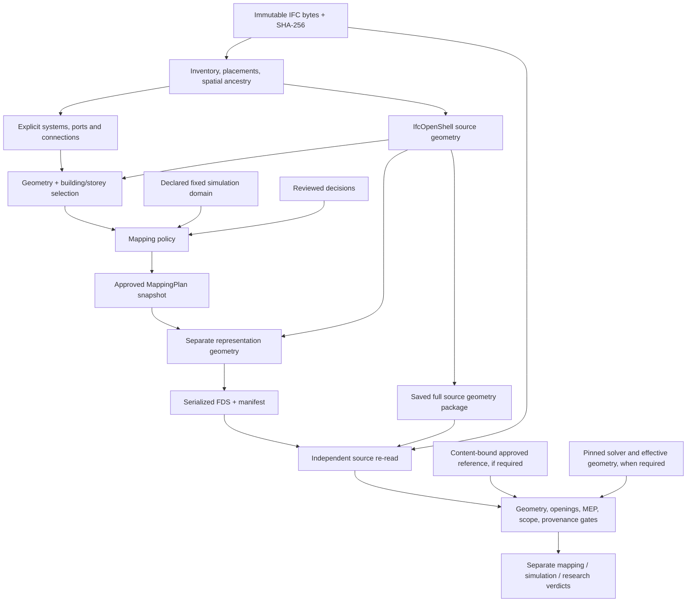

# Verified mapping functional correction

Base: `codex/post-refactor-correctness`, `c7462d1b88935fc50390786e2ce49fbc3a460ab1`.
Work branch: `codex/verified-mapping-correctness`.

## Stage A: dependency and truth boundaries

The converter's geometry cache is never an independent audit reference. Counts
from older revisions are observations, not acceptance criteria. Unsupported
source geometry, uncertainty and pending boundary treatment block acceptance.

## Execution record

- A: inspected policy/scope/boundary/serializer, geometry, MEP, validation and use cases.
- B–J: tracked in focused implementation commits and the final evidence report.
- Private IFC evidence is kept outside Git under `.local-reference-cases/functional-correctness/`.
- No golden approval, scenario physics, generic GEOM clipping or automatic merge is included.
