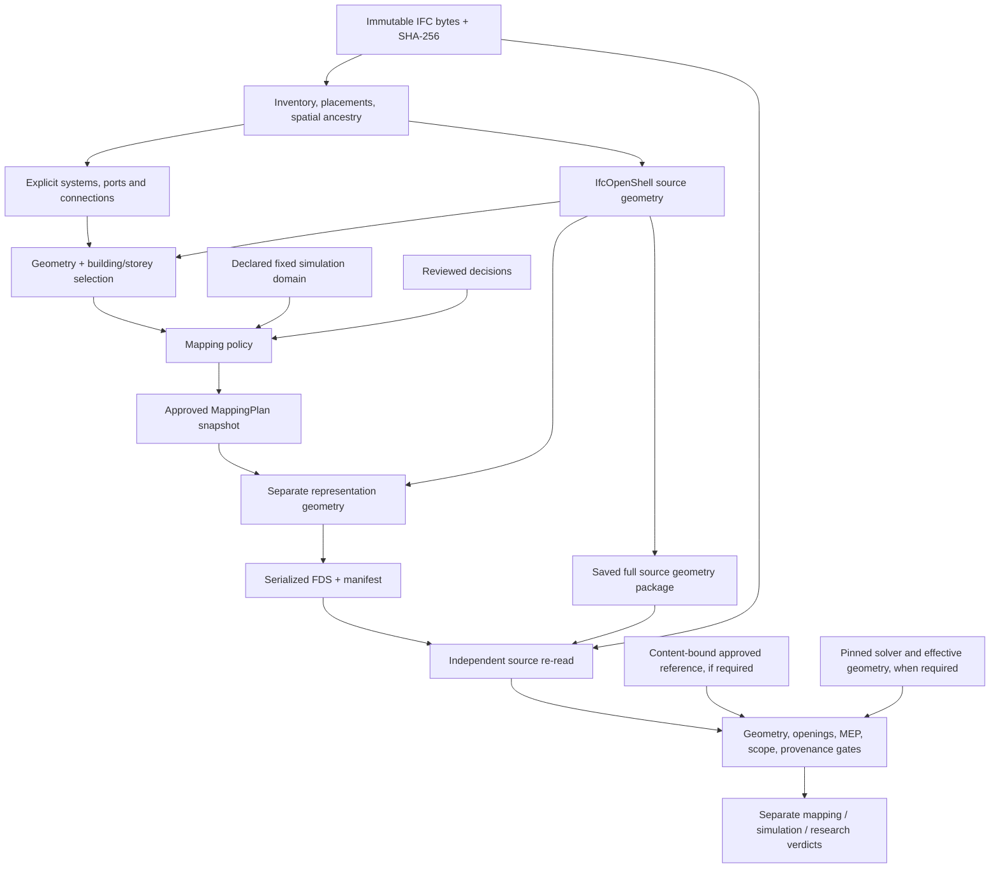

# Verified mapping functional correction

Base: `codex/post-refactor-correctness`, `c7462d1b88935fc50390786e2ce49fbc3a460ab1`.
Work branch: `codex/verified-mapping-correctness`.

## Stage A: dependency and truth boundaries

The converter's geometry cache is never an independent audit reference. Counts
from older revisions are observations, not acceptance criteria. Unsupported
source geometry, uncertainty and pending boundary treatment block acceptance.

## Execution record

- A: inspected policy/scope/boundary/serializer, geometry, MEP, validation and use cases.
- B–J: tracked in focused implementation commits and the final evidence report.
- Private IFC evidence is kept outside Git under `.local-reference-cases/functional-correctness/`.
- No golden approval, scenario physics, generic GEOM clipping or automatic merge is included.

## Correctness changes and invariants

- Serializer requires the exact strategy approved on the source model. Neither
  an emitting/non-emitting change nor OBST/GEOM interchange is authorized by editing
  a plan. Roles, reviewed decisions, source scope and boundary evidence also match.
- `serialize_mapping` returns a detached `SerializationResult`. The legacy tuple API
  mirrors primitive IDs/exported bounds only. It never assigns the plan domain to
  the source model. New plans do not inherit previous serialization IDs.
- A missing/invalid physical solid or unresolved opening has no fake GEOM. Its
  disposition is `UNSUPPORTED`, with source-qualified identity and explicit findings.
  Source-unavailable evidence is inconclusive; confirmed invalid topology fails.
- GEOM uses binary64 round-trip coordinates. Boolean audit uses Manifold `Mesh64`;
  the installed trimesh adapter's Float32 conversion is not used for audit geometry.
- Source mesh and source domain remain unchanged by representation generation.
  Boundary OBST represents only the separately authorized intersection. All other
  crossing cases retain pending validation and cannot be promoted by serialization.
- Top storey bounds come from actual same-source/building geometry or explicit
  scope bounds. Unassigned crossing geometry is tested spatially inside the selected
  building volume; unrelated buildings cannot supply the next-storey elevation.
- IFC class/type and structured evidence determine MEP categories. Names are hints.
  An unspecified pipe/pump/controller is `UNRESOLVED`; it remains reference geometry.
  Explicit relationship identities, ports and systems are preserved and independently
  compared. Network differences report affected entities, expected and actual values.
- Self-intersection predicates use adaptive/exact plane and segment tests, including
  crossings away from a shared vertex and contained components. Backend/predicate
  uncertainty produces inconclusive evidence rather than a fabricated defect.

## Reviewed baseline deltas

`docs/evidence/mapping-baseline-deltas.json` records old/new values. IFC fixture bytes,
accounted entity counts, primitive counts and all six overall verdicts are unchanged.
This is an intended functional correction, not an architectural parity claim.

| Case | Explained differences |
|---|---|
| A, E, F | No semantic snapshot change |
| B opening | CSV hash changes because opening identity, placement and void/filling relationship provenance are now recorded |
| C FZK | Stair STEP 14502 has invalid source geometry: `GEOM/MISSING` becomes `NONE/UNSUPPORTED`, replacing a misleading missing-output finding with a source-geometry finding; traceability can pass while geometry still fails |
| C FZK scope | Six `IfcSpace` products (20909, 21283, 21640, 33774, 34191, 34763) are retained by actual spatial intersection; they remain semantic, produce no obstacle and change the package metadata hash |
| C FZK precision | One GEOM's Y bounds now retain 6.502394/8.502394 rather than four-decimal rounding; a previous passage finding disappears with preserved precision/binary64 measurements; other opening failures remain |
| D MEP | Unspecified system function is inconclusive, not confirmed from a free-text name. Two physical products without source geometry are explicitly unsupported, producing entity-specific inconclusive findings |

No tolerance was relaxed. Changes to reference geometry do not inherit approval;
candidate/reference approval and B1/B2 domain review remain external decisions.

## Performance and operational scope

Topology inspection is vectorized with an independent copy of the old algorithm
as a defect-count parity oracle. Passage candidate queries use a 3D index and
still execute the same exact solid operations. Identical independently rebuilt
oriented triangle sets have a direct whole-surface identity proof after topology
and intersection checks. No bounding-box proxy is used as an audit metric.

The ingestion cache now stores binary geometry and mesh-free metadata. It is keyed
by source hash, engine/settings and ingestion revision; scope, mapping decisions and
boundary results are not reused. Independent audit always bypasses this cache.
Source upload/inventory/conversion sharing should use an opaque server source handle
bound to immutable SHA-256 bytes, parser/ingestion revision and bounded retention.
The current API still uploads separately for inventory and conversion; that transport
optimization is not represented as completed or used to justify any fidelity result.

Workers expose bounded stage progress and downloadable failure diagnostics. Conversion
checkpoints retain inventory, graph, package, FDS and an explicit unaccepted audit state
before independent audit. The benchmark runner observes the modular collaborators and
passes a durable output directory; facade-only timing no longer misses actual work.
